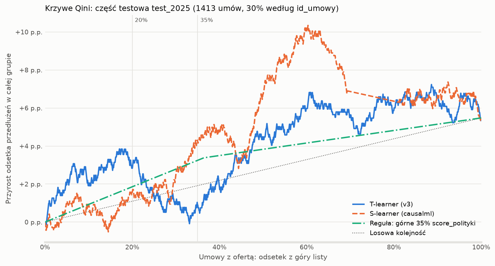
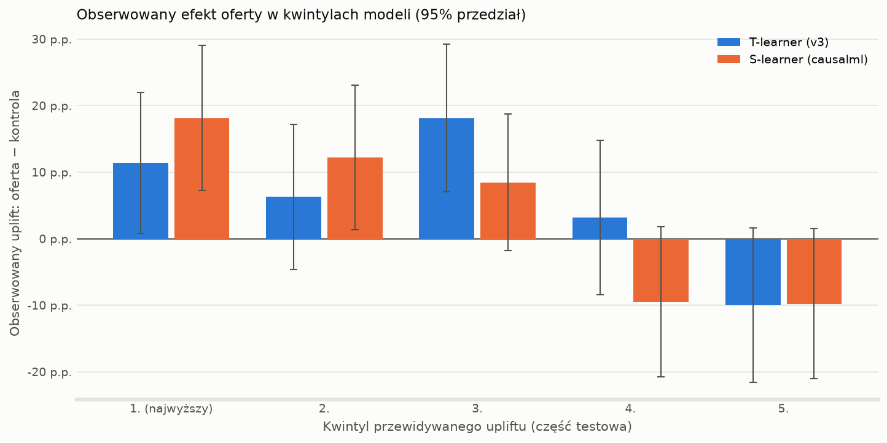

# Uplift: komu rabat zmienia decyzję. T-learner (v3) i S-learner wobec reguły „górne 35% score”

Stan: 2026-11-16. Wszystkie liczby liczy [`uplift.py`](uplift.py). Wyniki są w
`versions/v3_uplift_tlearner/metryki.json`, predykcje części testowej w `evals/wyniki/v3_uplift_tlearner.parquet`,
a runy w MLflow (eksperyment `najemcy`: `v3_uplift_tlearner`, `s_learner_causalml`, `regula_gorne_35_score`,
`score_polityki_ciagly`). Analiza samego testu rabatu jest w
[docs/test_rabatu_2025.md](../../../../../docs/test_rabatu_2025.md).

## Wnioski

1. **Żaden model nie jest lepszy od obecnej reguły „rabat dla górnych 35% `score_polityki`” w sposób, który dałoby
   się wykazać na tych danych.** Na odłożonych 30% testu (1 413 umów) oba modele mają wyższe wyniki punktowe, ale
   wszystkie różnice mieszczą się w przypadkowych wahaniach. Przykład: AUUC S-learner minus reguła wynosi
   +1,39 p.p., a 95% przedział sięga od −1,50 do +4,32.
2. **Prostszy S-learner (causalml) wypadł lepiej niż T-learner v3.** Wśród 20% umów, które S-learner ocenił
   najwyżej, oferta podniosła przedłużenia o 18,1 p.p. (od 6,8 do 29,1). Dla T-learnera było to 11,4 p.p., a dla
   reguły 10,6 p.p. T-learner przesadza: najwyższemu kwintylowi przypisuje +22,2 p.p., a w danych widać +11,4 p.p.
3. **Modele wskazują inne osoby niż score dostawcy.** Korelacja ich rankingów ze `score_polityki` wynosi prawie
   zero (Spearman od −0,03 do 0,00), a mimo to oba znajdują osoby, na które rabat działa. To sygnał, że w naszych
   cechach (B2B, logowania do portalu, czynsz, indeksacja) jest informacja, której score nie ma. Na razie to jednak
   wskazówka, a nie wynik.
4. **Co to znaczy dla Domilo:** zostajemy przy regule „górne 35% score” i nie wpisujemy v3 do `current.yaml`.
   Do decyzji o modelu potrzeba dużo więcej losowych danych. Żeby z mocą 80% wykryć różnicę 5 p.p. w górnych 20%
   listy, potrzeba około 12 razy więcej umów testowych niż 1 413 (sekcja „Ograniczenia”).

## Wyniki

### Dane i podział

- **Zbiór:** tylko losowy test oferty `retencja_decyzje.okres = 'test_2025'`, czyli końce umów 2025-07-01 –
  2026-03-31 i oferta przydzielona 50/50. Wynik to przedłużenie (1 − `migawki_najemcy.odejdzie`).
- **Podział:** około 70% umów idzie do treningu według `md5('uplift_test_2025:' || id_umowy)`
  (`features/najemcy/zbior.py`, `podziel_uplift`). Ta sama umowa trafia zawsze do tej samej części. Najemca z kilkoma
  umowami (w `test_2025` jest ich 122) może mieć umowy w obu częściach.
- **Cechy:** 28 cech v1 z dnia migawki (`features/najemcy/cechy.py`), z `linia` zamienioną na 0/1 `b2b`. Migawka
  wypada 15 dni przed ofertą, więc cechy pochodzą sprzed oferty. Modele nie widzą `score_polityki`, `grupa` ani
  wyniku (`base.KOLUMNY_ZAKAZANE`).

| Część | Umowy | Oferta | Kontrola | % przedłużeń: oferta | % przedłużeń: kontrola | Efekt oferty (p.p.) | Udział B2B |
|---|---:|---:|---:|---:|---:|---:|---:|
| trening (70%) | 3 321 | 1 622 | 1 699 | 62,6 | 57,6 | +5,1 | 16,0% |
| test (30%) | 1 413 | 710 | 703 | 64,2 | 58,7 | +5,5 | 15,9% |

### Modele i punkt odniesienia

| Ranking | Opis | Uczenie |
|---|---|---|
| **v3_uplift_tlearner** | dwa LightGBM: P(przedłużenie) w grupie oferta i w kontroli; uplift = różnica | drzewa z 5-krotnej CV na treningu każdej grupy (wczesne zatrzymanie po log-loss): oferta 97, kontrola 67 |
| S-learner (causalml 0.18.0) | `BaseSClassifier` z jednym `LGBMClassifier` na [oferta, cechy]; uplift = P(· \| oferta = 1) − P(· \| oferta = 0) | te same parametry; 79 drzew z 5-krotnej CV na treningu |
| **Reguła: górne 35% `score_polityki`** (baseline) | 1 dla `score_polityki` ≥ 0,5182 (kwantyl 0,65 na treningu), w przeciwnym razie 0 | bez uczenia; na teście obejmuje 36,4% umów |
| `score_polityki` ciągły | score dostawcy jako ranking (dodatkowo) | bez uczenia |

Parametry LightGBM (`versions/v3_uplift_tlearner/model.py`, ustalone przed oceną na teście): `learning_rate` 0,03,
`num_leaves` 15, `min_child_samples` 50, `feature_fraction` 0,8, `bagging_fraction` 0,8, `lambda_l2` 1,0.

### Miary

- **Krzywa Qini:** pokazuje, o ile punktów procentowych wzrośnie odsetek przedłużeń w całej grupie, jeśli ofertę
  dostanie φ umów z góry listy (`Y_o(φ)/N_o − Y_k(φ)/N_k`). Na 100% krzywa kończy się na efekcie dla wszystkich
  (+5,48 p.p. na teście), a losowa kolejność daje prostą od 0 do tego punktu.
- **AUUC:** pole pod krzywą Qini, czyli średni przyrost przedłużeń przy φ od 0 do 1. **AUUC − losowo** to przewaga
  nad losową kolejnością (AUUC − efekt / 2).
- **Uplift w górnych 20%:** % przedłużeń z ofertą minus % w kontroli wśród 20% umów najwyżej na liście.
- **Remisy:** reguła daje tylko 0 i 1, a S-learner zwraca dokładnie 0 dla 164 umów. Dlatego krzywa ma punkty tylko na
  końcach grup równych wyników, a remis na granicy czołówki wchodzi z wagą ułamkową. `causalml.metrics.get_qini`
  sortuje wiersze bez obsługi remisów, więc miary liczy `evals/metryki_uplift.py`.
- **95% przedziały:** bootstrap wierszy części testowej (2 000 losowań, te same dla wszystkich rankingów).

### Krzywe Qini (część testowa, 1 413 umów)



Odcinek prosty na krzywej S-learnera (około 69–82% listy) to 164 umowy z przewidywanym upliftem równym dokładnie 0:
w tych liściach model nie używa cechy `oferta`. Reguła daje odcinek prosty do 36,4% (wszyscy w górnych 35% mają ten
sam wynik), a potem drugi do 100%.

### Tabela: AUUC i uplift w czołówce

| Ranking | AUUC (p.p.) | 95% | AUUC − losowo (p.p.) | 95% | Uplift w górnych 20% (p.p.) | 95% | Uplift w górnych 35% (p.p.) | 95% |
|---|---:|---:|---:|---:|---:|---:|---:|---:|
| T-learner (v3_uplift_tlearner) | +4,03 | +0,49 – +7,62 | +1,29 | −1,01 – +3,73 | +11,4 | +1,4 – +23,3 | +8,0 | +0,2 – +16,8 |
| S-learner (causalml) | +4,82 | +1,34 – +8,47 | +2,08 | −0,26 – +4,47 | +18,1 | +6,8 – +29,1 | +14,4 | +6,5 – +23,1 |
| **Reguła: górne 35% `score_polityki`** (baseline) | +3,43 | +0,50 – +6,37 | +0,69 | −1,14 – +2,47 | +10,6 | +1,4 – +18,9 | +10,6 | +1,4 – +18,8 |
| `score_polityki` jako ranking ciągły | +3,87 | +0,64 – +7,06 | +1,13 | −1,17 – +3,35 | +10,3 | −0,9 – +21,5 | +10,3 | +0,9 – +18,9 |

Dla reguły uplift w górnych 20% i w górnych 35% jest taki sam. Wszyscy w górnych 35% mają ten sam wynik, więc
górne 20% to w praktyce losowa część tej grupy.

**Różnice (95% przedział z tych samych losowań bootstrapu)**

| Różnica | AUUC (p.p.) | Uplift w górnych 20% (p.p.) | Uplift w górnych 35% (p.p.) |
|---|---:|---:|---:|
| T-learner − reguła | +0,60 (−2,31 – +3,46) | +0,8 (−10,4 – +13,9) | −2,6 (−11,4 – +7,6) |
| S-learner − reguła | +1,39 (−1,50 – +4,32) | +7,6 (−5,1 – +19,0) | +3,8 (−5,5 – +13,8) |
| T-learner − S-learner | −0,79 (−2,16 – +0,56) | −6,8 (−14,7 – +3,4) | −6,4 (−12,7 – +0,3) |
| T-learner − `score_polityki` ciągły | +0,16 (−2,99 – +3,51) | +1,1 (−12,7 – +15,7) | −2,4 (−11,5 – +8,2) |

Wszystkie przedziały różnic obejmują zero.

Na teście reguła daje w górnych 35% uplift +10,6 p.p. Na całym `test_2025` było to +15,5 p.p.
([docs/test_rabatu_2025.md](../../../../../docs/test_rabatu_2025.md)). Ta różnica sama pokazuje, jak bardzo wyniki
na 1 413 umowach zależą od przypadku.

### Przewidywany a obserwowany uplift w kwintylach



| Kwintyl (1 = najwyższy) | T: przewidywany | T: obserwowany (95%) | S: przewidywany | S: obserwowany (95%) |
|---|---:|---:|---:|---:|
| 1 | +22,2 | +11,4 (+0,8 – +22,0) | +11,1 | +18,1 (+7,2 – +29,0) |
| 2 | +12,5 | +6,3 (−4,6 – +17,2) | +7,0 | +12,2 (+1,4 – +23,0) |
| 3 | +6,1 | +18,1 (+7,0 – +29,3) | +3,7 | +8,5 (−1,8 – +18,7) |
| 4 | −1,5 | +3,1 (−8,5 – +14,7) | +0,4 | −9,5 (−20,8 – +1,8) |
| 5 | −15,0 | −10,0 (−21,6 – +1,6) | −5,0 | −9,8 (−21,0 – +1,5) |

Każdy kwintyl to 282–283 umowy. T-learner rozciąga swoje przewidywania: 10. percentyl to −12,9 p.p., 90. percentyl
+21,3 p.p., a wartości ujemne ma 32,6% umów. Na tych przewidywaniach nie można więc opierać kwot. S-learner zaniża
skalę efektu (10. i 90. percentyl: −4,0 i +10,7 p.p.), ale lepiej porządkuje listę: jego obserwowany uplift spada
w kwintylach 1 → 2 → 3 → 4/5.

### Co napędza modele

Spearman między rankingami na części testowej: T-learner ↔ S-learner 0,806; T-learner ↔ `score_polityki` −0,027;
S-learner ↔ `score_polityki` −0,001; reguła ↔ `score_polityki` 0,834.

Średni przewidywany uplift T-learnera wynosi +6,0 p.p. w B2C i −1,6 p.p. w B2B; dla S-learnera +4,1 i +0,1 p.p.
Kierunek zgadza się z testem rabatu (B2C +6,8 p.p., B2B −3,0 p.p. w całym `test_2025`).

| Cecha | Udział w gain: model oferta | Udział w gain: model kontrola |
|---|---:|---:|
| b2b | 0,297 | 0,303 |
| portal_logowania_3m | 0,148 | 0,078 |
| czynsz_do_podobnych | 0,089 | 0,102 |
| indeksacja_ostatnia_pct | 0,083 | 0,111 |
| czynsz_m2 | 0,083 | 0,093 |
| ankieta_ostatni_wynik | 0,044 | 0,023 |

`portal_logowania_3m` waży w modelu dla grupy oferta prawie dwa razy więcej niż w modelu dla kontroli. Możliwe, że
na rabat reagują najemcy aktywni w portalu, czyli ci, do których oferta faktycznie dociera, ale tego jeszcze nie
sprawdzaliśmy.

### Ograniczenia

- Część testowa ma 1 413 umów, czyli około 700 w każdej grupie. Błąd standardowy różnicy model − reguła w górnych
  20% wynosi około 6,1 p.p. (95% przedział z bootstrapu / 3,92: S-learner 6,14, T-learner 6,20). Żeby wykryć różnicę
  5 p.p. z mocą 80% przy α = 0,05, błąd musiałby spaść do 5 / (1,96 + 0,84) = 1,78 p.p. To wymaga mniej więcej
  (6,1 / 1,78)² ≈ 12 razy więcej losowych umów testowych, czyli około 17 tys.
- Dane pochodzą z jednego okresu (końce umów 2025-07 – 2026-03). Podział jest losowy, a nie w czasie, więc wynik nie
  mówi, jak model zachowa się na nowych miesiącach.
- Parametry ustaliliśmy przed testem i nie stroiliśmy ich. Inne parametry mogą dać inne wyniki, ale wybieranie ich
  na tych 1 413 umowach byłoby dopasowaniem do przypadku.

## SQL i kod

Uruchomienie (wymaga `domilo.duckdb` z `migawki_najemcy` i `cechy_najemcy`, czyli `pypyr baza`):

```bash
cd api && poetry run python -m api.ai.churn_model.evals.uplift            # z zapisem do MLflow
cd api && poetry run python -m api.ai.churn_model.evals.uplift --bez-mlflow
cd api && poetry run pytest -q tests/test_churn_uplift.py
```

Zbiór (`features/najemcy/zbior.py`, `wczytaj_zbior` + `podziel_uplift`):

```sql
SELECT m.id_umowy, m.linia AS linia_umowy, m.data_do, m.data_migawki, m.miesiac_konca,
       m.wypowiedzenie_przed_migawka, m.odejdzie,
       r.score_polityki, r.okres, r.grupa
FROM migawki_najemcy AS m
LEFT JOIN retencja_decyzje AS r USING (id_umowy);
-- + cechy z features/najemcy/sql/{umowa,platnosci,relacja,budynek}.sql (cechy_najemcy), złączenie po id_umowy;
-- potem w Pythonie: okres = 'test_2025', część = md5('uplift_test_2025:' || id_umowy) < 0,70 → trening
```

Sprawdzenie podziału w SQL (DuckDB; ten sam wynik co `czesc_uplift`, 3 321 / 1 413):

```sql
SELECT CASE WHEN ('0x' || left(md5('uplift_test_2025:' || id_umowy), 13))::UBIGINT / pow(16, 13) < 0.70
            THEN 'trening' ELSE 'test' END AS czesc,
       grupa, count(*) AS umowy
FROM retencja_decyzje WHERE okres = 'test_2025' GROUP BY ALL ORDER BY ALL;
```

Kod:

- `versions/v3_uplift_tlearner/model.py`: `ModelUpliftT` (`fit(df, oferta, y)`, `predict` = uplift,
  `predict_skladowe` = P(przedłużenie) z ofertą i bez), `macierz`, `liczba_drzew` (CV);
- `evals/uplift.py`: S-learner (`BaseSClassifier(learner=LGBMClassifier(...), control_name=0)`), reguła, miary,
  bootstrap, kwintyle, wykresy, zapis i MLflow;
- `evals/metryki_uplift.py`: `krzywa_qini`, `auuc`, `qini_w`, `uplift_w_czolowce`, `miary`, `bootstrap_miar`;
- testy: `api/tests/test_churn_uplift.py` (podział, krzywa z remisami, AUUC, uplift w czołówce, bootstrap,
  T-learner na danych syntetycznych ze znanym efektem, odrzucenie cech zakazanych).
