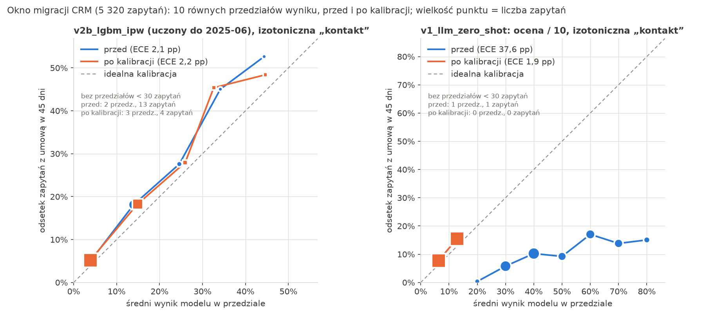

# Kolejka zapytań: kalibracja v2b_lgbm_ipw i oceny LLM v1 (2026-11-15)

## Wnioski

1. Model v2b po kalibracji podaje szansę na umowę, której można użyć do liczenia pieniędzy, ale kalibracja niewiele
   zmieniła, bo model był już prawie skalibrowany. Na obsłużonych zapytaniach z testu (2026-03 – 2026-06) średnio
   przewidywał 9,67% umów przy faktycznych 9,05%, a po kalibracji 9,53% (ECE 0,63 → 0,59 pp).
2. W oknie migracji model zaniża szansę na umowę we wszystkich przedziałach, zarówno przed kalibracją, jak i po niej:
   średnio 8,28% wobec 10,51% faktycznych umów, ECE 2,15 → 2,22 pp (przedziały ufności się pokrywają). Przyczyną jest
   samo okno: w marcu i kwietniu 2025 obsłużone zapytania z okna dały 10,51% umów, a obsłużone spoza okna 8,31%.
   Kalibracja na innym okresie tego nie naprawi, więc w podobnych warunkach przychód z kolejki będzie zaniżony.
3. Kolejność zapytań praktycznie się nie zmienia. AUC w oknie spadło z 0,7814 do 0,7805, a na teście z 0,7882 do
   0,7880. Spadek bierze się z remisów: zamiast 5 317 różnych wyników w oknie jest ich 59.
4. Ocena LLM v1 podzielona przez 10 nie jest prawdopodobieństwem: średnio 48,10% wobec 10,51% umów w oknie. Po
   przeskalowaniu (np. ocena 3 → 4,33%, ocena 8 → 14,49%) liczby się zgadzają (ECE 1,86 pp), ale v1 dalej słabo
   odróżnia dobre zapytania od słabych: Brier 0,0926 wobec 0,0837 dla v2b, AUC 0,6215.
5. Sam ECE nie wystarczy do wyboru modelu. Stała 8,69% dla każdego zapytania ma w oknie ECE 1,82 pp, czyli niższe niż
   v2b, choć nikogo nie wyróżnia. Dlatego obok ECE podaję Brier (stała 0,0944, v2b po kalibracji 0,0837).

## Co zrobiono i jakie decyzje podjąłem

- **Walidacja była w treningu.** Zapisany `v2b_lgbm_ipw` uczył się na zamkniętych zapytaniach 2023-01 – 2026-02
  (`features/leady/podzial_v2.py`). Wszystkie 29 305 niecenzurowanych zapytań z 2025-07 – 2026-02 są w jego zbiorze
  uczącym (zapytanie Q1), więc kalibracja na nich byłaby kalibracją na danych treningowych. Dlatego uczę v2b od nowa
  tym samym kodem (`ModelLGBMIPW`, te same cechy i parametry) na danych do 2025-06-30. W tabelach to „v2b”;
  zapisany model to „v2b zapisany” i służy tylko do porównania.
- **Zbiory** (czas warszawski; zbiór testowy nie bierze udziału w kalibracji):

  | Zbiór | Okres | Zapytania | Umowy | Do czego |
  |---|---|---:|---:|---|
  | trening | 2023-01-01 – 2025-06-30, zamknięte, niecenzurowane, bez okna migracji | 98 222 (80 241 obsłużonych) | — | uczenie v2b (238 drzew; zapisany v2b: 182) i v0 |
  | walidacja | 2025-07-01 – 2026-02-28, niecenzurowane (wszystkie są zamknięte) | 29 305 (24 238 obsłużonych) | 2 322 (2 265 wśród obsłużonych) | tylko kalibracja |
  | okno migracji | 2025-03-03 – 2025-04-13 | 5 320 (wszystkie obsłużone) | 559 | ocena (główna) |
  | test | 2026-03-01 – 2026-06-30 | 15 217 (12 570 obsłużonych) | 1 167 (1 137) | ocena (pomocnicza) |

- **Na co kalibrujemy.** v2b przewiduje szansę na umowę *po kontakcie doradcy*, a w oknie migracji skontaktowano się
  z każdym. Główny wariant „kontakt” kalibruje więc na obsłużonych zapytaniach walidacji z wagą
  `min(1 / P(obsłużony), 10)` z modelu skłonności v2b (0 wag przyciętych, suma wag 29 438,95, ważona konwersja 8,69%).
  Wariant „wszystkie” kalibruje na wszystkich zapytaniach walidacji bez wag (konwersja 7,92%) i daje szansę na umowę
  przy obecnym sposobie oddzwaniania. W kolejce według pieniędzy właściwy jest wariant „kontakt”.
- **Metoda:** `sklearn.isotonic.IsotonicRegression(y_min=0, y_max=1, out_of_bounds="clip")`. Ocena v1 = ocena / 10
  z `ai/llm/cache` (bez wywołań API) przechodzi tę samą kalibrację.
- **ECE:** 10 równych przedziałów wyniku [0; 0,1), …, [0,9; 1]. Każdy przedział daje |średni wynik − odsetek umów|,
  a ECE to średnia tych różnic ważona liczbą zapytań w przedziale. Dla porównania podaję też ECE z 10 decyli wyniku.
  95% CI z bootstrapu (1 000 losowań). Brier = średni kwadrat (wynik − umowa).
- **Baseline:** v0_regula_zrodla (konwersja źródło × linia z treningu, nieobsłużone = 0, jak w `ewaluacja_v2b.py`)
  przed kalibracją i po tej samej kalibracji oraz stała (konwersja walidacji).

## Wyniki

### T1. Okno migracji (5 320 zapytań, 559 umów; k = 127)

ECE i różnice średnich w pp; w nawiasie 95% CI.

| Wersja | Średni wynik | Odsetek umów | ECE 10 przedziałów | ECE 10 decyli | Brier | AUC | lift@10% | precision@127 | Różnych wyników |
|---|---:|---:|---:|---:|---:|---:|---:|---:|---:|
| v2b przed | 8,38% | 10,51% | 2,15 (1,41–2,93) | 2,14 | 0,0835 | 0,7814 | 3,38 | 51,2% | 5 317 |
| **v2b po, „kontakt”** | 8,28% | 10,51% | **2,22** (1,47–3,01) | 2,25 | 0,0837 | **0,7805** | 3,40 | 50,9% | 59 |
| v2b po, „wszystkie” | 7,49% | 10,51% | 3,02 (2,21–3,78) | 3,02 | 0,0843 | 0,7804 | 3,40 | 50,9% | 63 |
| v1 przed (ocena / 10) | 48,10% | 10,51% | 37,59 (36,70–38,54) | 37,59 | 0,2510 | 0,6198 | 1,40 | 15,1% | 8 |
| **v1 po, „kontakt”** | 8,64% | 10,51% | **1,86** (1,03–2,64) | 1,91 | 0,0926 | **0,6215** | 1,40 | 15,1% | 7 |
| v1 po, „wszystkie” | 7,86% | 10,51% | 2,64 (1,81–3,42) | 2,69 | 0,0930 | 0,6198 | 1,40 | 15,1% | 8 |
| v0 przed (baseline) | 7,23% | 10,51% | 3,28 (2,45–4,06) | 3,28 | 0,0924 | 0,6328 | 1,89 | 22,0% | 16 |
| v0 po, „kontakt” (baseline) | 8,17% | 10,51% | 2,34 (1,48–3,10) | 2,34 | 0,0918 | 0,6355 | 1,89 | 22,0% | 8 |
| stała 8,69% (baseline) | 8,69% | 10,51% | 1,82 (0,97–2,59) | 1,82 | 0,0944 | 0,5000 | 1,00 | 10,5% | 1 |
| stała 7,92% (baseline) | 7,92% | 10,51% | 2,58 (1,74–3,35) | 2,58 | 0,0947 | 0,5000 | 1,00 | 10,5% | 1 |
| v2b zapisany (uczony do 2026-02) | 8,32% | 10,51% | 2,19 (1,37–2,93) | 2,44 | 0,0835 | 0,7846 | 3,52 | 48,0% | 5 316 |

Zmiana AUC po kalibracji „kontakt”: v2b −0,0008 (0,7814 → 0,7805), v1 +0,0017 (0,6198 → 0,6215). Kalibracja
izotoniczna nie zmienia kolejności, ale łączy sąsiednie wyniki w jeden poziom, a remis może AUC i obniżyć, i podnieść.
W v1 połączyła oceny 4 i 5 (T3), a w oknie ocena 5 dała mniej umów niż ocena 4 (T5), więc remis AUC podniósł.



### T2. Test 2026-03 – 2026-06: wszystkie (15 217, 1 167 umów, k = 125) i obsłużone (12 570, 1 137 umów)

Na wszystkich zapytaniach testu wariant „kontakt” z założenia przeszacowuje, bo część zapytań nie dostała kontaktu.
Dla v2b i v1 właściwym porównaniem są obsłużone.

| Wersja | Średni wynik (wszystkie) | ECE (wszystkie) | AUC (wszystkie) | Średni wynik (obsłużone) | Odsetek umów (obsłużone) | ECE (obsłużone) | Brier (obsłużone) | AUC (obsłużone) |
|---|---:|---:|---:|---:|---:|---:|---:|---:|
| v2b przed | 9,01% | 1,34 | 0,7882 | 9,67% | 9,05% | 0,63 | 0,0745 | 0,7771 |
| **v2b po, „kontakt”** | 8,88% | 1,27 | **0,7880** | 9,53% | 9,05% | **0,59** | 0,0746 | 0,7768 |
| v2b po, „wszystkie” | 8,06% | 0,55 | 0,7881 | 8,70% | 9,05% | 0,68 | 0,0746 | 0,7769 |
| v1 przed (ocena / 10) | 48,68% | 41,01 | 0,6168 | 48,71% | 9,05% | 39,66 | 0,2564 | 0,6176 |
| **v1 po, „kontakt”** | 8,77% | 1,10 | 0,6139 | 8,78% | 9,05% | **0,26** | 0,0811 | 0,6151 |
| v1 po, „wszystkie” | 7,98% | 0,31 | 0,6168 | 7,99% | 9,05% | 1,05 | 0,0812 | 0,6176 |
| v0 przed (baseline) | 7,94% | 0,74 | 0,6845 | 8,94% | 9,05% | 1,26 | 0,0803 | 0,6446 |
| v0 po, „kontakt” (baseline) | 8,81% | 1,14 | 0,6714 | 9,50% | 9,05% | 0,50 | 0,0801 | 0,6478 |
| stała 8,69% (baseline) | 8,69% | 1,02 | 0,5000 | 8,69% | 9,05% | 0,36 | 0,0823 | 0,5000 |
| v2b zapisany | 9,06% | 1,39 | 0,7896 | 9,74% | 9,05% | 0,70 | 0,0742 | 0,7774 |

Odsetek umów wśród wszystkich zapytań testu: 7,67%. Zmiana AUC po kalibracji „kontakt” na wszystkich zapytaniach testu:
v2b −0,0003, v1 −0,0029. Precyzja czołówki v2b na teście: 35,2% → 34,9% (precision@125), lift@10% 3,74 → 3,74.
Na obsłużonych zapytaniach walidacji v2b przed kalibracją miał ECE 0,56 pp (średnio 9,47% wobec 9,34%), czyli już
w okresie walidacji był prawie skalibrowany.

### T3. Ocena LLM v1 → szansa na umowę (kalibracja na walidacji)

| Ocena v1 | Obsłużone zapytania walidacji | „kontakt” | Wszystkie zapytania walidacji | „wszystkie” |
|---:|---:|---:|---:|---:|
| 1 | 2 | 0,00% | 3 | 0,00% |
| 2 | 1 080 | 0,83% | 1 307 | 0,84% |
| 3 | 5 210 | 4,33% | 6 374 | 3,95% |
| 4 | 5 870 | 8,21% | 7 023 | 7,50% |
| 5 | 3 300 | 8,21% | 3 909 | 7,52% |
| 6 | 3 789 | 12,01% | 4 557 | 10,80% |
| 7 | 3 339 | 12,78% | 4 086 | 11,72% |
| 8 | 1 647 | 14,49% | 2 045 | 13,01% |
| 9 | 1 | 100,00% | 1 | 100,00% |
| 10 | 0 (brak w danych) | 100,00% (przycięcie do ostatniego punktu) | 0 | 100,00% |

Oceny 1, 9 i 10 mają w walidacji 0–3 zapytania, więc ich wartości nie mają oparcia w danych (patrz „Ryzyka”).

### T4. v2b w oknie migracji: przedziały użyte do ECE i wykresu

| Przedział wyniku | Zapytań przed | Średni wynik przed | Odsetek umów przed | Zapytań po | Średni wynik po | Odsetek umów po |
|---|---:|---:|---:|---:|---:|---:|
| 0,0–0,1 | 3 854 | 4,1% | 5,2% | 3 855 | 3,9% | 5,2% |
| 0,1–0,2 | 955 | 14,0% | 18,1% | 996 | 14,9% | 18,3% |
| 0,2–0,3 | 290 | 24,6% | 27,6% | 229 | 26,0% | 27,9% |
| 0,3–0,4 | 151 | 34,1% | 45,0% | 205 | 32,6% | 45,4% |
| 0,4–0,5 | 57 | 44,3% | 52,6% | 31 | 44,6% | 48,4% |
| 0,5–0,6 | 12 | 53,8% | 50,0% | 2 | 55,2% | 100,0% |
| 0,6–0,7 | 1 | 64,3% | 100,0% | 1 | 66,7% | 100,0% |
| 0,8–0,9 | 0 | — | — | 1 | 83,9% | 100,0% |

### T5. v1 w oknie migracji: każda ocena osobno (przed kalibracją)

| Ocena | Zapytań | Odsetek umów |
|---:|---:|---:|
| 1 | 1 | 0,0% |
| 2 | 281 | 0,4% |
| 3 | 1 143 | 5,8% |
| 4 | 1 289 | 10,2% |
| 5 | 683 | 9,2% |
| 6 | 822 | 17,0% |
| 7 | 716 | 13,8% |
| 8 | 385 | 15,1% |

### T6. Czy okno migracji odstaje: odsetek umów wśród obsłużonych zapytań w każdym miesiącu (zapytanie Q2)

| Miesiąc | Obsłużone | Odsetek umów | W oknie migracji |
|---|---:|---:|---:|
| 2024-01 | 2 558 | 8,60% | 0 |
| 2024-02 | 2 707 | 8,42% | 0 |
| 2024-03 | 2 734 | 8,56% | 0 |
| 2024-04 | 2 795 | 8,94% | 0 |
| 2024-05 | 2 908 | 8,67% | 0 |
| 2024-06 | 3 027 | 8,33% | 0 |
| 2024-07 | 3 328 | 8,47% | 0 |
| 2024-08 | 3 497 | 8,89% | 0 |
| 2024-09 | 3 342 | 8,74% | 0 |
| 2024-10 | 2 852 | 8,84% | 0 |
| 2024-11 | 2 519 | 8,02% | 0 |
| 2024-12 | 2 111 | 9,76% | 0 |
| 2025-01 | 2 612 | 8,54% | 0 |
| 2025-02 | 2 831 | 8,62% | 0 |
| **2025-03** | 3 807 | **10,59%** | 3 645 |
| **2025-04** | 3 378 | **9,21%** | 1 675 |
| 2025-05 | 3 060 | 8,46% | 0 |
| 2025-06 | 3 246 | 9,83% | 0 |
| 2025-07 | 3 477 | 9,35% | 0 |
| 2025-08 | 3 704 | 8,91% | 0 |
| 2025-09 | 3 595 | 8,23% | 0 |
| 2025-10 | 3 064 | 9,60% | 0 |
| 2025-11 | 2 694 | 9,28% | 0 |
| 2025-12 | 2 269 | 9,21% | 0 |
| 2026-01 | 2 627 | 10,35% | 0 |
| 2026-02 | 2 808 | 10,29% | 0 |
| 2026-03 | 3 096 | 8,69% | 0 |
| 2026-04 | 3 076 | 9,23% | 0 |
| 2026-05 | 2 989 | 9,07% | 0 |
| 2026-06 | 3 409 | 9,18% | 0 |

Marzec–kwiecień 2025 (zapytanie Q3): obsłużone w oknie 5 320, umowy 10,51%; obsłużone poza oknem 1 865, umowy 8,31%.
W tych samych miesiącach 2024 roku: 8,56% i 8,94%. Wysoki odsetek umów nie wynika więc z pory roku, tylko z okna.
Dlaczego tak było, z danych nie wiadomo. Hipoteza do sprawdzenia: call center dzwoniło szybciej niż doradcy (czas
pierwszego kontaktu nie wchodzi do tej analizy).

### Ryzyka kalibracji izotonicznej (do decyzji przed wdrożeniem)

- **Skrajne wyniki opierają się na pojedynczych zapytaniach.** v2b: wynik surowy 0,5916–0,6178 dostaje 66,8%,
  dalej mapa rośnie liniowo do 100% przy 0,6659, a od tego miejsca jest 100%. Powód: najwyższy wynik w walidacji
  (0,6659) miało jedno obsłużone zapytanie, które skończyło się umową. Na teście 9 zapytań ma po kalibracji ≥ 60%,
  a umowę podpisało 1 (w walidacji 12 z 19, w oknie 2 z 2). v1: ocena 9 (1 zapytanie w walidacji) i ocena 10 (brak
  w walidacji) dostają 100%.
- **Najniższe wyniki dostają 0%.** v2b: surowy wynik do 0,0050 → 0%. Takich zapytań jest 198 w walidacji,
  50 w oknie i 112 na teście, a umów wśród nich nie ma. Mimo to w kolejce według pieniędzy wartość 0 zł wyrzuca
  zapytanie na koniec bez względu na wartość najmu.
- Możliwa poprawka (niezrobiona, do decyzji): wymagać minimalnej liczby zapytań na schodek albo przyciąć wynik do
  przedziału pokrytego danymi, np. [najniższy, najwyższy] odsetek umów w przedziałach z ≥ 30 zapytaniami.

## SQL i kod

Wszystko liczy [`kalibracja.py`](kalibracja.py) (deterministycznie: LightGBM `seed=42`, `deterministic=True`, bootstrap
`ziarno=42`). Wyniki trafiają do `wyniki/kalibracja.json` (wszystkie miary, przedziały, mapy kalibracji, Q2, Q3),
`wyniki/kalibracja.parquet` (wynik każdej wersji dla każdego zapytania walidacji, okna i testu) i
`wyniki/kalibracja_okno.png`. Run trafia do MLflow, eksperyment `leady`, run `v2b_lgbm_ipw_izotoniczna`
(`8d7ba2737c8045e99124af5a84526048`; wcześniejsze przebiegi z poprawkami wykresu i przedziałów oznaczone jako
usunięte).

```bash
pypyr baza                                   # domilo.duckdb + leady_cel
cd api && poetry run python -m api.ai.lead_model.evals.kalibracja            # z MLflow
cd api && poetry run python -m api.ai.lead_model.evals.kalibracja --bez-mlflow
```

**Q1. Czy walidacja 2025-07 – 2026-02 jest w zbiorze uczącym zapisanego v2b** (uruchomione przez `polacz()`, tak jak
`podzial_v2.podziel`). Wynik: walidacja 29 305, w treningu v2b 29 305, spoza 0, zamkniętych 29 305.

```python
z = wczytaj_zbior(polacz()); t = z["utworzono"]; S = "Europe/Warsaw"
znany = z["umowa_45d"].notna() & ~z["cenzurowany"]
wal = znany & (t >= pd.Timestamp("2025-07-01", tz=S)) & (t < pd.Timestamp("2026-03-01", tz=S))
tr = znany & z["zamkniety"] & ~z["okno_migracji"] & (t >= pd.Timestamp("2023-01-01", tz=S)) & (t < pd.Timestamp("2026-03-01", tz=S))
wal.sum(), (wal & tr).sum(), (wal & ~tr).sum(), (wal & z["zamkniety"]).sum()
```

**Q2. Odsetek umów wśród obsłużonych w każdym miesiącu** (`SQL_KONWERSJA_MIESIECZNA`; CLI `duckdb` 1.5 nie otworzy
`domilo.duckdb`, więc przez `polacz()`):

```sql
SELECT strftime(date_trunc('month', l.utworzono), '%Y-%m') AS miesiac,
       count(*) FILTER (WHERE c.obsluzony) AS obsluzone,
       avg(c.umowa_45d::INT) FILTER (WHERE c.obsluzony) AS konwersja_obsluzonych,
       count(*) FILTER (WHERE c.okno_migracji) AS w_oknie_migracji
FROM crm_leady AS l JOIN leady_cel AS c USING (id_leada)
WHERE c.umowa_45d IS NOT NULL AND NOT c.cenzurowany
  AND l.utworzono >= TIMESTAMPTZ '2024-01-01 00:00 Europe/Warsaw'
  AND l.utworzono <  TIMESTAMPTZ '2026-07-01 00:00 Europe/Warsaw'
GROUP BY 1 ORDER BY 1;
```

**Q3. Marzec–kwiecień 2025: w oknie i poza nim** (`SQL_OKNO_A_RESZTA_MIESIECY`):

```sql
SELECT c.okno_migracji, count(*) AS obsluzone, avg(c.umowa_45d::INT) AS konwersja_obsluzonych
FROM crm_leady AS l JOIN leady_cel AS c USING (id_leada)
WHERE c.obsluzony AND c.umowa_45d IS NOT NULL AND NOT c.cenzurowany
  AND l.utworzono >= TIMESTAMPTZ '2025-03-01 00:00 Europe/Warsaw'
  AND l.utworzono <  TIMESTAMPTZ '2025-05-01 00:00 Europe/Warsaw'
GROUP BY 1 ORDER BY 1;
```

**Podział, uczenie i kalibracja** (fragmenty `kalibracja.py`):

```python
KONIEC_TRENINGU = pd.Timestamp("2025-07-01", tz="Europe/Warsaw")
zbiory, cechy = przygotuj(con)                      # ewaluacja_v2.przygotuj: podzial_v2 + cechy + sygnały v1
uczacy = (zbiory["trening"]["utworzono"] < KONIEC_TRENINGU).to_numpy()
v2b = ModelLGBMIPW().fit(X_tr, y_tr)                # X_tr: cechy treningu do 2025-06 + kolumna obsluzony

def kalibruj(p_wal, y_wal, wagi=None):
    return IsotonicRegression(y_min=0.0, y_max=1.0, out_of_bounds="clip").fit(p_wal, y_wal, sample_weight=wagi)

wagi_wal = v2b.wagi(X_wal[obsl_wal])                # min(1 / P(obsłużony), 10)
kal_kontakt = kalibruj(v2b.predict(X_wal)[obsl_wal], y_wal[obsl_wal], wagi_wal)
kal_wszystkie = kalibruj(v2b.predict(X_wal), y_wal)
# v1: wynik = ocena (1–10) z ai/llm/cache / 10, te same dwie kalibracje
```

**ECE** (10 równych przedziałów; krawędzie zaokrąglone, żeby ocena 3/10 trafiała do [0,3; 0,4)):

```python
kr = np.round(np.linspace(0, 1, 11), 10)
nr = np.clip(np.searchsorted(kr, p, side="right") - 1, 0, 9)
t = pd.DataFrame({"nr": nr, "p": p, "y": y}).groupby("nr").agg(n=("y", "size"), sr=("p", "mean"), konw=("y", "mean"))
ece = (t["n"] * (t["sr"] - t["konw"]).abs()).sum() / t["n"].sum()
```
