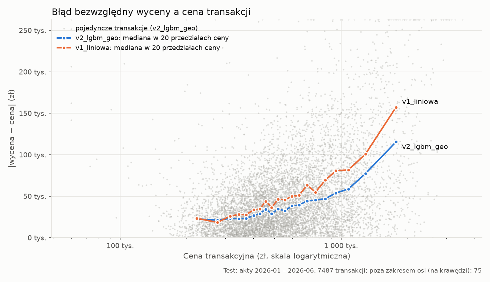
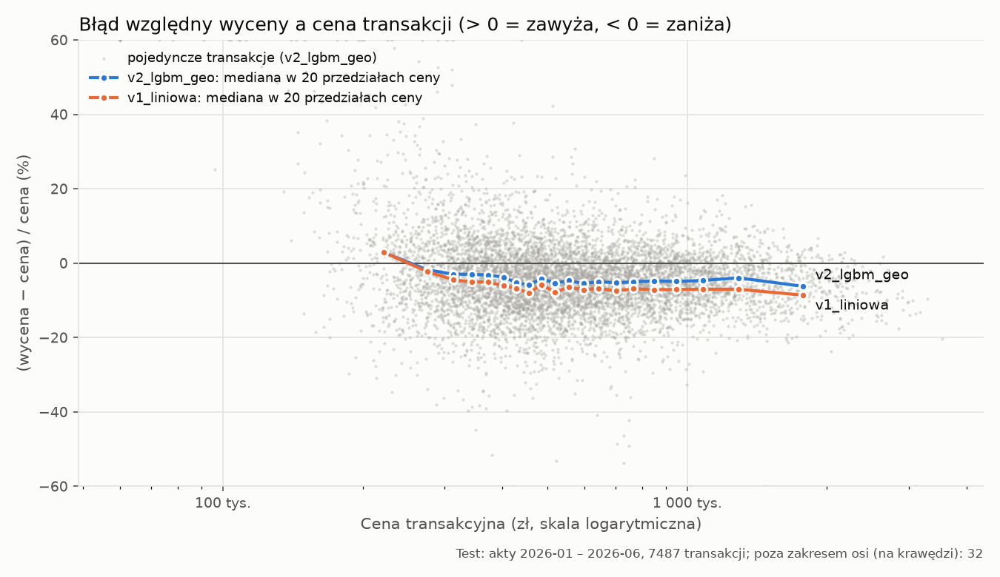

# B1. Błędy v2 na zbiorze testowym i wycena ofert z Katowic

Źródło: `domilo.duckdb` zbudowana z `data/` (eksport 2026-09-30 23:59 Europe/Warsaw) przez `pypyr baza`.
Policzono 2026-11-15. Wszystkie liczby pochodzą z
[`analiza_bledow_v2.py`](../api/api/ai/valuation_model/evals/analiza_bledow_v2.py) (sekcja [SQL i kod](#sql-i-kod)).
„v2” oznacza tu dwie wersje: **v2_lgbm_geo** (LightGBM z otoczeniem i sąsiedztwem, najlepsza,
[b4](b4_wycena_v2_lgbm_geo.md)) oraz v2_lightgbm (LightGBM na cechach v1, [b3](b3_wycena_v2_geo.md)). Szczegółowa
analiza dotyczy v2_lgbm_geo, a MAPE v2_lightgbm i v1 podajemy obok. Test (akty 2026-01 – 2026-06, 7 487 transakcji)
został otwarty przy ewaluacji. Tu tylko opisujemy jego błędy, więc poprawek wymyślonych na tej podstawie nie wolno
sprawdzać na tym samym teście.

## Wnioski

Na transakcjach z 2026 model myli się najbardziej przy tanich i małych mieszkaniach. Dla lokali poniżej 300 tys. zł
średni błąd wynosi 15,6%, a dla lokali poniżej 30 m² 10,3%, podczas gdy dla mieszkań powyżej 1 mln zł 6,9%.
Najsłabiej wycenia apartamentowce, które systematycznie zaniża o ok. 10%, bo typu budynku w ogóle nie dostaje,
oraz Łódź (11,3%). W złotych błąd rośnie razem z ceną: mediana ok. 22 tys. zł dla najtańszych i ok. 116 tys. zł dla
najdroższych. Poza znanymi miastami model zawodzi poważnie. 40 lokali z pakietu dewelopera w Katowicach v2_lgbm_geo
wycenia średnio o 24,9% wyżej niż rzeczoznawca, a v2_lightgbm o 40,2% (mediany). Za tych 40 lokali (z 180 w pakiecie) wyszłoby
ok. 4 mln zł więcej niż w operatach (21,49 wobec 17,45 mln zł). Model nie zgłosił problemu, bo niczego nie sprawdza: zawsze
zwraca liczbę, także dla miasta, którego nigdy nie widział (wyjaśnienie w [tabeli 9](#9-dlaczego-model-nie-zgłosił-problemu)).

## Tabele

MAE w zł; MAPE, MdAPE i „mediana błędu” w %. Mediana błędu = mediana (wycena − cena) / cena: < 0 oznacza, że model
zaniża wycenę. Kolumny „v2_lightgbm” i „v1” to MAPE tych wersji na tych samych transakcjach.

### 1. Test według segmentu ceny transakcyjnej

Granice: < 300 000; 300 000 – 599 999; 600 000 – 999 999; ≥ 1 000 000 zł.

| Segment | Transakcje | MAE | MAPE | MdAPE | Mediana błędu | MAPE v2_lightgbm | MAPE v1 |
|---|---:|---:|---:|---:|---:|---:|---:|
| < 300 tys. | 798 | 31 332 | 15,62 | 8,54 | −0,17 | 15,72 | 15,43 |
| 300–600 tys. | 3 516 | 35 824 | 8,19 | 6,57 | −4,46 | 9,75 | 9,72 |
| 600 tys. – 1 mln | 2 031 | 55 752 | 7,33 | 6,00 | −5,02 | 9,22 | 9,38 |
| > 1 mln | 1 142 | 100 003 | 6,86 | 5,99 | −5,07 | 9,19 | 9,26 |
| wszystkie | 7 487 | 50 540 | 8,55 | 6,49 | −4,46 | 10,16 | 10,17 |

Uwaga: podział według **prawdziwej** ceny zawsze wygląda gorzej na krańcach. Transakcje, które wyszły tanio (lub
drogo) przez czynniki nieznane modelowi, trafiają do skrajnych segmentów, a model wycenia je bliżej środka. Dlatego
w segmencie < 300 tys. MAPE jest wysoki przy medianie błędu bliskiej 0. W praktyce znamy tylko wycenę, więc
ważniejsza jest tabela 2 (segment według wyceny modelu): tam najtańsze lokale też mają najwyższy błąd.

### 2. Test według segmentu wyceny v2_lgbm_geo (to, co widać w chwili wyceny)

| Segment wyceny | Transakcje | MAE | MAPE | MdAPE | Mediana błędu | MAPE v2_lightgbm | MAPE v1 |
|---|---:|---:|---:|---:|---:|---:|---:|
| < 300 tys. | 899 | 33 156 | 13,41 | 9,48 | −6,27 | 14,07 | 13,73 |
| 300–600 tys. | 3 691 | 39 797 | 8,91 | 6,79 | −4,47 | 10,40 | 10,41 |
| 600 tys. – 1 mln | 1 877 | 55 947 | 6,75 | 5,61 | −4,38 | 8,64 | 8,78 |
| > 1 mln | 1 020 | 94 787 | 6,26 | 5,29 | −3,79 | 8,64 | 8,68 |

### 3. Test według miasta

| Miasto | Transakcje | MAE | MAPE | MdAPE | Mediana błędu | MAPE v2_lightgbm | MAPE v1 |
|---|---:|---:|---:|---:|---:|---:|---:|
| Warszawa | 2 978 | 54 902 | 7,79 | 6,19 | −4,45 | 9,55 | 9,66 |
| Wrocław | 1 122 | 47 540 | 8,30 | 6,35 | −3,90 | 9,80 | 9,73 |
| Kraków | 1 252 | 49 984 | 8,44 | 6,06 | −4,61 | 9,98 | 9,97 |
| Gdańsk | 750 | 49 095 | 8,67 | 6,71 | −3,67 | 10,35 | 10,11 |
| Poznań | 754 | 47 011 | 9,67 | 7,09 | −4,93 | 11,13 | 11,26 |
| Łódź | 631 | 42 328 | 11,29 | 8,47 | −5,94 | 12,65 | 12,49 |

### 4. Test według typu budynku (`rcn_transakcje.typ_budynku`; model tej kolumny nie dostaje)

| Typ budynku | Transakcje | MAE | MAPE | MdAPE | Mediana błędu | MAPE v2_lightgbm | MAPE v1 |
|---|---:|---:|---:|---:|---:|---:|---:|
| blok | 6 182 | 46 513 | 8,43 | 6,25 | −4,18 | 10,07 | 10,10 |
| kamienica | 706 | 57 199 | 8,40 | 6,62 | −4,61 | 9,71 | 9,74 |
| dom wielorodzinny | 301 | 55 789 | 8,71 | 7,35 | −4,88 | 9,84 | 9,60 |
| apartamentowiec | 298 | 113 011 | 11,16 | 10,98 | −10,19 | 13,48 | 13,13 |

Apartamentowce model zaniża o ok. 10% (mediana), czyli dwa razy bardziej niż resztę. Typ budynku jest w
`rcn_transakcje` i `radar_oferty`, ale nie jest cechą modelu. Słabość apartamentowców widać w każdym segmencie ceny
(MAPE 10,9–13,1%), a w blokach powyżej 300 tys. zł MAPE wynosi 6,2–8,0%:

| Segment ceny | Apartamentowiec | Blok | Dom wielorodzinny | Kamienica |
|---|---:|---:|---:|---:|
| < 300 tys. | 13,06 (4) | 15,73 (703) | 11,94 (22) | 15,82 (69) |
| 300–600 tys. | 10,88 (96) | 7,99 (3 029) | 9,39 (136) | 8,90 (255) |
| 600 tys. – 1 mln | 11,67 (83) | 7,21 (1 653) | 7,65 (87) | 6,47 (208) |
| > 1 mln | 10,97 (115) | 6,19 (797) | 7,45 (56) | 7,01 (174) |

MAPE v2_lgbm_geo w %, w nawiasie liczba transakcji.

### 5. Lokale < 30 m²

| Metraż | Transakcje | MAE | MAPE | MdAPE | Mediana błędu | MAPE v2_lightgbm | MAPE v1 |
|---|---:|---:|---:|---:|---:|---:|---:|
| < 30 m² | 2 817 | 37 324 | 10,34 | 7,63 | −4,50 | 11,82 | 11,79 |
| ≥ 30 m² | 4 670 | 58 512 | 7,46 | 5,92 | −4,45 | 9,16 | 9,19 |

| Lokale < 30 m² w mieście | Transakcje | MAE | MAPE | MdAPE | Mediana błędu |
|---|---:|---:|---:|---:|---:|
| Warszawa | 1 117 | 39 386 | 8,96 | 7,22 | −4,46 |
| Kraków | 452 | 36 958 | 10,12 | 7,48 | −4,26 |
| Wrocław | 444 | 35 435 | 10,21 | 7,48 | −3,84 |
| Gdańsk | 275 | 34 938 | 10,86 | 7,32 | −3,49 |
| Poznań | 293 | 37 301 | 12,33 | 8,13 | −4,86 |
| Łódź | 236 | 34 634 | 14,53 | 11,24 | −7,31 |

Małe lokale to 2 817 z 7 487 transakcji testowych (mediana metrażu 25,2 m²). Ich mediana ceny m² wynosi
15 097 zł, a dla lokali ≥ 30 m² 14 563 zł. Mediana wyceny m² v2_lgbm_geo to odpowiednio 14 423 i 13 983 zł.
Najgorzej jest w Łodzi: MAPE 14,5%, zaniżenie o 7,3%.

### 6. Błąd w funkcji ceny





Szare punkty to pojedyncze transakcje z oceną v2_lgbm_geo, a linie to mediany w 20 przedziałach ceny o równej
liczności. Punkty spoza osi leżą na krawędzi: 75 powyżej 263 079 zł (P99 błędu bezwzględnego) i 32 poza ±60%.
Te same dane w tabeli:

| Przedział ceny | Transakcje | Mediana \|błędu\| v2_lgbm_geo (zł) | Mediana \|błędu\| v1 (zł) | Mediana \|błędu\| v2_lgbm_geo (%) | Mediana błędu v2_lgbm_geo (%) | Mediana błędu v1 (%) |
|---|---:|---:|---:|---:|---:|---:|
| 60–251 tys. | 377 | 22 560 | 23 404 | 10,1 | 2,8 | 2,9 |
| 252–296 tys. | 376 | 21 177 | 18 439 | 7,7 | −1,8 | −2,3 |
| 297–329 tys. | 375 | 23 252 | 25 846 | 7,3 | −3,0 | −4,5 |
| 330–359 tys. | 374 | 22 897 | 27 980 | 6,6 | −3,0 | −5,1 |
| 360–386 tys. | 382 | 23 399 | 27 742 | 6,3 | −3,2 | −5,1 |
| 387–414 tys. | 367 | 26 662 | 33 680 | 6,5 | −3,8 | −6,1 |
| 415–442 tys. | 374 | 29 165 | 34 467 | 6,8 | −5,3 | −6,8 |
| 443–469 tys. | 370 | 34 380 | 43 934 | 7,4 | −5,9 | −8,0 |
| 470–500 tys. | 374 | 28 919 | 36 523 | 6,0 | −4,1 | −5,9 |
| 501–538 tys. | 379 | 34 765 | 46 536 | 6,7 | −5,4 | −7,8 |
| 539–577 tys. | 370 | 32 287 | 45 682 | 5,8 | −4,7 | −6,5 |
| 578–621 tys. | 382 | 38 349 | 49 824 | 6,5 | −5,5 | −7,2 |
| 622–672 tys. | 368 | 39 456 | 50 989 | 6,2 | −5,0 | −6,8 |
| 673–734 tys. | 374 | 44 301 | 63 450 | 6,4 | −5,3 | −7,5 |
| 735–808 tys. | 373 | 45 302 | 54 882 | 5,9 | −5,0 | −6,9 |
| 809–894 tys. | 374 | 47 018 | 69 393 | 5,5 | −4,8 | −7,1 |
| 895–1 006 tys. | 378 | 53 870 | 80 665 | 5,7 | −4,9 | −7,1 |
| 1 007–1 157 tys. | 371 | 58 765 | 81 799 | 5,5 | −4,7 | −7,0 |
| 1 158–1 455 tys. | 374 | 77 260 | 100 778 | 6,0 | −4,0 | −7,0 |
| 1 457–3 541 tys. | 375 | 115 542 | 157 266 | 6,5 | −6,2 | −8,6 |

Błąd w złotych rośnie z ceną, a błąd w procentach jest najwyższy w najtańszym przedziale (10,1%). Od ok. 300 tys. zł
błąd procentowy jest prawie stały (mediana 5,5–7,4%). Poza najtańszym przedziałem v2_lgbm_geo zaniża w każdym przedziale (−1,8% do
−6,2%), a v1 jeszcze bardziej (−2,3% do −8,6%).

### 7. Katowice: wycena 40 lokali z due diligence

Wyceniliśmy wszystkie 1 240 ofert z Katowic z `radar_oferty`. 40 z nich ma operat `due_diligence` (wrzesień 2026).
Wszystkie 40 to jeden pakiet dewelopera: PK060 „Osiedle Szyb”, Śląskie Domy, 180 lokali. Rynek pierwotny, bloki,
rok budowy 2026, Bogucice, mediana metrażu 36,35 m².

Cechy ofert policzono tak, jak w dniu wyceny: geo.sql dla położenia oferty, sąsiedzi spośród transakcji RCN
opublikowanych przed dniem wyceny (`sasiedztwo_punktow.sql`). Dzień wyceny = `data_wyceny` operatu, a dla ofert
bez operatu `data_publikacji`. Błąd = (wycena − wartość operatu) / wartość operatu. Operat to opinia
rzeczoznawcy, a nie cena transakcyjna, więc traktujemy go jako punkt odniesienia, a nie prawdę.

| Wycena | Operaty | **Mediana błędu** | MAPE | MdAPE | Min | Max | Wyceny poniżej operatu | Suma wycen (mln zł) |
|---|---:|---:|---:|---:|---:|---:|---:|---:|
| **v2_lgbm_geo** | 40 | **+24,9** | 26,4 | 24,9 | −3,8 | +54,5 | 2 | 21,49 |
| v2_lightgbm | 40 | **+40,2** | 42,5 | 40,2 | +11,4 | +82,0 | 0 | 24,19 |
| v1_liniowa | 40 | — | — | — | — | — | — | odmowa: `ValueError: Miasto nieznane w zbiorze treningowym: Katowice` |
| cena ofertowa (punkt odniesienia) | 40 | +5,5 | 11,5 | 6,6 | −72,8 | +42,1 | 12 | 17,84 |

Suma 40 operatów: 17,45 mln zł. Zwykła cena z ogłoszenia jest bliżej operatu niż model.

| Cena za m² (mediana) | zł/m² |
|---|---:|
| operat due diligence (40) | 10 269 |
| cena ofertowa tych 40 lokali | 10 714 |
| wycena v2_lgbm_geo tych 40 lokali | 13 145 |
| wycena v2_lightgbm tych 40 lokali | 14 589 |
| cena ofertowa, wszystkie oferty z Katowic (cena > 0) | 10 060 |
| wycena v2_lgbm_geo, wszystkie oferty z Katowic | 11 938 |
| RCN trening: Łódź / Poznań / Gdańsk / Wrocław / Kraków / Warszawa | 8 484 / 11 372 / 13 246 / 13 608 / 14 370 / 15 789 |

v2_lgbm_geo wycenia Bogucice na poziomie Gdańska (13 145 zł/m²), a rzeczoznawca na poziomie bliższym Poznania.

### 8. Sygnał, który był dostępny bez operatów: wycena a cena ofertowa

Oferty z okresu 2026-06-01 – 2026-09-30 (do dnia eksportu), cena > 0. Wycena v2_lgbm_geo / cena ofertowa − 1:

| Miasto | Oferty | Mediana (v2_lgbm_geo) | MdAPE względem ceny ofertowej | Mediana (v2_lightgbm) |
|---|---:|---:|---:|---:|
| Gdańsk | 1 333 | −10,4 | 11,4 | −13,3 |
| Kraków | 2 334 | −10,9 | 11,8 | −12,9 |
| Poznań | 1 350 | −11,8 | 12,5 | −13,3 |
| Warszawa | 5 421 | −10,8 | 11,5 | −12,8 |
| Wrocław | 2 002 | −10,2 | 11,1 | −12,1 |
| Łódź | 1 151 | −11,5 | 13,1 | −13,3 |
| **Katowice** | 1 239 | **+19,1** | 19,8 | **+34,5** |

W każdym znanym mieście model wycenia ok. 10–12% poniżej ceny z ogłoszenia (ceny ofertowe są wyższe od
transakcyjnych, a model dodatkowo zaniża 2026). W Katowicach wycenia o 19% **powyżej**. Ten rozjazd było widać od
razu, bez operatów.

### 9. Dlaczego model nie zgłosił problemu

**Prostym językiem:** model jest jak kalkulator, który zawsze pokazuje wynik. Nie ma przycisku „nie wiem”. Nikt go
nie nauczył sprawdzać, czy lokal przypomina te, na których się uczył, więc na pytanie o Katowice odpowiada równie
pewnie jak o Warszawę. Szczegóły:

| Powód | Co pokazują dane |
|---|---|
| Model nigdy nie widział Katowic | Każda z 1 240 ofert z Katowic ma miasto i dzielnicę nieznane w treningu oraz zero sąsiednich transakcji RCN. W innych miastach takich ofert jest 0. W `rcn_transakcje` Katowic brak w danych. |
| Nieznane miasto model traktuje jak „brak danych” i zgaduje | Tak zbudowaliśmy v2 (b3: „miasto albo dzielnica nieznane w treningu trafiają do LightGBM jako brak”). Drzewa idą wtedy domyślną gałęzią, która nie ma nic wspólnego z Katowicami. Wyjaśnienie wyceny (SHAP) pokazuje, że dla Katowic ani miasto, ani dzielnica prawie nic nie wnoszą (wkład dzielnicy +0,021 do ln wyceny), a wycena opiera się na metrażu i średnim poziomie całego treningu. |
| „Brak sąsiadów” model zna tylko z 23 transakcji | W treningu zero sąsiadów miały tylko 23 transakcje (0,060%), wszystkie z 1–2 stycznia 2023, czyli z pierwszych dni danych. Dla Katowic ten przypadek dotyczy 100% ofert. Model obniża za to wycenę o ok. 11% (wkład −0,115 do ln wyceny), ale to zbyt mało, a podstawa była zła. |
| v1 miała bezpiecznik, v2 go straciła | v1 rzuca błąd „Miasto nieznane w zbiorze treningowym: Katowice”. Przy przejściu na LightGBM (b3) nieznane kategorie zamieniliśmy na „brak”, żeby model nie przerywał pracy, i tym samym usunęliśmy jedyne ostrzeżenie. |
| Nie ma przedziału niepewności | `predict_interval` v2_lgbm_geo rzuca `NotImplementedError`. Szeroki przedział albo „nie wiem” byłby sygnałem. |
| Testy tego nie mogły wykryć | Zbiór testowy ma tylko 6 miast z treningu. Dobry wynik na teście (MAPE 8,55%) mówi o tych miastach, nie o nowych. |

Do potwierdzenia przed zmianami (propozycje, nic jeszcze nie zrobiono):

1. Bezpiecznik „poza danymi”: odmowa wyceny przy nieznanym mieście i ostrzeżenie przy nieznanej dzielnicy albo
   mniej niż 20 sąsiadach RCN.
2. Przedział P10–P90 (i tak wymaga go bank).
3. Kontrola rozjazdu z ceną ofertową (tabela 8) jako alarm dla nowych rynków.
4. `typ_budynku` jako cecha (apartamentowce, tabela 4).

## SQL i kod

Odtworzenie (z katalogu głównego repozytorium):

```bash
pypyr baza                                                                      # jeśli nie ma domilo.duckdb
cd api && poetry run python -m api.ai.valuation_model.evals.analiza_bledow_v2    # tabele 1–9, wykresy w docs/img/
cd .. && pypyr test tests="api/tests/test_wycena_geo.py api/tests/test_wycena_sasiedztwo.py"
```

Modele: zapisane `versions/v2_lgbm_geo/model.joblib`, `versions/v2_lightgbm/model.joblib`,
`versions/v1_liniowa/model.joblib` (bez ponownego uczenia). Metryki jak w `evals/metryki.py`
(MAE = mean|w − c|, MAPE = 100·mean(|w − c| / c), MdAPE = mediana, mediana błędu = 100·median((w − c) / c)).

### Test: dane i segmenty (`analiza_testu`)

```python
df = wczytaj_transakcje_z_cechami(con)          # transakcje + geo.sql + sasiedztwo.sql
df = df[df.zbior == "test"].merge(con.execute("SELECT id_transakcji, typ_budynku FROM rcn_transakcje").df())
df["geo"] = v2_lgbm_geo.predict(df); df["lgbm"] = v2_lightgbm.predict(df[KOLUMNY_CECH]); df["v1"] = v1.predict(...)
df["segment_ceny"] = pd.cut(df.cena_pln, [0, 300_000, 600_000, 1_000_000, inf], right=False)
df["segment_wyceny"] = pd.cut(df.geo, [0, 300_000, 600_000, 1_000_000, inf], right=False)
df["metraz_grupa"] = np.where(df.metraz < 30, "< 30 m²", "≥ 30 m²")
# metryki w grupach: miasto, typ_budynku, metraz_grupa, segmenty; wykresy: pd.qcut(cena_pln, 20) i mediany w przedziałach
```

### Oferty: `SQL_OFERTY` (oferty z okresu 2026-06 – 2026-09 + operaty due diligence)

```sql
SELECT r.id_oferty AS id_transakcji, r.miasto, r.dzielnica, r.lat, r.lon, r.metraz, r.pokoje, r.pietro,
       r.rok_budowy, r.rynek, r.typ_budynku, r.cena_ofertowa, r.id_pakietu,
       coalesce(o.data_wyceny, r.data_publikacji)::DATE AS dzien_wyceny,
       o.id_operatu, o.wartosc_pln AS wartosc_operatu
FROM radar_oferty r
LEFT JOIN operaty o ON o.id_oferty = r.id_oferty AND o.typ = 'due_diligence'
WHERE r.data_publikacji >= TIMESTAMP '2026-06-01' AND r.data_publikacji < TIMESTAMP '2026-10-01';
```

Cechy ofert: `cechy_geo(con, <oferty: id_transakcji, miasto, dzielnica, lat, lon>)`, czyli `geo.sql` z
podstawionym źródłem punktów, oraz `cechy_sasiedztwa_punktow(con, <oferty: ..., dzien_wyceny>)`:

### `api/api/ai/features/wycena/sasiedztwo_punktow.sql` (rdzeń)

```sql
pary AS (
    SELECT p.id_transakcji, s.id_transakcji AS id_sasiada, s.cena_m2, s.dzien_aktu AS dzien_sasiada,
           <haversine p–s> AS odl_m
    FROM punkty p
    JOIN (SELECT * FROM rcn_transakcje WHERE data_publikacji_rejestru < TIMESTAMP '2026-10-01') s
      ON s.miasto = p.miasto
     AND s.data_aktu::DATE < p.dzien_wyceny
     AND s.data_aktu::DATE >= (p.dzien_wyceny - INTERVAL 12 MONTH)::DATE
     AND s.data_publikacji_rejestru < p.dzien_wyceny          -- znana w dniu wyceny
)
-- dalej jak sasiedztwo.sql: 20 najbliższych (remis: nowsza, mniejsze id), mediana cena_m2, liczba, lista id
```

### Opis pakietu due diligence (sekcja 7)

```sql
SELECT r.rynek, r.typ_budynku, r.dzielnica, count(*), median(o.wartosc_pln), median(r.cena_ofertowa),
       median(r.metraz), min(r.rok_budowy), max(r.rok_budowy), count(DISTINCT r.id_pakietu)
FROM operaty o JOIN radar_oferty r USING (id_oferty)
WHERE o.typ = 'due_diligence' GROUP BY ALL;

SELECT * FROM radar_pakiety WHERE id_pakietu IN (
    SELECT r.id_pakietu FROM operaty o JOIN radar_oferty r USING (id_oferty) WHERE o.typ = 'due_diligence');
```

### Diagnoza (sekcja 9)

```python
miasto_nieznane = ~oferty.miasto.isin(v2_lgbm_geo.kategorie_["miasto"])
dzielnica_nieznana = ~(oferty.miasto + " | " + oferty.dzielnica).isin(v2_lgbm_geo.kategorie_["dzielnica"])
bez_sasiadow = oferty.sasiedzi_liczba == 0
trening_bez_sasiadow = trening[trening.sasiedzi_liczba == 0]       # 23 transakcje, 2023-01-01 – 2023-01-02
wklady = v2_lgbm_geo.explain(oferty).groupby(katowice_czy_nie)[wklad_*].mean()   # SHAP, ln(zł)
v1.predict(katowice)            # -> ValueError: Miasto nieznane w zbiorze treningowym: Katowice
v2_lgbm_geo.predict_interval()  # -> NotImplementedError
```
