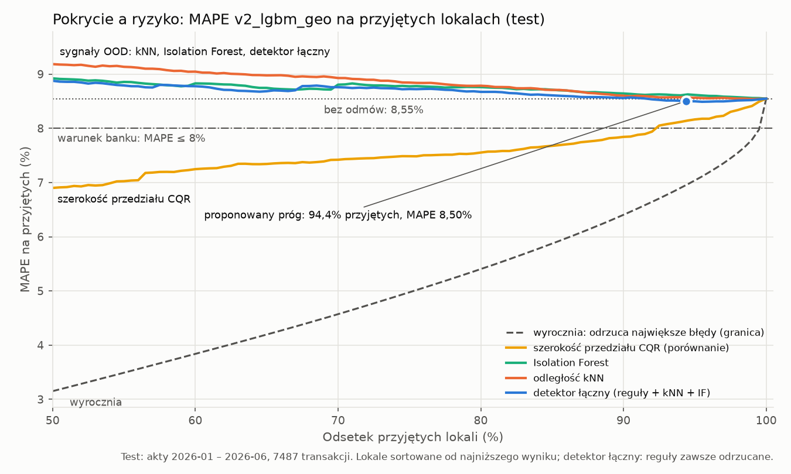

# B1. Detektor danych spoza zakresu (OOD): kiedy model wyceny ma powiedzieć „nie wiem”

Źródło: `domilo.duckdb` zbudowana z `data/` (eksport 2026-09-30 23:59 Europe/Warsaw) przez `pypyr baza`.
Policzono 2026-11-15. Wszystkie liczby pochodzą z [`ood_v3.py`](../api/api/ai/valuation_model/evals/ood_v3.py)
(sekcja [SQL i kod](#sql-i-kod)) i są zapisane w `api/api/ai/valuation_model/versions/v3_przedzialy/ood_metryki.json`.
Detektor: [`versions/v3_przedzialy/ood.py`](../api/api/ai/valuation_model/versions/v3_przedzialy/ood.py), zapisany
w `versions/v3_przedzialy/ood.joblib`. Błąd wyceny = |P50 − cena| / cena, P50 = zapisany v2_lgbm_geo.

## Wnioski

Detektor odrzuca wszystkie 1 240 ofert z Katowic, w tym 40 z operatem due diligence, i podaje powód słowami
(„Miasto Katowice: 0 transakcji w zbiorze treningowym”), więc model nie wyceni już Katowic o 24,9% za wysoko bez ostrzeżenia
(b1_bledy.md). Z 7 200 lokali Domilo odrzuca 569 (7,9%). 410 z nich to dwa całe budynki w dzielnicach, których rejestr cen
prawie nie zna (Stocznia Park w Młodym Mieście: 11 transakcji, Księży Młyn Lofts: 28). Reszta to głównie nietypowe
metraże, np. 5 pokoi powyżej 140 m² albo 1 pokój poniżej 20 m². Na transakcjach testowych z 2026 detektor odrzuca 5,6% i prawie
nie poprawia dokładności: MAPE przyjętych wynosi 8,50% wobec 8,55% bez odmów. „Nietypowy” wśród znanych miast nie
znaczy „trudny do wyceny”, więc detektor jest bezpiecznikiem, a nie sposobem na MAPE ≤ 8%. Proponujemy próg
= 99. percentyl wyników treningu (wybrany na walidacji). Do MAPE ≤ 8% prowadzi raczej odmowa przy szerokim przedziale
CQR: próg 34,3% wyceny ustalony na walidacji daje na teście 86,3% przyjętych przy MAPE 7,71%.

## Tabele

### 1. Odsetek odmów z rozbiciem na powody

Procent lokali z danym powodem. Lokal może mieć kilka powodów, więc kolumny nie sumują się do „odmowy”.
W nawiasie: lokale, dla których to **jedyny** powód. Próg kNN i IF: 99. percentyl treningu (propozycja, tabela 4).

| Zbiór | Lokale | **Odmowy** | Miasto < 80 | Dzielnica < 80 | Metraż poza p0,5–p99,5 | Rok budowy poza zakresem / brak | Nietypowy typ lokalu | kNN | Isolation Forest |
|---|---:|---:|---:|---:|---:|---:|---:|---:|---:|
| **test** (RCN, akty 2026-01 – 2026-06) | 7 487 | **5,6** | 0,0 (0,0) | 0,9 (0,8) | 0,0 (0,0) | 2,3 (2,2) | 1,0 (1,0) | 0,7 (0,5) | 1,1 (0,9) |
| **oferty z Katowic** (2026-06 – 2026-09) | 1 240 | **100,0** | 100,0 (0,0) | 100,0 (0,0) | 0,0 (0,0) | 27,1 (0,0) | 0,7 (0,0) | 99,8 (0,0) | 1,5 (0,0) |
| **lokale Domilo** (stan 2026-09-30) | 7 200 | **7,9** | 0,0 (0,0) | 5,7 (5,6) | 1,0 (0,0) | 0,0 (0,0) | 1,8 (0,8) | 0,3 (0,2) | 0,6 (0,3) |
| walidacja (RCN, 2025-07 – 2025-12) | 7 686 | 5,1 | 0,0 (0,0) | 0,7 (0,7) | 0,0 (0,0) | 2,4 (2,3) | 0,7 (0,7) | 0,5 (0,4) | 1,0 (0,8) |
| oferty z 6 miast z treningu (2026-06 – 2026-09) | 13 591 | 18,0 | 0,0 (0,0) | 0,7 (0,6) | 1,3 (0,0) | 14,2 (13,5) | 2,1 (0,8) | 1,1 (0,4) | 1,2 (0,8) |

Liczby odmów: test 421 z 7 487, Katowice 1 240 z 1 240 (w tym 40 z 40 operatów due diligence), Domilo 569 z 7 200,
walidacja 391 z 7 686, oferty z 6 miast 2 448 z 13 591.

Katowice: każdą ofertę odrzucają co najmniej dwie reguły (miasto i dzielnica), dlatego w nawiasach są zera. kNN
sam wskazuje 99,8% z nich. Najbardziej odstaje liczba sąsiednich transakcji RCN (0, czyli −21,2 odch. std. od
średniej treningu). Isolation Forest wskazuje tylko 1,5%, więc bez reguł i kNN Katowice by przeszły.

### 2. Lokale Domilo: skąd odmowy

Suma po budynkach: dzielnica 410, nietypowy typ lokalu 133, metraż 70, Isolation Forest 40, kNN 19, miasto 0,
rok budowy 0. Odmowa dotyczy co najmniej jednego lokalu w 36 z 38 budynków. Budynki z co najmniej 5 odmowami:

| Budynek | Miasto, dzielnica | Rok oddania, typ, segment | Lokale | **Odmowy** | Dzielnica | Metraż | Typ lokalu | kNN | IF |
|---|---|---|---:|---:|---:|---:|---:|---:|---:|
| B38 Stocznia Park | Gdańsk, Młode Miasto | 2024, nowy, standard | 230 | **230** | 230 | 1 | 4 | 0 | 0 |
| B35 Domilo Księży Młyn Lofts | Łódź, Księży Młyn | 1928, rewitalizacja, standard | 180 | **180** | 180 | 0 | 2 | 0 | 0 |
| B04 Domilo Powiśle Prestige | Warszawa, Śródmieście | 2020, nowy, premium | 150 | **40** | 0 | 20 | 20 | 7 | 40 |
| B21 Domilo Granary Prestige | Gdańsk, Śródmieście | 2019, nowy, premium | 160 | **16** | 0 | 15 | 16 | 0 | 0 |
| B26 Domilo Wilanów Zielony | Warszawa, Wilanów | 2022, nowy, standard | 216 | 8 | 0 | 0 | 3 | 5 | 0 |
| B07 Domilo Bemowo Lotnisko | Warszawa, Bemowo | 2010, nowy, standard | 230 | 7 | 0 | 2 | 5 | 2 | 0 |
| B37 Kępa Park | Wrocław, Kępa Mieszczańska | 2024, nowy, standard | 290 | 7 | 0 | 4 | 7 | 0 | 0 |
| B11 Domilo Kabaty Las | Warszawa, Ursynów | 2012, nowy, standard | 200 | 6 | 0 | 1 | 6 | 0 | 0 |
| B17 Domilo Ruczaj | Kraków, Dębniki | 2017, nowy, standard | 170 | 6 | 0 | 2 | 6 | 0 | 0 |
| B05 Domilo Gocław | Warszawa, Praga-Południe | 2008, nowy, standard | 260 | 5 | 0 | 2 | 5 | 0 | 0 |
| B31 Domilo Włochy Okęcie | Warszawa, Włochy | 2022, nowy, standard | 230 | 5 | 0 | 1 | 3 | 2 | 0 |
| B30 Domilo Bałuty | Łódź, Bałuty-Centrum | 2006, nowy, standard | 170 | 5 | 0 | 3 | 5 | 0 | 0 |

Pozostałe 24 budynki mają po 1–4 odmowy. Lokale Domilo z powodem „metraż” lub „typ lokalu”:

| Pokoje | Lokale | Metraż min. (m²) | Metraż maks. (m²) |
|---:|---:|---:|---:|
| 1 | 68 | 17,0 | 59,3 |
| 2 | 17 | 17,7 | 84,2 |
| 3 | 11 | 30,0 | 112,7 |
| 4 | 11 | 45,1 | 166,8 |
| 5 | 26 | 140,1 | 167,9 |

W RCN treningowym metraż sięga od 20,0 do 140,0 m² (p0,5–p99,5; tyle samo min. i maks. w całym `rcn_transakcje`), więc
Domilo ma lokale mniejsze i większe niż jakakolwiek transakcja w rejestrze. Kawalerki Domilo mają do 59,3 m², a w
treningu p99,5 lokali 1-pokojowych to 42,3 m².

### 3. Krzywa pokrycie–ryzyko (test)



Lokale sortujemy od najmniej do najbardziej nietypowego według danego wyniku i przyjmujemy coraz większą część.
Oś pionowa to MAPE v2_lgbm_geo na przyjętych. Dobry sygnał „nie wiem” daje krzywą opadającą w lewo, bo odrzucanie
podejrzanych lokali obniża błąd. Wyrocznia odrzuca lokale z największym prawdziwym błędem, więc wyznacza granicę
możliwości. Wykres walidacji: [img/b1_ood_pokrycie_ryzyko_walidacja.png](img/b1_ood_pokrycie_ryzyko_walidacja.png).
Te same dane w tabeli (MAPE % na przyjętych):

| Przyjęte | Detektor łączny | kNN | Isolation Forest | Szerokość CQR (porównanie) | Wyrocznia |
|---:|---:|---:|---:|---:|---:|
| 50% | 8,88 | 9,18 | 8,92 | 6,90 | 3,15 |
| 60% | 8,78 | 9,05 | 8,83 | 7,25 | 3,84 |
| 70% | 8,76 | 8,93 | 8,81 | 7,42 | 4,57 |
| 80% | 8,67 | 8,79 | 8,76 | 7,55 | 5,40 |
| 90% | 8,56 | 8,60 | 8,64 | 7,84 | 6,40 |
| 95% | 8,50 | 8,57 | 8,62 | 8,16 | 7,04 |
| 100% | 8,55 | 8,55 | 8,55 | 8,55 | 8,55 |

Detektor łączny: lokal z dowolną regułą ma wynik +∞ i odpada pierwszy, pozostałe sortujemy według
max(odl_kNN / próg_kNN, wynik_IF / próg_IF). Wynik > 1 oznacza odmowę.

Krzywe kNN i Isolation Forest są płaskie, a przy dużych odmowach nawet rosną. Odrzucenie połowy transakcji
„najdalszych” od treningu podnosi MAPE z 8,55% do 9,18% (kNN). Nietypowe położenie, np. daleko od centrum albo przy
parku, nie utrudnia wyceny. Trudne są lokale typowe, ale tanie i małe (b1_bledy.md). Sygnałem błędu jest szerokość
przedziału CQR: krzywa opada od 8,55% do 6,90% przy połowie przyjętych.

### 4. Wybór progu kNN i Isolation Forest (na walidacji, bez testu)

Progi = kwantyl wyników na treningu, gdzie każda transakcja ma za sąsiadów inne transakcje treningowe, nie samą
siebie. Reguły są stałe. Katowice i Domilo nie mają cen RCN, więc służą tylko do oceny odsetka odmów.

| Kwantyl treningu | Próg kNN | Próg IF | Walidacja: odmowy | Walidacja: MAPE przyjętych | Walidacja: MAPE odrzuconych | Katowice: odmowy | Domilo: odmowy |
|---:|---:|---:|---:|---:|---:|---:|---:|
| 0,950 | 1,741 | 0,5498 | 12,1 | 8,81 | 8,04 | 100,0 | 13,9 |
| 0,980 | 2,064 | 0,5781 | 6,9 | 8,71 | 8,85 | 100,0 | 9,2 |
| **0,990 (propozycja)** | **2,412** | **0,5961** | **5,1** | **8,67** | **9,59** | **100,0** | **7,9** |
| 0,995 | 2,946 | 0,6091 | 4,4 | 8,68 | 9,57 | 100,0 | 7,7 |
| 0,999 | 4,244 | 0,6392 | 3,8 | 8,68 | 9,68 | 100,0 | 7,5 |

Dlaczego 0,99:

- Przy 0,95 odrzucone lokale mają **niższy** błąd niż przyjęte (8,04% wobec 8,81%), czyli odmawiamy zwykłym lokalom.
- Od 0,99 w górę MAPE odrzuconych przestaje rosnąć (9,57–9,68%), MAPE przyjętych się nie zmienia (8,67–8,68%), a
  odmowy maleją już tylko o reguły, które zostają (3,8–5,1%).
- 0,99 oznacza, że każdy z dwóch sygnałów odrzuca z założenia ok. 1% zwykłych transakcji z treningu. Katowice
  odpadają przy każdym progu.

Na teście ten próg daje 94,4% przyjętych i MAPE 8,50% (bez odmów 8,55%), na walidacji 94,9% i 8,67% (bez odmów 8,72%).

### 5. Czy odrzucone lokale są trudniejsze? (test, MAPE v2_lgbm_geo w %)

| Grupa | Test: lokale | Test: MAPE | Walidacja: lokale | Walidacja: MAPE |
|---|---:|---:|---:|---:|
| przyjęte | 7 066 | 8,50 | 7 295 | 8,67 |
| odrzucone | 421 | 9,30 | 391 | 9,59 |
| powód: dzielnica < 80 transakcji | 65 | 9,45 | 51 | 9,96 |
| powód: rok budowy poza zakresem / brak | 169 | **10,73** | 182 | 10,28 |
| powód: nietypowy typ lokalu | 77 | 7,95 | 55 | 7,22 |
| powód: kNN | 51 | 8,97 | 41 | 8,21 |
| powód: Isolation Forest | 80 | 7,36 | 79 | 10,29 |

Reguły „dzielnica” i „rok budowy” trafiają w lokale wyceniane gorzej. „Typ lokalu” odrzuca lokale wyceniane dobrze.
Isolation Forest daje wynik niestabilny (10,29% na walidacji, 7,36% na teście, po ok. 80 lokali).

### 6. Rok budowy poza zakresem: kto to jest

Zakres treningu: 1883–2025 (p0,5–p99,5). Test (169 odmów z tym powodem):

| Rok budowy | Rynek | Transakcje |
|---:|---|---:|
| 1880 | wtórny | 10 |
| 1881 | wtórny | 11 |
| 1882 | wtórny | 3 |
| 2026 | pierwotny | 132 |
| 2026 | wtórny | 13 |

Oferty 2026-06 – 2026-09 (`SQL_OFERTY`, z tabeli 7):

| Oferty | Rok budowy brak | Rok > 2025 | Rok < 1883 | W zakresie |
|---|---:|---:|---:|---:|
| 6 miast z treningu | 1 627 (pierwotny 54, wtórny 1 573) | 254 (pierwotny 233, wtórny 21) | 49 | 11 661 |
| Katowice | 160 (pierwotny 37, wtórny 123) | 164 (pierwotny 164) | 12 | 904 |

Większość odmów „rok budowy” w ofertach to **brak roku** w ogłoszeniu. W RCN rok budowy jest zawsze (0 braków), więc
model nigdy nie widział lokalu bez roku. Druga grupa to nowe budynki (2026), których w treningu do 2025-06 być nie
mogło. Ta reguła będzie odrzucać coraz więcej nowych budynków, dopóki modelu nie douczymy (pytanie do decyzji).

### 7. Powody słowami: przykłady

| Zbiór | Id | Powody (tak, jak zwraca `DetektorOOD.ocen`) |
|---|---|---|
| test | T046283 | Dzielnica Młode Miasto (Gdańsk): 11 transakcji w zbiorze treningowym (wymagane co najmniej 80) |
| test | T046277 | Rok budowy 2026 poza zakresem treningu 1883–2025 (p0,5–p99,5) |
| test | T046338 | Nietypowy typ lokalu: 3-pokojowy o metrażu 110,9 m², w treningu 3-pokojowe mają 30,6–102,8 m² (p0,5–p99,5) |
| test | T046566 | Lokal daleko od transakcji treningowych: średnia odległość do 10 najbliższych 2,42 (próg 2,41), najbardziej odstają: park do 400 m (2,1 odch. std. od średniej treningu), piętro (2,0 odch. std. od średniej treningu) |
| test | T046328 | Nietypowa kombinacja cech (Isolation Forest): wynik 0,610 (próg 0,596) |
| Katowice | O162157 | Miasto Katowice: 0 transakcji w zbiorze treningowym (wymagane co najmniej 80); Dzielnica Ligota (Katowice): 0 transakcji w zbiorze treningowym (wymagane co najmniej 80); Brak roku budowy; Lokal daleko od transakcji treningowych: średnia odległość do 10 najbliższych 3,23 (próg 2,41), najbardziej odstają: liczba sąsiednich transakcji (-21,2 odch. std. od średniej treningu), mediana ceny m² sąsiednich transakcji (-4,5 odch. std. od średniej treningu) |
| Domilo | B35-0001 | Dzielnica Księży Młyn (Łódź): 28 transakcji w zbiorze treningowym (wymagane co najmniej 80) |
| Domilo | B02-0064 | Metraż 17,3 m² poza zakresem treningu 20,0–140,0 m² (p0,5–p99,5); Nietypowy typ lokalu: 1-pokojowy o metrażu 17,3 m², w treningu 1-pokojowe mają 20,0–42,3 m² (p0,5–p99,5) |
| Domilo | B01-0143 | Nietypowy typ lokalu: 4-pokojowy o metrażu 46,1 m², w treningu 4-pokojowe mają 49,4–140,0 m² (p0,5–p99,5) |
| Domilo | B02-0018 | Lokal daleko od transakcji treningowych: średnia odległość do 10 najbliższych 2,49 (próg 2,41), najbardziej odstają: metraż (3,0 odch. std. od średniej treningu), liczba pokoi (2,9 odch. std. od średniej treningu) |
| Domilo | B04-0004 | Nietypowa kombinacja cech (Isolation Forest): wynik 0,614 (próg 0,596) |

Powody Isolation Forest nie wskazują cechy, bo las izolacyjny jej nie podaje. Lokal B04-0004 jest w budynku segmentu
premium (B04 Domilo Powiśle Prestige, Warszawa Śródmieście).

### 8. Porównanie: odmowa przy szerokim przedziale CQR

Próg = szerokość (P90 − P10) / P50, przy której na walidacji przyjmujemy najwięcej lokali z MAPE ≤ 8% (wybrany na
walidacji, na test przeniesiony jako wartość, a nie odsetek):

| Zbiór | Próg szerokości | Przyjęte | MAPE przyjętych | MAPE odrzuconych |
|---|---:|---:|---:|---:|
| walidacja | 34,3% | 87,0% | 7,95 | 13,85 |
| test | 34,3% | 86,3% | **7,71** | 13,79 |

Ta reguła nie jest częścią detektora OOD (dotyczy niepewności w znanych miastach), ale to jedyny z porównanych
sygnałów, który obniża MAPE poniżej warunku banku. W Katowicach szerokość nie pomaga: mediana 29,7% (b1_przedzialy.md,
tabela 10), czyli poniżej progu 34,3%.

### 9. Parametry detektora (z treningu, 38 522 transakcji)

| Parametr | Wartość |
|---|---|
| zakres metrażu (p0,5–p99,5) | 20,0–140,0 m² |
| zakres roku budowy (p0,5–p99,5) | 1883–2025 |
| metraż wg liczby pokoi (p0,5–p99,5) | 1: 20,0–42,3; 2: 20,7–66,9; 3: 30,6–102,8; 4: 49,4–140,0; 5: 85,2–140,0 m² |
| transakcje wg liczby pokoi | 1: 14 207; 2: 12 397; 3: 8 413; 4: 2 798; 5: 707 (innych liczb pokoi nie ma) |
| dzielnice < 80 transakcji | Gdańsk Młode Miasto 11, Gdańsk Letnica 27, Łódź Księży Młyn 28, Poznań Śródka 50, Poznań Ławica 60 |
| miasta < 80 transakcji | żadne z 6 miast treningu; każde inne miasto ma 0 |
| próg kNN (średnia odległość do 10 najbliższych, kwantyl 0,99 treningu) | 2,412 |
| próg Isolation Forest (−score_samples, kwantyl 0,99 treningu) | 0,5961 |

## Decyzje metodyczne

| Decyzja | Wybór | Uzasadnienie |
|---|---|---|
| „Nietypowy typ lokalu” | liczba pokoi z < 80 transakcjami albo metraż poza p0,5–p99,5 lokali z tą samą liczbą pokoi | RCN nie ma kolumny typu lokalu, a lokale Domilo nie mają `typ_budynku` (w `pms_budynki` jest tylko `typ` nowy/rewitalizacja i `segment`). Mapowanie Domilo na typy budynku z RCN byłoby założeniem biznesowym, którego nie mamy. Liczba pokoi i metraż są w RCN, ofertach i PMS. |
| Przestrzeń kNN / IF | 17 cech liczbowych modelu: metraż, pokoje, piętro, rok budowy + 13 cech otoczenia i sąsiedztwa (`CECHY_DOMYSLNE`) | Miasto i dzielnicę sprawdzają reguły. Kodowanie ich w odległości mieszałoby skale. Standaryzacja średnią i odchyleniem z treningu. |
| Braki w cechach | `odl_metro_m` → maksimum treningu (metro tylko w Warszawie), `sasiedzi_mediana_ceny_m2` → 0 (brak sąsiadów), reszta → mediana treningu | Brak metra to „daleko od metra”, a nie średnia. Brak sąsiadów ma oddalać punkt od treningu. |
| Odległość kNN | średnia z 10 odległości euklidesowych; dla treningu bez samego punktu | Bez wykluczenia próg byłby zaniżony (punkt ma odległość 0 do siebie). |
| Opis powodu kNN | dwie cechy lokalu najdalej od średniej treningu (z-score) | Porównanie z sąsiadami ukrywało przyczynę: dla Katowic najbliższe są 23 transakcje treningowe bez sąsiedztwa (b1_bledy.md, sekcja 9). |
| Próg | kwantyl 0,99 treningu, wybrany na walidacji (tabela 4) | Test był już otwarty (b4, b1_przedzialy). Pokazujemy na nim krzywą i wynik, ale progu na nim nie wybieramy. |
| Cechy lokali Domilo | położenie budynku (`pms_budynki.lat/lon`), `rok_oddania` jako rok budowy, sąsiedzi RCN opublikowani przed 2026-10-01 | Wycena „na dzień eksportu”. Cechy liczone raz na budynek (38) i dołączone do 7 200 lokali. |

## SQL i kod

Odtworzenie (z katalogu głównego repozytorium):

```bash
pypyr baza                                                               # jeśli nie ma domilo.duckdb
cd api && poetry run python -m api.ai.valuation_model.evals.ood_v3       # tabele 1–9, wykresy w docs/img/
cd .. && pypyr test tests="api/tests/test_wycena_ood.py"
```

Wynik jest deterministyczny (`IsolationForest(random_state=42)`, kNN dokładny).

### Dane

Transakcje RCN z cechami i podziałem jak w b4 (`wczytaj_transakcje_z_cechami`). Oferty jak w b1_bledy.md
(`SQL_OFERTY` z `analiza_bledow_v2.py`, cechy na `dzien_wyceny`). Lokale Domilo:

```sql
-- punkty do geo.sql i sasiedztwo_punktow.sql (jeden na budynek)
SELECT id_budynku AS id_transakcji, miasto, dzielnica, lat, lon, DATE '2026-10-01' AS dzien_wyceny
FROM pms_budynki;

-- lokale (7 200)
SELECT l.id_lokalu, l.id_budynku, b.nazwa, b.miasto, b.dzielnica, l.metraz, l.pokoje, l.pietro,
       b.rok_oddania AS rok_budowy, b.typ AS typ_budynku_pms, b.segment
FROM pms_lokale l JOIN pms_budynki b USING (id_budynku);

-- tabela 6: rok budowy w ofertach
SELECT miasto = 'Katowice' AS katowice,
       CASE WHEN rok_budowy IS NULL THEN 'brak' WHEN rok_budowy > 2025 THEN '>2025'
            WHEN rok_budowy < 1883 THEN '<1883' ELSE 'w zakresie' END AS rok,
       rynek, count(*)
FROM (<SQL_OFERTY>) GROUP BY ALL;
```

### Detektor (`versions/v3_przedzialy/ood.py`, rdzeń)

```python
det = DetektorOOD(min_transakcji=80, kwantyle=(0.005, 0.995), k=10, kwantyl_progu=0.99).fit(trening)
# fit: liczności miasto / (miasto, dzielnica) / pokoje; np.nanquantile(metraz|rok_budowy, [0.005, 0.995]);
#      metraż p0,5–p99,5 w każdej liczbie pokoi; uzupełnienie braków; Z = (X − średnia) / odchylenie;
#      NearestNeighbors(k + 1).fit(Z); IsolationForest(200 drzew, random_state=42).fit(Z);
#      prog_knn_ = quantile(średnia odległość do 10 najbliższych bez siebie, 0.99); prog_if_ = quantile(−score_samples, 0.99)
ocena = det.ocen(X)   # kolumny: odmowa, kody, powody (słowami, „; ”), odl_knn, wynik_if, powod_<kod>
```

### Krzywa pokrycie–ryzyko i próg (`ood_v3.py`)

```python
blad = abs(v2_lgbm_geo.predict(d) / d.cena_pln - 1)
wynik_laczny = np.where(regula, inf, np.maximum(odl_knn / prog_knn, wynik_if / prog_if))
def krzywa(wynik, blad, przyjete):                       # przyjete = 0,500; 0,505; …; 1,000
    kolejnosc = np.argsort(wynik, kind="stable")
    n = round(przyjete * len(blad))
    return 100 * cumsum(blad[kolejnosc])[n - 1] / n      # MAPE na przyjętych
# tabela 4: progi = kwantyle q ∈ {0,95; 0,98; 0,99; 0,995; 0,999} wyników treningu (bez siebie) -> det.ocen(walidacja, ...)
# tabela 8: szerokość = (p90 − p10) / p50 z v2_lgbm_geo_cqr; próg = szerokość przy największym odsetku przyjętych
#           z MAPE ≤ 8% na walidacji; ten sam próg na teście
```

### Rozbicie powodów

```python
flagi = ocena[[f"powod_{k}" for k in KODY]]
procent_powodu = 100 * flagi.mean()                         # lokal może mieć kilka powodów
tylko_ten = 100 * (flagi & (flagi.sum(axis=1) == 1)).mean()  # w nawiasie w tabeli 1
# Domilo: groupby(id_budynku, …).agg(lokale, odmowy, suma flag); sumy po budynkach w tabeli 2
```
