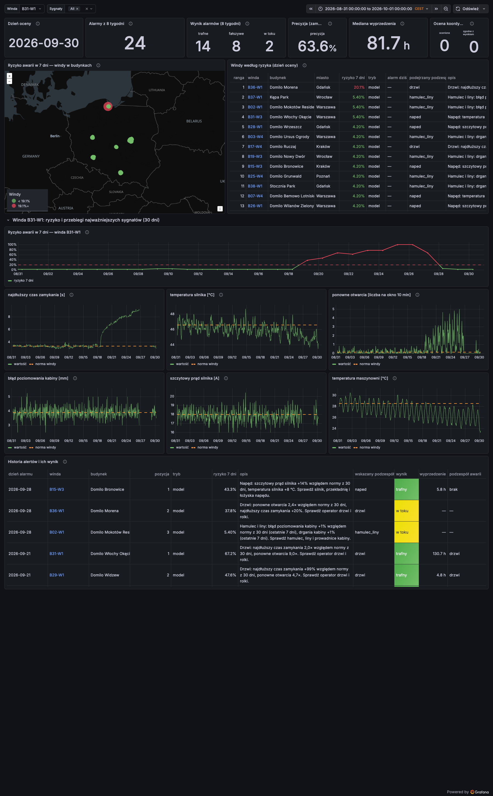

# Tablica działu technicznego (Grafana) i ocena alertów przez koordynatora

Data: 2026-11-16. Kod: `api/api/contexts_boundaries/maintenance_bc/panel_techniczny.py` (dane tablicy),
`maintenance_bc/ryzyko_wstecz.py` (symulacja wstecz), `api/api/adapters/alerty_ocena.py` + `POST /lifts/alerts/feedback`
(`api/api/main.py`), `dev/serwisownik_mock/app.py` (strona `/koordynator`), `dev/grafana/` (compose, źródło danych,
szablon tablicy `windy.szablon.json`, `konfiguruj.py`). Uruchomienie: `pypyr grafana` → http://127.0.0.1:3400/d/domilo-windy.



## Wnioski

1. Dział techniczny ma jedną tablicę z czterema widokami. Mapa i ranking pokazują ryzyko awarii każdej windy
   w najbliższych 7 dniach. Dla wybranej windy widać jej ryzyko dzień po dniu i przebiegi 6 najważniejszych sygnałów
   z 30 dni na tle jej normy. Pod spodem jest historia alertów z wynikiem: trafny, fałszywy albo w toku.
2. Z ostatnich 8 tygodni danych (alarmy 2026-08-04 – 2026-09-28, symulacja wstecz zadań dziennych) 14 z 24 alertów
   było trafnych, 8 fałszywych, a 2 są jeszcze w toku. Precyzja na zamkniętych oknach wynosi 63,6%, a od alertu do
   awarii mija w medianie 81,7 h, czyli ok. 3,4 dnia na wizytę technika (T1). W 12 z 14 trafnych alertów wskazany
   podzespół zgadzał się z tym, który się zepsuł.
3. Przykład z tablicy: winda B31-W1 od 2026-09-18 zamyka drzwi coraz dłużej. 2026-09-19 jej ryzyko przekroczyło próg
   opłacalności wizyty, 2026-09-21 dostała alert, a awaria drzwi przyszła 131 h później.
4. Koordynator może w Serwisowniku oznaczyć każdy alert jako trafny albo fałszywy (oraz podać faktyczny podzespół).
   Oceny trafiają do tabeli `alerty_ocena` jako nowe etykiety. Na razie nie ma ani jednej — pojawią się, gdy
   koordynator zacznie oceniać. Te etykiety dotyczą tylko wind wybranych przez model, więc przy ponownym uczeniu
   trzeba to uwzględnić (nie są losową próbą).

## Tabele

### T1. Podsumowanie 8 tygodni (`podsumowanie_8_tyg`; alerty z `alarmy_wind` po symulacji wstecz 2026-07-27 – 2026-09-30)

| Okres (dni alarmu) | Alarmy | Trafne | Fałszywe | W toku | Precyzja (zamknięte okna) | Mediana wyprzedzenia | Wyprzedzenie: min – maks | Wskazany podzespół = faktyczny (trafne) |
|---|---:|---:|---:|---:|---:|---:|---:|---:|
| 2026-08-04 – 2026-09-28 | 24 | 14 | 8 | 2 | 63,6% | 81,7 h | 4,8 – 137,2 h | 12 z 14 |

Cała historia w tabeli (od 2026-07-27, 10 poniedziałków): 30 alertów, 16 trafnych, 12 fałszywych, 2 w toku.
Faktyczny podzespół w 14 trafnych alertach z 8 tygodni: drzwi 8, napęd 3, brak wskazania (`brak`) 2, hamulec/liny 1.

### T2. Tablica: panele i źródła

| Panel | Dane (`dev/grafana/dane/*.parquet`) | Definicja |
|---|---|---|
| Dzień oceny, Alarmy, Wynik, Precyzja, Mediana wyprzedzenia, Ocena koordynatora | `panel_info`, `podsumowanie_8_tyg` | 8 tygodni = dni alarmu w (ostatni dzień alarmu − 56 dni; ostatni dzień alarmu]; precyzja = trafne / (trafne + fałszywe) |
| Mapa „Ryzyko awarii w 7 dni” | `windy_ryzyko` | punkt = winda (windy budynku na okręgu wokół `pms_budynki.lat/lon`); czerwony = P(awaria 7 dni) ≥ p* = 19,12% |
| Windy według ryzyka | `windy_ryzyko` | ranking z najnowszego dnia `ryzyko_wind`, opis alertu, podejrzany podzespół; link do widoku windy |
| Ryzyko windy w czasie | `ryzyko_historia` | `ryzyko_wind.p_awarii_7d` każdego dnia, linia przerywana = p* |
| Przebiegi sygnałów (6 paneli) | `sygnaly_30d` | średnie godzinne z 30 dni przed odcięciem dnia oceny + norma windy (`<sygnał>_norma` z cech tego dnia) |
| Historia alertów i ich wynik | `alerty` | wynik, wyprzedzenie, podzespół awarii, ocena i podzespół koordynatora |

Wyniki alertów liczymy jak cel modelu (`dni_wind.awaria_7d`):
- **trafny** — start awarii tej windy (`awarie_odtworzone`: start z telemetrii albo pierwsze zgłoszenie) wypada w
  (06:00 dnia alarmu; 06:00 + 7 dni];
- **w toku** — okno nie zamknęło się jeszcze przed stanem danych o awariach, czyli najpóźniejszym
  `serwis_zgloszenia.utworzono` = 2026-09-30 20:06;
- **fałszywy** — w pozostałych przypadkach.

Sygnały na wykresach to 6 sygnałów o największym łącznym udziale w ważności (gain) modelu bazowego v2b. W kolejności:
najdłuższy czas zamykania, temperatura silnika, ponowne otwarcia, błąd poziomowania kabiny, szczytowy prąd silnika,
temperatura maszynowni. Liczba 6 to wybór prezentacyjny.

p* = koszt_wizyty / (skutecznosc × koszt_awarii_ponad_planowa) z `maintenance_bc/zalozenia.yaml` (założenia użytkownika,
`wartosc_alarmow.ekonomia`). To jedyny próg kolorów na tablicy.

### T3. Ocena alertu przez koordynatora (`alerty_ocena`)

| Pole | Wartości | Uwagi |
|---|---|---|
| klucz | (`dzien`, `id_windy`) = klucz idempotencji zgłoszenia `{id_windy}:{data_alarmu}` | ocena alertu spoza `alarmy_wind` → 404 |
| `ocena` | `trafny`, `falszywy` | ta sama ocena drugi raz = powtórzenie; inna = poprawka (`poprawki` + 1, `pierwsza_ocena` zostaje) |
| `podzespol` | drzwi, naped, hamulec_liny, sterownik, zewnetrzna, brak (opcjonalnie) | etykieta do oceny listy podejrzanych podzespołów |
| `komentarz`, `oceniajacy`, `id_zgloszenia`, `oceniono` | tekst, czas | `id_zgloszenia` z Serwisownika |

Przepływ: strona `http://127.0.0.1:8103/koordynator` (atrapa Serwisownika) → `POST /api/zgloszenia/ocena` →
Serwisownik → `POST http://127.0.0.1:8101/lifts/alerts/feedback` (API Domilo, `pypyr api`) → `alerty_ocena`. Atrapa
zapisuje ocenę u siebie dopiero, gdy Domilo ją przyjmie (jak przy pominięciach w atrapie CRM). Stan na 2026-11-16:
0 ocen. Wymyślonych ocen nie wpisywaliśmy do bazy; przepływ sprawdza test na bazie tymczasowej.

## SQL i kod

Symulacja wstecz (te same kroki co funkcje Inngest; ok. 3 min, 30 zgłoszeń w atrapie Serwisownika):

```bash
pypyr serwisownik_mock            # w osobnym terminalu
pypyr ryzyko_wind_wstecz          # od=2026-07-27 do=2026-09-30
pypyr grafana                     # dane tablicy, wtyczka, kontener, sprawdzenie zapytań przez API Grafany
```

Wynik alertu (`panel_techniczny.wyniki_alertow`), zasada zapisana w SQL:

```sql
WITH awarie AS (
    SELECT id_awarii, id_windy, podzespol,
        coalesce(start_awarii_tz, timezone('Europe/Warsaw', pierwsze_zgloszenie)) AS start_tz
    FROM awarie_odtworzone
),
alarmy AS (
    SELECT *, timezone('Europe/Warsaw', dzien + INTERVAL 6 HOUR) AS moment_alarmu,
        timezone('Europe/Warsaw', dzien + INTERVAL 7 DAY + INTERVAL 6 HOUR) AS koniec_okna
    FROM alarmy_wind
),
stan AS (SELECT timezone('Europe/Warsaw', max(utworzono)) AS stan FROM serwis_zgloszenia)
SELECT a.dzien, a.id_windy,
    CASE WHEN min(w.start_tz) IS NOT NULL THEN 'trafny'
         WHEN a.koniec_okna <= any_value(s.stan) THEN 'fałszywy' ELSE 'w toku' END AS wynik,
    (epoch(min(w.start_tz)) - epoch(a.moment_alarmu)) / 3600 AS wyprzedzenie_h
FROM alarmy AS a CROSS JOIN stan AS s
LEFT JOIN awarie AS w ON w.id_windy = a.id_windy AND w.start_tz > a.moment_alarmu AND w.start_tz <= a.koniec_okna
GROUP BY a.dzien, a.id_windy, a.moment_alarmu, a.koniec_okna;
```

Podsumowanie 8 tygodni: `panel_techniczny.podsumowanie` (mediana `wyprzedzenie_h` trafnych z okna).
Zgodność podzespołu (T1):

```python
a = pd.read_parquet("dev/grafana/dane/alerty.parquet")
a8 = a[pd.to_datetime(a.dzien) > pd.Timestamp("2026-08-03")]
((a8.podzespol_wskazany == a8.podzespol_awarii) & (a8.wynik == "trafny")).sum(), (a8.wynik == "trafny").sum()
```

Dane dla Grafany:
- Wtyczka `motherduck-duckdb-datasource` 0.4.6 ma w sobie DuckDB 1.5.6, który nie otwiera `domilo.duckdb` (format 2.0).
  Otwarty plik blokowałby też zapis zadaniom dziennym.
- Dlatego `panel_techniczny.py` zapisuje 6 plików Parquet. Źródło danych Grafany to DuckDB w pamięci z widokami
  `read_parquet` (`initSql`), a każde zapytanie czyta bieżący plik.
- W zapytaniach wtyczka oczekuje liczbowego `format` (0 = szereg czasowy, 1 = tabela). Zmienne wstawiamy jako
  `${winda:sqlstring}`, bo wtyczka sama dodaje apostrofy do `$winda`.
- `konfiguruj.py --sprawdz` wykonuje zapytanie każdego panelu przez `/api/ds/query` i kończy się błędem przy 0 wierszy.

Testy: `api/tests/test_panel_techniczny_wind.py`:
- wynik alertu (granice okna, w toku, wyprzedzenie), podsumowanie 8 tygodni, rozstawienie wind na mapie;
- zapis, powtórzenie i poprawka oceny, alert nieznany;
- przepływ koordynator → atrapa → API → `alerty_ocena` na bazie tymczasowej;
- komplet tabel panelu i wszystkie zapytania szablonu na plikach panelu.
