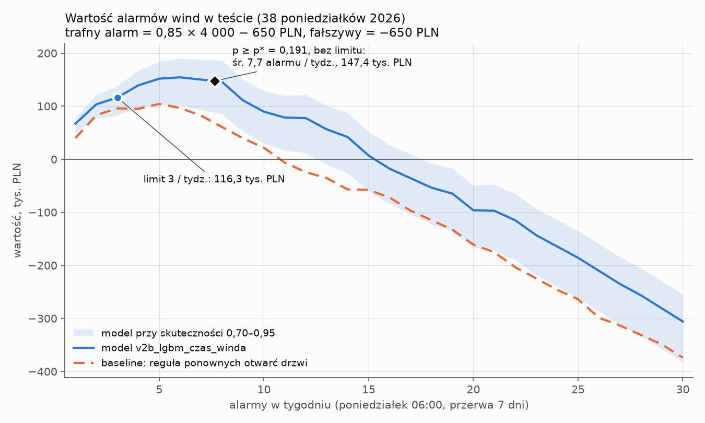

# Punkt pracy alarmów wind: 3 alarmy w poniedziałek, wartość w PLN, koszt limitu i tryb serwisowy (test 2026)

Stan: 2026-11-16, baza `domilo.duckdb` (eksport 2026-09-30). Model `v2b_lgbm_czas_winda` (zapisany
`model.joblib`, bez douczania; [porownanie.md](../api/api/ai/failure_model/evals/porownanie.md)), okres testowy
2026-01-01 – 2026-09-22, czyli 38 poniedziałków od 2026-01-05 do 2026-09-21. Reguła:
`api/api/contexts_boundaries/maintenance_bc/alarmy_wind.py`, stałe od użytkownika: `maintenance_bc/zalozenia.yaml`.
Aktywna wersja (`ai/failure_model/current.yaml`): **`v3_punkt_pracy`** = ten sam model co `v2b_lgbm_czas_winda`
(cechy bez okien serwisowych) + kalibracja izotoniczna na walidacji + opis punktu pracy (3 alarmy, poniedziałek,
przerwa 7 dni); jej wyniki na teście to wiersze „model” w T1–T11.

## Wnioski

1. Przy 3 alarmach w tygodniu (114 alarmów w 38 tygodni) po 56 alarmach (49,1%) winda faktycznie zepsuła się
   w ciągu 7 dni; przy losowym wyborze byłoby to średnio 6,0%. Alarm poprzedził jednak tylko 57 z 322 awarii
   (17,7%), a nawet ranking znający przyszłość uprzedziłby przy tym limicie 115 (35,7%), więc główne ograniczenie
   to liczba alarmów. Alarm wyprzedza awarię o medianę 85 godzin, a wyniki skaczą z tygodnia na tydzień
   (5 tygodni bez trafienia, 3 z trzema trafieniami).
2. Przy założeniach działu technicznego (trafny alarm wart 0,85 × 4 000 − 650 = 2 750 PLN, fałszywy −650 PLN)
   te 3 alarmy tygodniowo dały w teście 116 300 PLN, czyli w skali roku ok. 159 tys. PLN. Alarm opłaca się wtedy,
   gdy szansa awarii windy w 7 dni wynosi co najmniej p* = 19,1%.
3. Gdyby alarm dostawała każda winda z ryzykiem co najmniej p* (po kalibracji), dział miałby średnio 7,7 alarmu
   tygodniowo (od 2 do 15), z precyzją 34,0% i wartością 147 450 PLN. **Limit 3 alarmów kosztuje więc 31 150 PLN
   w teście, ok. 42,6 tys. PLN rocznie** (przy skuteczności wizyty 0,70–0,95: 31–66 tys. PLN rocznie). Więcej
   niż ok. 15 alarmów tygodniowo przynosi już stratę. Bez przerwy 7 dni wartość przy p* rośnie do 261 300 PLN, ale
   tylko przy założeniu, że wizyta nie zmienia ryzyka windy w następnym tygodniu (dane tego nie pokazują).
4. Prosta reguła „drzwi częściej otwierają się ponownie niż zwykle” przy tym samym limicie daje 50 trafnych alarmów
   i 95 900 PLN, model 56 i 116 300 PLN. Różnica (+20 400 PLN, 95% CI −6 800 … +47 600 PLN; precyzja +5,3 pp,
   −1,8 … +12,3 pp) mieści się w granicach przypadku, więc **nie możemy powiedzieć, że model jest lepszy od
   reguły**. Działają inaczej: reguła łapie więcej awarii drzwi (43 wobec 34), model awarie napędu (12 wobec 0)
   i hamulca/lin (4 wobec 0).
5. Okna trybu serwisowego (konserwacja: technik jeździ windą i wielokrotnie otwiera drzwi) nie zmieniają wyniku
   modelu: z nimi w cechach też daje 56 trafnych z 114 alarmów (różnica 0,0 pp, 95% CI −6,1 … +6,1 pp); zmienia
   37 alarmów, ale z tą samą liczbą trafnych. Prostą regułę drzwi te okna psują: jej precyzja spada z 43,9% do
   31,6% (−12,3 pp, −20,2 … −4,4 pp), bo wskazuje windy tuż po konserwacji. Filtr zostaje, a aktywną wersją jest
   `v3_punkt_pracy` (ten sam model + kalibracja).

## Definicje i decyzje

- **Alarm:** w każdy poniedziałek okresu testowego o 06:00 Europe/Warsaw ranking wszystkich wind, które mają ten
  dzień w `dni_wind` (winda stojąca o 06:00 z powodu awarii nie ma wiersza i nie dostaje alarmu). Alarm dostają
  3 windy o najwyższym ryzyku `v2b_lgbm_czas_winda` (remis: `id_windy` rosnąco).
- **Przerwa (interpretacja, do potwierdzenia):** winda z alarmem w dniu t nie dostaje alarmu w dniach t+1 … t+7,
  więc nie dostanie go w następny poniedziałek (najwcześniej po 14 dniach). Odczytanie „odstęp ≥ 7 dni” przy alarmach
  co 7 dni niczego nie blokuje; jego wynik to wiersz „model bez przerwy” w T1.
- **Trafny alarm:** start awarii tej windy (`awarie_odtworzone`, start jak w `dni_wind`) w (06:00 t; 06:00 t+7].
  To dokładnie `dni_wind.awaria_7d` dnia alarmu; skrypt sprawdza zgodność dla każdego alarmu.
- **Precyzja** = trafne alarmy / alarmy. **Czułość** liczona na awariach (nie na dniach): awarie ze startem
  w (2026-01-05 06:00; 2026-09-28 06:00], czyli w oknach 38 poniedziałków; awaria jest złapana, gdy jej start wypada
  w oknie alarmu tej samej windy. Awarie z 2026-01-01 – 2026-01-05 06:00 są poza zakresem (żaden poniedziałek ich nie
  obejmuje). W mianowniku są też awarie wind, które w poniedziałek stały i nie mogły dostać alarmu.
- **Awarie z sygnałem:** `podzespol` ∈ {drzwi, naped, hamulec_liny, sterownik}; bez `zewnetrzna` (zalanie, burza,
  wandalizm) i `brak` (notatka bez przyczyny).
- **Wyprzedzenie:** godziny od alarmu (06:00) do startu pierwszej awarii w oknie, dla trafnych alarmów
  (= `dni_wind.godziny_do_startu`).
- **Baseline:** ta sama reguła (3 windy, poniedziałek, przerwa 7 dni) na rankingu
  `drzwi_ponowne_otwarcia_do_normy_24h` (ta sama reguła co w [evals/porownanie.md](../evals/porownanie.md); brak
  pomiaru = najniższa pozycja). Dodatkowo ranking losowy (1 000 symulacji) i „wyrocznia” (ranking = `awaria_7d`,
  wiedza o przyszłości) jako górna granica przy 3 alarmach tygodniowo.
- **Wartość (założenia użytkownika, `maintenance_bc/zalozenia.yaml`):** trafny alarm = skuteczność × koszt awarii
  ponad naprawę planową − wizyta = 0,85 × 4 000 − 650 = 2 750 PLN; fałszywy = −650 PLN. Koszt awarii 4 000 PLN =
  dopłata za tryb pilny 1 710 (FinKs) + rekompensaty 290 (PMS) + skargi 800 i uwolnienia z kabiny 1 200 (szacunek
  kierownika działu technicznego); wizyta 650 PLN (FinKs); skuteczność 0,85, zakres 0,70–0,95 (ocena koordynatora).
  Wartość liczymy na alarmach, tak jak podał użytkownik: alarm, w którego oknie zaczęły się dwie awarie, liczy się raz.
  Historycznie nikt nie jechał na alarm, więc wartość to symulacja „co by było” oparta na skuteczności 0,85.
- **Próg opłacalności** p* = 650 / (0,85 × 4 000) = 0,191: przy prawdopodobieństwie awarii p* wartość oczekiwana
  alarmu wynosi 0 (p* × 2 750 − (1 − p*) × 650 = 0). Przy skuteczności 0,70: p* = 0,232; przy 0,95: p* = 0,171.
- **Kalibracja:** wynik LightGBM nie jest prawdopodobieństwem z założenia (`failure_model/base.py`), więc p* stosujemy
  do ryzyka po regresji izotonicznej dopasowanej na walidacji 2025-07-01 – 2025-12-31 (20 433 wiersze, 112 wind; ta
  sama walidacja wybrała liczbę drzew). Test 2026 nie służy do kalibracji. Reguła p*: w każdy poniedziałek alarm dostają
  wszystkie windy z ryzykiem ≥ p*, przerwa 7 dni bez zmian. Baseline kalibrujemy tak samo (izotonia na walidacji).
- **Krzywa wartości:** ta sama reguła z limitem k = 1 … 30 alarmów w poniedziałek (ranking na surowym wyniku, przerwa
  7 dni). Punkt p* nie leży na krzywej: liczba alarmów zmienia się co tydzień, na osi jest średnia.
- **Koszt limitu** = wartość reguły p* bez limitu − wartość reguły 3 alarmów. Najlepsze k na krzywej (6 alarmów,
  154 400 PLN) wybrano na teście, więc jest optymistyczne; p* ustalono z góry z kosztów i walidacji.
- **Skala roku** = wartość w teście × 52 / 38 (52 poniedziałki z alarmem w roku; decyzja metodyczna). Test obejmuje
  styczeń – wrzesień, więc sezonowość października – grudnia nie jest w nim widoczna.
- **Tryb serwisowy (wariant porównawczy):** cechy ręczne i tsfresh przeliczone bez warunku `tryb IS DISTINCT FROM
  'serwis'` (`bez_serwisu=False` w `features/windy/cechy.py` i `tsfresh_cechy.py`; tabele `cechy_windy_z_serwisem`,
  `cechy_windy_tsfresh_z_serwisem`, poza `pypyr baza`). Te same wiersze, ten sam podział, te same 179 kolumn (lista
  tsfresh z `tsfresh_wybrane.yaml` bez ponownej selekcji) i te same parametry LightGBM. Wariant obecny uczony
  ponownie daje dokładnie te same wyniki co zapisany `v2b_lgbm_czas_winda` (maks. różnica 0,0; 111 drzew), wariant
  z serwisem ma 113 drzew. Reguła wyboru ustalona przed porównaniem: okna serwisowe wchodzą do cech tylko wtedy, gdy
  precyzja przy 3 alarmach rośnie, a 95% CI różnicy nie obejmuje 0. Najbliższa konserwacja = najbliższa
  `data_wykonania` z `serwis_harmonogram` (wszystkie typy) przed dniem alarmu albo od niego; okna serwisowe w danych
  są tylko w dniach wykonania (8 475 z 8 475 dni z oknami serwisowymi), w godzinach 08:10–16:30, czyli po alarmie
  o 06:00 tego samego dnia. 5 przykładów = pierwsze 5 różnych alarmów według daty (reguła ustalona przed obejrzeniem
  listy).
- **95% CI:** bootstrap tygodni (10 000 losowań 38 tygodni ze zwracaniem, te same dla modelu i baseline). Tygodnie
  nie są całkiem niezależne (przerwa łączy sąsiednie tygodnie), więc przedziały są przybliżone.

## Tabele

Kontrola: PR-AUC wczytanego modelu na całym teście 0,3522 (jak w `metryki.json`); 5 286 wierszy `dni_wind`
w poniedziałki testu (318 z `awaria_7d = 1`); 322 awarie w zakresie, w tym 216 z sygnałem (to samo zwraca zapytanie
SQL w części „SQL i kod”).

### T1. Wynik reguły alarmu: model, baseline i punkty odniesienia

Przedziały w nawiasach: 95% CI z bootstrapu tygodni (model i baseline). „Złapane” może być większe od „trafne”, gdy w oknie jednego alarmu zaczęły się dwie awarie tej windy.

| ranking ryzyka | alarmy | trafne | precyzja | awarie | złapane | czułość | awarie z sygnałem | złapane z sygnałem | czułość z sygnałem | mediana wyprzedzenia (h) | różne windy z alarmem |
|---|---:|---:|---|---:|---:|---|---:|---:|---|---:|---:|
| **model v2b_lgbm_czas_winda** | 114 | 56 | 49,1% (40,4% … 57,9%) | 322 | 57 | 17,7% (14,2% … 21,6%) | 216 | 52 | 24,1% (19,5% … 28,8%) | 85,1 | 69 |
| baseline: reguła `drzwi_ponowne_otwarcia_do_normy_24h` | 114 | 50 | 43,9% (34,2% … 53,5%) | 322 | 51 | 15,8% (12,2% … 19,9%) | 216 | 44 | 20,4% (15,5% … 25,2%) | 82,5 | 77 |
| model bez przerwy (`przerwa_dni = 0`) | 114 | 61 | 53,5% | 322 | 62 | 19,3% | 216 | 56 | 25,9% | 81,5 | 59 |
| wyrocznia (zna `awaria_7d`) | 114 | 114 | 100,0% | 322 | 115 | 35,7% | 216 | 84 | 38,9% | 88,9 | 61 |
| losowo (średnia z 1000; 2,5–97,5 percentyl) | 114 | 6,9 | 6,0% (2,6% … 10,5%) | 322 | 6,9 | 2,1% (0,9% … 3,7%) | 216 | 4,7 | 2,2% (0,5% … 4,2%) | 77,8 | — |

### T2. Model − baseline (te same losowania tygodni)

| miara | model | baseline | model − baseline | 95% CI różnicy |
|---|---|---|---|---|
| precyzja | 49,1% | 43,9% | +5,3 pp | −1,8 pp … +12,3 pp |
| czułość (wszystkie awarie) | 17,7% | 15,8% | +1,9 pp | −0,6 pp … +4,5 pp |
| czułość (awarie z sygnałem) | 24,1% | 20,4% | +3,7 pp | +0,0 pp … +7,8 pp |

### T3. Tydzień po tygodniu

„trafne” = trafne alarmy / alarmy; „awarie” = awarie wszystkich 140 wind ze startem w oknie tygodnia (06:00 pon.; 06:00 następnego pon.]. Tydzień 2026-07-20: 26 awarii, w tym 17 z przyczyną zewnętrzną (zapytanie niżej).

| tydzień (pon. 06:00) | alarmy modelu (✓ trafny: godziny do startu, podzespół) | trafne | awarie | złapane | z sygnałem | złapane z sygnałem | trafne reguły | złapane reguły |
|---|---|---:|---:|---:|---:|---:|---:|---:|
| 2026-01-05 | B23-W1 ✓ 30 h, drzwi; B25-W1 ✗; B10-W1 ✓ 96 h, naped | 2 / 3 | 7 | 2 | 6 | 2 | 1 / 3 | 1 |
| 2026-01-12 | B24-W2 ✓ 7 h, drzwi; B29-W1 ✓ 127 h, drzwi; B14-W3 ✗ | 2 / 3 | 5 | 2 | 4 | 2 | 2 / 3 | 2 |
| 2026-01-19 | B08-W4 ✓ 99 h, naped; B05-W4 ✓ 128 h, drzwi; B05-W3 ✓ 122 h, drzwi | 3 / 3 | 8 | 3 | 5 | 3 | 1 / 3 | 1 |
| 2026-01-26 | B23-W4 ✗; B38-W1 ✗; B19-W4 ✓ 95 h, naped | 1 / 3 | 7 | 1 | 6 | 1 | 0 / 3 | 0 |
| 2026-02-02 | B16-W2 ✓ 58 h, brak; B06-W4 ✗; B09-W2 ✓ 90 h, naped | 2 / 3 | 4 | 2 | 2 | 1 | 1 / 3 | 1 |
| 2026-02-09 | B19-W1 ✗; B25-W1 ✗; B04-W2 ✗ | 0 / 3 | 10 | 0 | 6 | 0 | 0 / 3 | 0 |
| 2026-02-16 | B06-W1 ✓ 11 h, drzwi; B18-W1 ✗; B05-W2 ✗ | 1 / 3 | 6 | 1 | 4 | 1 | 0 / 3 | 0 |
| 2026-02-23 | B10-W2 ✗; B29-W3 ✗; B12-W1 ✗ | 0 / 3 | 6 | 0 | 5 | 0 | 0 / 3 | 0 |
| 2026-03-02 | B07-W3 ✓ 151 h, drzwi; B20-W3 ✗; B31-W3 ✓ 28 h, naped | 2 / 3 | 9 | 2 | 8 | 2 | 3 / 3 | 3 |
| 2026-03-09 | B31-W1 ✗; B02-W1 ✓ 69 h, hamulec_liny; B25-W1 ✗ | 1 / 3 | 7 | 1 | 7 | 1 | 2 / 3 | 2 |
| 2026-03-16 | B32-W3 ✓ 148 h, drzwi; B26-W3 ✓ 33 h, drzwi; B10-W1 ✓ 56 h, naped | 3 / 3 | 8 | 3 | 5 | 3 | 3 / 3 | 3 |
| 2026-03-23 | B18-W1 ✗; B30-W2 ✗; B13-W3 ✗ | 0 / 3 | 6 | 0 | 3 | 0 | 0 / 3 | 0 |
| 2026-03-30 | B27-W1 ✓ 152 h, brak; B22-W2 ✗; B37-W3 ✓ 72 h, drzwi | 2 / 3 | 9 | 2 | 6 | 1 | 2 / 3 | 2 |
| 2026-04-06 | B14-W1 ✓ 108 h, drzwi; B05-W4 ✗; B12-W1 ✗ | 1 / 3 | 6 | 1 | 6 | 1 | 1 / 3 | 1 |
| 2026-04-13 | B29-W4 ✗; B38-W4 ✓ 84 h, drzwi; B15-W1 ✓ 4 h, sterownik | 2 / 3 | 8 | 2 | 8 | 2 | 1 / 3 | 1 |
| 2026-04-20 | B26-W3 ✓ 148 h, drzwi; B01-W3 ✓ 80 h, drzwi; B06-W4 ✗ | 2 / 3 | 8 | 2 | 6 | 2 | 2 / 3 | 2 |
| 2026-04-27 | B38-W6 ✗; B08-W3 ✗; B21-W2 ✓ 80 h, drzwi | 1 / 3 | 6 | 1 | 5 | 1 | 1 / 3 | 1 |
| 2026-05-04 | B20-W2 ✓ 46 h, drzwi; B15-W3 ✗; B38-W3 ✗ | 1 / 3 | 8 | 1 | 6 | 1 | 1 / 3 | 1 |
| 2026-05-11 | B17-W1 ✓ 14 h, drzwi; B26-W3 ✓ 80 h, drzwi; B25-W1 ✗ | 2 / 3 | 10 | 2 | 9 | 2 | 2 / 3 | 2 |
| 2026-05-18 | B37-W2 ✓ 148 h, drzwi; B02-W1 ✓ 102 h, drzwi; B02-W4 ✗ | 2 / 3 | 6 | 2 | 6 | 2 | 2 / 3 | 2 |
| 2026-05-25 | B36-W2 ✗; B31-W2 ✗; B04-W4 ✗ | 0 / 3 | 8 | 0 | 7 | 0 | 0 / 3 | 0 |
| 2026-06-01 | B29-W1 ✓ 107 h, hamulec_liny; B15-W3 ✗; B07-W4 ✗ | 1 / 3 | 7 | 1 | 6 | 1 | 0 / 3 | 0 |
| 2026-06-08 | B14-W1 ✗; B20-W2 ✗; B33-W4 ✗ | 0 / 3 | 11 | 0 | 6 | 0 | 1 / 3 | 1 |
| 2026-06-15 | B20-W1 ✓ 82 h, brak; B07-W3 ✗; B16-W1 ✓ 8 h, naped | 2 / 3 | 16 | 2 | 6 | 1 | 1 / 3 | 1 |
| 2026-06-22 | B10-W1 ✗; B33-W4 ✓ 132 h, drzwi; B18-W2 ✗ | 1 / 3 | 7 | 1 | 6 | 1 | 2 / 3 | 2 |
| 2026-06-29 | B04-W4 ✓ 127 h, drzwi; B38-W2 ✓ 124 h, drzwi; B18-W1 ✗ | 2 / 3 | 10 | 2 | 7 | 2 | 2 / 3 | 2 |
| 2026-07-06 | B25-W1 ✓ 102 h, sterownik; B33-W4 ✗; B27-W3 ✗ | 1 / 3 | 7 | 1 | 6 | 1 | 2 / 3 | 2 |
| 2026-07-13 | B30-W2 ✓ 128 h, hamulec_liny; B15-W1 ✓ 1 h, drzwi; B38-W3 ✗ | 2 / 3 | 10 | 2 | 5 | 2 | 2 / 3 | 2 |
| 2026-07-20 | B31-W3 ✓ 151 h, brak; B24-W2 ✗; B24-W3 ✓ 56 h, naped | 2 / 3 | 26 | 2 | 5 | 1 | 2 / 3 | 2 |
| 2026-07-27 | B23-W2 ✓ 127 h, naped; B18-W4 ✗; B11-W3 ✗ | 1 / 3 | 12 | 1 | 6 | 1 | 0 / 3 | 0 |
| 2026-08-03 | B20-W1 ✗; B30-W4 ✗; B24-W2 ✓ 22 h, drzwi | 1 / 3 | 5 | 1 | 4 | 1 | 1 / 3 | 1 |
| 2026-08-10 | B19-W1 ✓ 137 h, drzwi; B36-W2 ✓ 128 h, drzwi; B29-W1 ✗ | 2 / 3 | 13 | 2 | 8 | 2 | 2 / 3 | 2 |
| 2026-08-17 | B20-W1 ✓ 80 h, naped; B02-W2 ✓ 27 h, brak; B30-W2 ✗ | 2 / 3 | 11 | 3 | 5 | 2 | 2 / 3 | 3 |
| 2026-08-24 | B29-W3 ✓ 84 h, drzwi; B19-W4 ✓ 7 h, hamulec_liny; B04-W2 ✗ | 2 / 3 | 8 | 2 | 5 | 2 | 1 / 3 | 1 |
| 2026-08-31 | B17-W3 ✓ 100 h, drzwi; B10-W3 ✗; B04-W4 ✗ | 1 / 3 | 7 | 1 | 5 | 1 | 1 / 3 | 1 |
| 2026-09-07 | B32-W3 ✗; B22-W3 ✓ 108 h, drzwi; B06-W1 ✗ | 1 / 3 | 7 | 1 | 6 | 1 | 1 / 3 | 1 |
| 2026-09-14 | B25-W1 ✓ 86 h, naped; B12-W1 ✗; B21-W4 ✓ 22 h, drzwi | 2 / 3 | 4 | 2 | 4 | 2 | 2 / 3 | 2 |
| 2026-09-21 | B31-W1 ✓ 131 h, drzwi; B29-W1 ✓ 5 h, drzwi; B06-W1 ✓ 34 h, naped | 3 / 3 | 9 | 3 | 6 | 3 | 3 / 3 | 3 |
| **razem** | | **56 / 114** | **322** | **57** | **216** | **52** | **50 / 114** | **51** |

### T4. Tygodnie według liczby trafnych alarmów (z 38)

| ranking ryzyka | 0 / 3 | 1 / 3 | 2 / 3 | 3 / 3 |
|---|---:|---:|---:|---:|
| **model v2b_lgbm_czas_winda** | 5 | 13 | 17 | 3 |
| baseline: reguła `drzwi_ponowne_otwarcia_do_normy_24h` | 8 | 13 | 14 | 3 |
| model bez przerwy (`przerwa_dni = 0`) | 3 | 14 | 16 | 5 |

### T5. Złapane awarie według podzespołu

| podzespół | z sygnałem | awarie | złapane: **model v2b_lgbm_czas_winda** | złapane: baseline: reguła `drzwi_ponowne_otwarcia_do_normy_24h` | złapane: model bez przerwy (`przerwa_dni = 0`) |
|---|---|---:|---:|---:|---:|
| drzwi | tak | 111 | 34 | 43 | 39 |
| zewnetrzna | nie | 71 | 0 | 2 | 0 |
| naped | tak | 44 | 12 | 0 | 9 |
| brak | nie | 35 | 5 | 5 | 6 |
| sterownik | tak | 31 | 2 | 1 | 1 |
| hamulec_liny | tak | 30 | 4 | 0 | 7 |

### T6. Wyprzedzenie trafnych alarmów (godziny od alarmu do startu awarii)

| ranking ryzyka | trafne | min | kwartyl 1 | mediana | kwartyl 3 | max | do 24 h |
|---|---:|---:|---:|---:|---:|---:|---:|
| **model v2b_lgbm_czas_winda** | 56 | 1,2 | 33,7 | 85,1 | 127,1 | 152,2 | 10 |
| baseline: reguła `drzwi_ponowne_otwarcia_do_normy_24h` | 50 | 1,2 | 34,5 | 82,5 | 127,2 | 152,2 | 9 |
| model bez przerwy (`przerwa_dni = 0`) | 61 | 1,2 | 34,0 | 81,5 | 127,0 | 152,2 | 9 |
| wyrocznia (zna `awaria_7d`) | 114 | 1,2 | 33,5 | 88,9 | 121,3 | 157,8 | 16 |

### T7. Wartość w PLN: limit 3 alarmów i próg p* (skuteczność 0,85)

„średnie p alarmów” = średnie skalibrowane ryzyko wind z alarmem (oczekiwana precyzja); wartość = trafne × 2 750 −
fałszywe × 650 PLN; skala roku = × 52 / 38. Baseline z progiem p*: ryzyko reguły skalibrowane tak samo na walidacji.

| ranking | reguła alarmu | alarmy | alarmy / tydzień (min–max) | trafne | precyzja | średnie p alarmów | złapane awarie (z 322) | wartość w teście (PLN) | wartość w skali roku (PLN) |
|---|---|---:|---|---:|---:|---:|---:|---:|---:|
| model | 3 alarmy w poniedziałek, przerwa 7 dni | 114 | 3,0 (3–3) | 56 | 49,1% | 0,508 | 57 | 116 300 | 159 147 |
| model | p ≥ p* bez limitu, przerwa 7 dni | 291 | 7,7 (2–15) | 99 | 34,0% | 0,363 | 100 | 147 450 | 201 774 |
| model | p ≥ p* bez limitu, bez przerwy | 414 | 10,9 (6–19) | 156 | 37,7% | 0,388 | 157 | 261 300 | 357 568 |
| baseline: reguła drzwi | 3 alarmy w poniedziałek, przerwa 7 dni | 114 | 3,0 (3–3) | 50 | 43,9% | 0,445 | 51 | 95 900 | 131 232 |
| baseline: reguła drzwi | p ≥ p* bez limitu, przerwa 7 dni | 126 | 3,3 (1–9) | 60 | 47,6% | 0,471 | 61 | 122 100 | 167 084 |
| baseline: reguła drzwi | p ≥ p* bez limitu, bez przerwy | 168 | 4,4 (2–9) | 79 | 47,0% | 0,492 | 80 | 159 400 | 218 126 |

### T8. Koszt limitu 3 alarmów i wrażliwość na skuteczność wizyty (model, przerwa 7 dni)

Koszt limitu = wartość reguły p* bez limitu − wartość 3 alarmów tygodniowo. Ostatnia kolumna: k z najwyższą wartością
na krzywej (wybrane na teście, więc optymistyczne). Przy skuteczności 0,95 reguła p* daje tę samą liczbę alarmów
i trafnych co przy 0,85 (291 i 99): skalibrowane ryzyko jest schodkowe (izotonia), więc niższy próg nie dodał alarmów.

| skuteczność | p* | wartość trafnego (PLN) | model, 3 / tydz.: wartość w teście | model, p*: alarmy / tydz. | model, p*: precyzja | model, p*: wartość w teście | koszt limitu w teście | koszt limitu w skali roku | najlepsze k na krzywej (wartość w teście) |
|---|---:|---:|---:|---:|---:|---:|---:|---:|---|
| 0,85 | 0,191 | 2 750 | 116 300 | 7,7 | 34,0% | 147 450 | 31 150 | 42 626 | 6 (154 400) |
| 0,70 | 0,232 | 2 150 | 82 700 | 6,8 | 37,7% | 105 400 | 22 700 | 31 063 | 5 (103 300) |
| 0,95 | 0,171 | 3 150 | 138 700 | 7,7 | 34,0% | 187 050 | 48 350 | 66 163 | 6 (190 000) |

### T9. Model − baseline w PLN (bootstrap tygodni, 10 000 losowań, skuteczność 0,85)

| reguła alarmu | model (PLN) | reguła (PLN) | model − reguła | 95% CI |
|---|---:|---:|---:|---|
| 3 alarmy / tydzień | 116 300 | 95 900 | 20 400 | −6 800 … 47 600 |
| p ≥ p* bez limitu | 147 450 | 122 100 | 25 350 | −12 552 … 61 300 |

### T10. Krzywa wartości: limit k alarmów w poniedziałek (przerwa 7 dni, skuteczność 0,85)



Pas = model przy skuteczności 0,70–0,95. Kółko: limit 3 alarmów; romb: reguła p* bez limitu (oś X = średnia liczba
alarmów w tygodniu). Dane wykresu:

| alarmy / tydzień | model: trafne / alarmy | model: wartość (PLN) | reguła: trafne / alarmy | reguła: wartość (PLN) |
|---:|---:|---:|---:|---:|
| 1 | 27 / 38 | 67 100 | 19 / 38 | 39 900 |
| 2 | 45 / 76 | 103 600 | 39 / 76 | 83 200 |
| 3 | 56 / 114 | 116 300 | 50 / 114 | 95 900 |
| 4 | 70 / 152 | 139 200 | 57 / 152 | 95 000 |
| 5 | 81 / 190 | 151 900 | 67 / 190 | 104 300 |
| 6 | 89 / 228 | 154 400 | 72 / 228 | 96 600 |
| 7 | 95 / 266 | 150 100 | 75 / 266 | 82 100 |
| 8 | 101 / 304 | 145 800 | 76 / 304 | 60 800 |
| 9 | 98 / 342 | 110 900 | 77 / 342 | 39 500 |
| 10 | 99 / 380 | 89 600 | 79 / 380 | 21 600 |
| 11 | 103 / 418 | 78 500 | 78 / 418 | −6 500 |
| 12 | 110 / 456 | 77 600 | 80 / 456 | −24 400 |
| 13 | 111 / 494 | 56 300 | 84 / 494 | −35 500 |
| 14 | 114 / 532 | 41 800 | 85 / 532 | −56 800 |
| 15 | 111 / 570 | 6 900 | 92 / 570 | −57 700 |
| 16 | 111 / 608 | −17 800 | 95 / 608 | −72 200 |
| 17 | 113 / 646 | −35 700 | 95 / 646 | −96 900 |
| 18 | 115 / 684 | −53 600 | 97 / 684 | −114 800 |
| 19 | 119 / 722 | −64 700 | 99 / 722 | −132 700 |
| 20 | 117 / 760 | −96 200 | 98 / 760 | −160 800 |
| 21 | 124 / 798 | −97 100 | 101 / 798 | −175 300 |
| 22 | 126 / 836 | −115 000 | 100 / 836 | −203 400 |
| 23 | 125 / 874 | −143 100 | 101 / 874 | −224 700 |
| 24 | 126 / 912 | −164 400 | 102 / 912 | −246 000 |
| 25 | 127 / 950 | −185 700 | 104 / 950 | −263 900 |
| 26 | 127 / 988 | −210 400 | 101 / 988 | −298 800 |
| 27 | 127 / 1026 | −235 100 | 104 / 1026 | −313 300 |
| 28 | 128 / 1064 | −256 400 | 106 / 1064 | −331 200 |
| 29 | 128 / 1102 | −281 100 | 108 / 1102 | −349 100 |
| 30 | 128 / 1140 | −305 800 | 108 / 1140 | −373 800 |

### T11. Kalibracja ryzyka modelu na teście (izotonia dopasowana na walidacji 2025-07 – 2025-12)

Brier na teście: surowy wynik 0,04601, po kalibracji 0,04599; ROC AUC po kalibracji 0,7725 (izotonia robi remisy,
surowy 0,773). Granica 0,191 = p*.

| p (skalibrowane) | wiersze testu | średnie p | odsetek `awaria_7d` | wiersze w poniedziałki |
|---|---:|---:|---:|---:|
| [0,000; 0,020) | 466 | 0,014 | 0,024 | 78 |
| [0,020; 0,050) | 29 278 | 0,029 | 0,029 | 4241 |
| [0,050; 0,100) | 3 773 | 0,055 | 0,059 | 497 |
| [0,100; 0,191) | 378 | 0,124 | 0,103 | 56 |
| [0,191; 0,300) | 757 | 0,234 | 0,230 | 115 |
| [0,300; 1,000) | 2 122 | 0,455 | 0,432 | 299 |
| **razem test** | 36 774 | 0,0614 | 0,0600 | 5286 |
| walidacja (dopasowanie) | 20 433 | 0,0575 | 0,0575 | — |

### T12. Tryb serwisowy: co zmienia w danych testu

W teście 11 281 z 36 774 wierszy (30,7%) ma okno serwisowe w 7 dniach przed 05:50, w poniedziałki 1 606 z 5 286.
Te wiersze mają nieco mniej awarii w 7 dni (5,64% wobec 6,15% bez serwisu w tygodniu). Okna serwisowe zmieniają
167 ze 179 cech choć w jednym wierszu testu; najczęściej stosunki do normy i normy (norma z dni 15–44 prawie zawsze
obejmuje jedną comiesięczną konserwację). 10 cech o największym odsetku zmienionych wierszy:

| cecha | odsetek wierszy testu z inną wartością |
|---|---:|
| `wibracje_rms_do_normy_7d` | 74,0% |
| `uzycie_otwarcia_drzwi_do_normy_7d` | 68,2% |
| `wibracje_rms_do_normy_3d` | 67,1% |
| `uzycie_kursy_do_normy_7d` | 64,0% |
| `wibracje_rms_do_normy_24h` | 63,6% |
| `wibracje_rms_norma` | 61,7% |
| `drzwi_ponowne_otwarcia_do_normy_7d` | 61,6% |
| `naped_prad_sr_do_normy_7d` | 60,0% |
| `uzycie_otwarcia_drzwi_do_normy_3d` | 60,0% |
| `naped_prad_max_do_normy_7d` | 59,9% |

Telemetria w godzinach 08:00–16:59 (pora konserwacji), średnio na okno 10 min:

| tryb | okna | kursy | otwarcia drzwi | ponowne otwarcia | czas zamykania drzwi (s) | prąd silnika (A) | wibracje RMS (mg) |
|---|---:|---:|---:|---:|---:|---:|---:|
| normalny | 9 850 159 | 2,061 | 4,742 | 0,212 | 3,272 | 11,733 | 18,077 |
| serwis | 68 894 | 7,001 | 22,343 | 5,427 | 3,573 | 12,988 | 27,643 |

W trybie serwisowym ponownych otwarć drzwi jest ok. 26 razy więcej niż w normalnej pracy, a czas zamykania drzwi
różni się mało (3,57 s wobec 3,27 s).

### T13. Ranking na teście w obu wariantach cech (95% CI: bootstrap wind)

| wariant cech | ranking | ROC AUC | PR-AUC |
|---|---|---|---|
| bez serwisu (obecny) | model | 0,773 (0,743–0,803) | 0,352 (0,305–0,401) |
| z serwisem | model | 0,776 (0,745–0,806) | 0,348 (0,301–0,398) |
| bez serwisu (obecny) | baseline: reguła drzwi | 0,636 (0,611–0,661) | 0,238 (0,200–0,279) |
| z serwisem | baseline: reguła drzwi | 0,632 (0,609–0,655) | 0,199 (0,166–0,232) |

### T14. Reguła 3 alarmów w obu wariantach cech

„z serwisem w 7 dniach” = alarmy windy, która miała okno serwisowe w 7 dniach przed alarmem. Różnice „z − bez”:
bootstrap tygodni (10 000 losowań, te same dla obu wariantów).

| wariant cech | ranking | alarmy | trafne | precyzja | złapane awarie | czułość | czułość z sygnałem | mediana wyprzedzenia (h) | alarmy z serwisem w 7 dniach | wartość w teście (PLN) |
|---|---|---:|---:|---:|---:|---:|---:|---:|---:|---:|
| bez serwisu (obecny) | model | 114 | 56 | 49,1% | 57 | 17,7% | 24,1% | 85,1 | 33 | 116 300 |
| z serwisem | model | 114 | 56 | 49,1% | 57 | 17,7% | 23,1% | 84,0 | 32 | 116 300 |
| bez serwisu (obecny) | baseline: reguła drzwi | 114 | 50 | 43,9% | 51 | 15,8% | 20,4% | 82,5 | 29 | 95 900 |
| z serwisem | baseline: reguła drzwi | 114 | 36 | 31,6% | 36 | 11,2% | 14,8% | 59,6 | 61 | 48 300 |

| ranking | precyzja: z − bez | 95% CI | czułość: z − bez | 95% CI |
|---|---:|---|---:|---|
| model | +0,0 pp | −6,1 pp … +6,1 pp | +0,0 pp | −2,2 pp … +2,4 pp |
| baseline: reguła drzwi | −12,3 pp | −20,2 pp … −4,4 pp | −4,7 pp | −7,5 pp … −1,9 pp |

Alarmy, które są tylko w jednym wariancie (dla modelu wspólnych jest 77 ze 114; korelacja Spearmana wyników modelu
w obu wariantach na teście 0,909):

| alarm tylko w wariancie | alarmy | trafne | precyzja | z oknem serwisowym w 7 dniach przed alarmem | mediana dni od ostatniej konserwacji |
|---|---:|---:|---:|---:|---:|
| tylko bez serwisu | 37 | 18 | 48,6% | 10 | 14,0 |
| tylko z serwisem | 37 | 18 | 48,6% | 9 | 18,0 |
| baseline, tylko bez serwisu | 53 | 20 | 37,7% | 11 | — |
| baseline, tylko z serwisem | 53 | 6 | 11,3% | 43 | — |

Ważność cech (udział w gain, 5 pierwszych): bez serwisu `drzwi_czas_zamykania_max_do_normy_24h` 19,3%,
`drzwi_ponowne_otwarcia_do_normy_24h` 8,2%, `naped_temp_silnika_do_normy_24h` 7,3%, `naped_prad_max_do_normy_24h`
5,8%, `naped_blad_poziomowania_do_normy_7d` 3,6%; z serwisem `drzwi_czas_zamykania_max_do_normy_24h` 21,6%,
`naped_temp_silnika_do_normy_24h` 7,5%, `naped_prad_max_do_normy_24h` 5,0%, `drzwi_czas_zamykania_max_trend_7d` 4,8%,
`naped_blad_poziomowania_do_normy_7d` 3,3% — ponowne otwarcia wypadają z pierwszej piątki.

### T15. Pięć alarmów różnych między wariantami (pierwsze według daty) i najbliższa konserwacja

„pozycja” = miejsce windy w rankingu tego poniedziałku (alarm dostają miejsca 1–3, o ile przerwa nie blokuje windy);
dni od alarmu: − przed, + po alarmie.

| poniedziałek | winda | alarm tylko w wariancie | pozycja: bez / z serwisem | trafny | okna serwisowe w 7 dniach (w tym 24 h) | najbliższa konserwacja (typ, dni od alarmu) | ostatnia przed alarmem |
|---|---|---|---|---|---:|---|---|
| 2026-01-12 | B02-W4 | z serwisem | 5 / 1 | nie | 0 (0) | 2026-01-14 (przeglad_dodatkowy, +2) | 2025-12-25 (konserwacja_30d) |
| 2026-01-12 | B29-W1 | bez serwisu | 2 / 6 | tak (127 h, drzwi) | 0 (0) | 2026-01-22 (konserwacja_30d, +10) | 2025-12-25 (konserwacja_30d) |
| 2026-01-26 | B01-W3 | z serwisem | 4 / 3 | tak (26 h, naped) | 8 (0) | 2026-01-21 (konserwacja_30d, -5) | 2026-01-21 (konserwacja_30d) |
| 2026-01-26 | B19-W4 | bez serwisu | 3 / 5 | tak (95 h, naped) | 0 (0) | 2026-02-03 (konserwacja_30d, +8) | 2026-01-13 (przeglad_dodatkowy) |
| 2026-02-02 | B09-W2 | bez serwisu | 4 / 6 | tak (90 h, naped) | 0 (0) | 2026-02-11 (konserwacja_30d, +9) | 2026-01-13 (konserwacja_30d) |

**Skąd różnica.** Tylko w jednym z pięciu przykładów okno serwisowe trafiło w tydzień przed alarmem: B01-W3
(2026-01-26) miała konserwację 2026-01-21 (8 okien serwisowych) i w wariancie z serwisem awansowała z 4. na 3. miejsce;
jej alarm okazał się trafny (awaria napędu po 26 h). W pozostałych czterech tygodniach nie było konserwacji przed
alarmem (ostatnia 13–20 dni wcześniej), a najbliższa była 2–10 dni po alarmie, więc nie mogła wpłynąć na cechy.
Te alarmy różnią się, bo wariant z serwisem to inny model: okna serwisowe zmieniają normy (dni 15–44) i stosunki do
normy u prawie wszystkich wind, model uczy się na nich innych drzew (113 zamiast 111) i przestawia windy z okolic
granicy 3 alarmów (w przykładach miejsca 1–6) (np. B02-W4: 5. → 1. miejsce, fałszywy alarm; B29-W1: 2. → 6., utracony trafny).
To samo widać na wszystkich 74 różnych alarmach: tylko 19 z nich (10 + 9) miało okno serwisowe w 7 dniach przed
alarmem, a oba warianty mają wśród nich po 18 trafnych z 37. Wygląda na to, że model sam nauczył się pomijać konserwację: w treningu
każda winda ma ją co miesiąc, a skoki ponownych otwarć po konserwacji nie zapowiadają awarii (wiersze z serwisem
w tygodniu mają nawet mniej awarii), więc w wariancie z serwisem ponowne otwarcia tracą wagę na rzecz czasu
zamykania drzwi, który w trybie serwisowym prawie się nie zmienia (ważność cech wyżej). Reguła drzwi się nie uczy: bez filtra
53 jej alarmy zmieniają się, z tego 43 trafiają w windy z konserwacją w ostatnim tygodniu i tylko 6 z 53 jest
trafnych (11,3%).

## SQL i kod

Powtórzenie (z katalogu głównego; potrzebna baza z `dni_wind`, `cechy_windy`, `cechy_windy_tsfresh`, `pypyr baza`):

```bash
cd api && poetry run python -m api.contexts_boundaries.maintenance_bc.punkt_pracy   # tabele T1–T6 (ok. 1,5 min)
cd api && poetry run python -m api.contexts_boundaries.maintenance_bc.wartosc_alarmow  # T7–T11 + wykres (ok. 1 min)
cd api && poetry run python -m api.contexts_boundaries.maintenance_bc.tryb_serwisowy --buduj   # tabele wariantu (~2 min)
cd api && poetry run python -m api.contexts_boundaries.maintenance_bc.tryb_serwisowy --zapisz  # T12–T15, v3, current.yaml
poetry run pytest tests/test_alarmy_wind.py tests/test_failure_model_v3.py          # reguła, PLN, v3, current.yaml
```

- Tryb serwisowy: `api/api/contexts_boundaries/maintenance_bc/tryb_serwisowy.py` — `zbuduj_wariant` (cechy bez filtra:
  `zbuduj_cechy_windy(con, tabela=..., bez_serwisu=False)`, `zbuduj_cechy_tsfresh(..., bez_serwisu=False)`;
  warunek `features/windy/cechy.filtr_serwisu`), `dane` (`zbior.wczytaj_zbior(con, tabela_cech, tabela_tsfresh)`,
  kontrola tych samych wierszy i kolumn), `naucz` (ModelLGBMCzasWinda, `podzial_czas_winda`), `roznice_cech`,
  `bootstrap`, `opisz_alarmy` (konserwacja przed / po alarmie). Zapis `--zapisz`: `versions/v3_punkt_pracy/`
  (`model.joblib`, `metryki.json`), `current.yaml`, run MLflow `v3_punkt_pracy` w eksperymencie `windy`.
- Wersja: `api/api/ai/failure_model/versions/v3_punkt_pracy/model.py` (`ModelPunktPracy`: `predict` = ranking modelu
  bazowego, `prawdopodobienstwo` = izotonia, `punkt_pracy`, `bez_serwisu`); odczyt: `failure_model/base.wczytaj_obecny()`.

- Wartość: `api/api/contexts_boundaries/maintenance_bc/wartosc_alarmow.py` — `ekonomia(z, skutecznosc)` (wartość
  trafnego / fałszywego alarmu i p*), `wartosc(trafne, alarmy, ekon)`, `kalibruj` (`IsotonicRegression` na walidacji),
  `przebieg` (reguła z limitem albo progiem: `wybierz_alarmy(..., limit=None, prog=p*)`), `krzywa` (k = 1 … 30),
  `bootstrap_roznicy` (T9), `rysuj` (`docs/img/b4_krzywa_wartosci.png`). Założenia: `wczytaj_zalozenia_pelne()`
  (rozbicie 4 000 PLN, zakres skuteczności); skrypt sprawdza, że składniki sumują się do 4 000.

- Reguła: `api/api/contexts_boundaries/maintenance_bc/alarmy_wind.py` — `wybierz_alarmy(ryzyko, limit, przerwa_dni,
  dzien_alarmu)` (ranking → alarmy), `ocen_alarmy(alarmy, awarie, poniedzialki)` (trafność, czułość, tygodnie,
  wyprzedzenie), `wczytaj_zalozenia()` (`zalozenia.yaml`: `alarmy_na_tydzien` 3, `dzien_alarmu` 0 = poniedziałek,
  `przerwa_dni` 7; źródło: użytkownik, 2026-11-16).
- Ewaluacja: `api/api/contexts_boundaries/maintenance_bc/punkt_pracy.py` — dane: `features/windy/zbior.py`
  (`wczytaj_zbior`), test z `failure_model/evals/ewaluacja_v2.py` (`podzial_czas_winda`, maska `test`), ryzyko
  z `versions/v2b_lgbm_czas_winda/model.joblib`, baseline `wynik_reguly(drzwi_ponowne_otwarcia_do_normy_24h)`;
  losowo: 1 000 symulacji (ziarno 2026); bootstrap tygodni: 10 000 losowań (ziarno 2026); `sprawdz_z_dni_wind`:
  trafność = `dni_wind.awaria_7d`, wyprzedzenie = `dni_wind.godziny_do_startu` dla każdego alarmu.

### Awarie (ten sam start co CTE `awarie` w `features/windy/dni_wind.sql`)

```sql
SELECT id_awarii, id_windy, podzespol,
    coalesce(start_awarii_tz, timezone('Europe/Warsaw', pierwsze_zgloszenie)) AS start_tz
FROM awarie_odtworzone;
```

### Kontrole użyte w opisie

```sql
-- awarie w zakresie czułości i awarie z sygnałem (wynik: 322, 216)
WITH a AS (
    SELECT podzespol, coalesce(start_awarii_tz, timezone('Europe/Warsaw', pierwsze_zgloszenie)) AS s
    FROM awarie_odtworzone
)
SELECT count(*), count(*) FILTER (podzespol IN ('drzwi', 'naped', 'hamulec_liny', 'sterownik'))
FROM a
WHERE s > TIMESTAMPTZ '2026-01-05 06:00:00+01' AND s <= TIMESTAMPTZ '2026-09-28 06:00:00+02';

-- tydzień 2026-07-20 według podzespołu (wynik: zewnetrzna 17, brak 4, drzwi 3, sterownik 1, naped 1)
WITH a AS (
    SELECT podzespol, coalesce(start_awarii_tz, timezone('Europe/Warsaw', pierwsze_zgloszenie)) AS s
    FROM awarie_odtworzone
)
SELECT podzespol, count(*)
FROM a
WHERE s > TIMESTAMPTZ '2026-07-20 06:00:00+02' AND s <= TIMESTAMPTZ '2026-07-27 06:00:00+02'
GROUP BY 1 ORDER BY 2 DESC;

-- poniedziałki testu w dni_wind (wynik: 5 286 wierszy, 318 z awarią, 38 poniedziałków, 2026-01-05 – 2026-09-21)
SELECT count(*), sum(awaria_7d), count(DISTINCT dzien), min(dzien), max(dzien)
FROM dni_wind
WHERE dzien BETWEEN '2026-01-01' AND '2026-09-22' AND dayofweek(dzien) = 1;
```

### Reguła (rdzeń `wybierz_alarmy`)

```python
r = r[r["dzien"].dt.day_of_week == dzien_alarmu]          # tylko poniedziałki
ostatni = {}                                              # id_windy -> dzień ostatniego alarmu
for dzien, grupa in r.groupby("dzien", sort=True):
    granica = dzien - pd.Timedelta(days=przerwa_dni)      # alarm w (dzien − 7; dzien) blokuje; t−7 też blokuje
    wolne = grupa[[not (w in ostatni and ostatni[w] >= granica) for w in grupa["id_windy"]]]
    wybrane = wolne.sort_values(["ryzyko", "id_windy"], ascending=[False, True]).head(limit)
    ...                                                   # zapis alarmów, ostatni[w] = dzien
```

### Tryb serwisowy (T12–T15)

```sql
-- okna serwisowe w 7 dniach (i 24 h) przed odcięciem 05:50 dnia oceny (SQL_SERWIS_7D)
WITH s AS (SELECT id_windy, ts_utc FROM telemetra_windy WHERE tryb = 'serwis')
SELECT d.id_windy, d.dzien,
    count(s.ts_utc) AS okna_serwisu_7d,
    count(s.ts_utc) FILTER (s.ts_utc > timezone('Europe/Warsaw', d.dzien + INTERVAL '05:50') - INTERVAL 24 HOUR)
        AS okna_serwisu_24h
FROM dni_wind AS d
LEFT JOIN s
    ON s.id_windy = d.id_windy
   AND s.ts_utc > timezone('Europe/Warsaw', d.dzien + INTERVAL '05:50') - INTERVAL 168 HOUR
   AND s.ts_utc <= timezone('Europe/Warsaw', d.dzien + INTERVAL '05:50')
WHERE d.dzien BETWEEN '2026-01-01' AND '2026-09-22'
GROUP BY d.id_windy, d.dzien;

-- konserwacje i przeglądy wykonane (SQL_HARMONOGRAM)
SELECT id_windy, CAST(data_wykonania AS DATE) AS data_wykonania, typ
FROM serwis_harmonogram WHERE data_wykonania IS NOT NULL;

-- dni z oknami serwisowymi a dni wykonania z harmonogramu (wynik: 8 475 dni, 68 894 okna, 8 475 z wykonaniem,
-- mediana 8 okien dziennie, okna 08:10–16:30)
WITH s AS (
    SELECT id_windy, CAST(timezone('Europe/Warsaw', ts_utc) AS DATE) AS d, count(*) AS n,
        min(strftime(timezone('Europe/Warsaw', ts_utc), '%H:%M')) AS od,
        max(strftime(timezone('Europe/Warsaw', ts_utc), '%H:%M')) AS do_
    FROM telemetra_windy WHERE tryb = 'serwis' GROUP BY 1, 2
),
h AS (SELECT DISTINCT id_windy, CAST(data_wykonania AS DATE) AS d FROM serwis_harmonogram)
SELECT count(*), sum(n),
    count(*) FILTER (EXISTS (SELECT 1 FROM h WHERE h.id_windy = s.id_windy AND h.d = s.d)),
    median(n), min(od), max(do_)
FROM s;

-- telemetria według trybu w godzinach 08–16 czasu Warszawy (T12)
SELECT tryb, count(*), avg(kursy), avg(otwarcia_drzwi), avg(ponowne_otwarcia), avg(czas_zamykania_drzwi_sr_s),
    avg(prad_silnika_sr_a), avg(wibracje_rms_mg)
FROM telemetra_windy
WHERE strftime(timezone('Europe/Warsaw', ts_utc), '%H') BETWEEN '08' AND '16'
GROUP BY 1;
```
