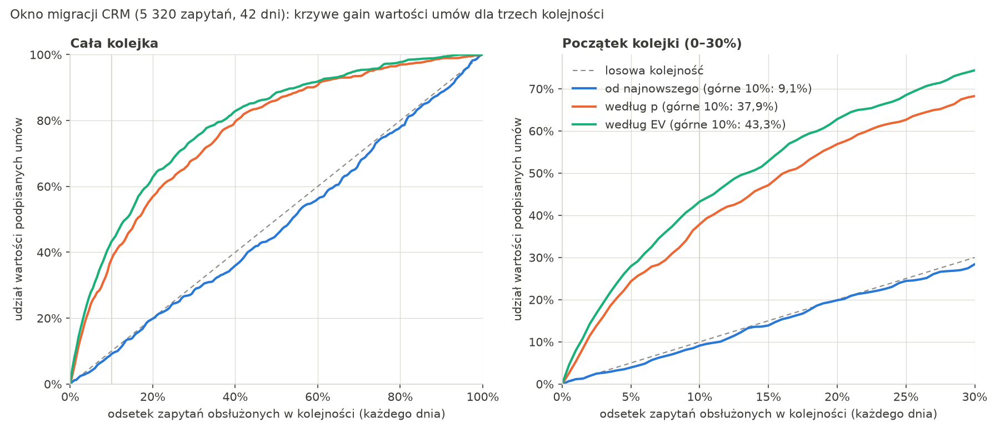

# Kolejka zapytań według pieniędzy: od najnowszego, według p, według EV (2026-11-15)

## Wnioski

1. W oknie migracji doradcy, którzy każdego dnia biorą pierwsze 10% zapytań w kolejności według wartości oczekiwanej
   (EV), trafiliby w 43,3% wartości podpisanych umów. Kolejka według samej szansy na umowę (p) daje 37,9%, a kolejka
   od najnowszego 9,1%, czyli tyle, co losowa kolejność.
2. EV wygrywa z p o 2,4–8,4 pp wartości, choć daje mniej umów (31,2% wobec 33,9%). Przesuwa doradców na zapytania
   B2B o kilka lokali (128 zapytań z więcej niż jednym lokalem w czołówce wobec 65) i prawie całkiem pomija najem
   średnioterminowy MID (3 zapytania MID w czołówce wobec 127), bo przy MID przyjmujemy krótki najem.
3. Ten sam wynik daje miara bez naszych założeń, czyli rzeczywiste wpłaty czynszu do września 2026: EV 40,9%, p 37,2%,
   różnica +0,7 … +6,7 pp. Przewaga EV nie wynika więc tylko z tego, że EV i miara mają ten sam czas najmu.
4. Kwoty EV nadają się do ułożenia kolejności, ale nie do planu przychodu. Suma EV to 18,1 mln zł, a wartość umów
   22,1 mln zł, głównie dlatego, że model w oknie zaniża szansę na umowę (suma p 440,7 wobec 559 umów; patrz
   [kalibracja.md](../api/api/ai/lead_model/evals/kalibracja.md)).
5. Najsłabszym założeniem jest czas najmu MID: 4,51 miesiąca ze średniej zakończonych najmów. Wpłaty z najmów MID
   z okna (2,93 mln zł) już przekroczyły założoną wartość tych umów (2,39 mln zł). Krzywa przeżycia z projektu
   Retencja może wpuścić część zapytań MID z powrotem do czołówki.

## Założenia (`api/api/contexts_boundaries/leasing_bc/zalozenia.yaml`)

Metodę podał użytkownik (czat 2026-11-15), a wartości policzono z `data/`
([`zalozenia_z_danych.py`](../api/api/contexts_boundaries/leasing_bc/zalozenia_z_danych.py), SQL niżej).
Test `api/tests/test_leasing_wartosc.py` sprawdza, że YAML zgadza się z danymi.

| Założenie | Wartość | Źródło | Odpowiada |
|---|---|---|---|
| `czas_najmu_mies`: spodziewany czas najmu wg linii = średnia zakończonych najmów (dni / 30,4375) | B2B 16,50 (2 990 najmów), B2C 19,01 (7 640), MID 4,51 (5 481) | `pms_najmy`; **zaniżona**, do zastąpienia krzywą przeżycia w projekcie Retencja | Natalia |
| `czynsz_mediana_pln`: mediana `czynsz_katalogowy` linii w mieście, PLN / mies. / lokal | T1 | `pms_lokale` × `pms_budynki`, stan na 2026-09-30 | brak (do uzupełnienia) |
| `godziny_doradcow`: godziny z grafiku na dzień pracy, 2025-10-01 – 2026-09-30 (302 dni pracy) | razem 66,69; Warszawa 24,38 (4 doradców), Kraków 12,19 (2), Wrocław 12,10 (2), Gdańsk 6,10 (1), Poznań 6,05 (1), Łódź 5,86 (1) | `crm_grafik` × `crm_doradcy` | brak (do uzupełnienia) |

### T1. Mediana czynszu katalogowego (PLN / mies. / lokal; w nawiasie liczba lokali)

| Miasto | B2B | B2C | MID |
|---|---:|---:|---:|
| Gdańsk | 2 795 (94) | 2 495 (512) | 3 285 (44) |
| Kraków | 2 860 (191) | 2 250 (1 048) | 3 450 (61) |
| Poznań | 2 360 (135) | 1 910 (519) | 2 850 (46) |
| Warszawa | 3 110 (525) | 2 530 (2 061) | 3 735 (314) |
| Wrocław | 2 595 (194) | 2 080 (771) | 3 270 (135) |
| Łódź | 2 200 (161) | 1 850 (389) | brak w danych (0 lokali MID) → czynsz i czas B2C |

**Decyzje wykonawcy, do potwierdzenia:**
- **Łódź/MID.** W Łodzi nie ma lokali MID, a wszystkie 67 umów z zapytań MID z Łodzi w historii CRM to najmy
  B2C (zapytanie Q7). Dlatego takie zapytania wyceniam czynszem i czasem najmu B2C (`zastepstwo` w YAML).
  W oknie dotyczy to 139 zapytań, z których żadne nie skończyło się umową.
- **Okres grafiku:** 12 miesięcy przed eksportem. W tej analizie godziny nie wchodzą do wyniku. Żeby zamienić je na
  liczbę zapytań, które doradcy obsłużą dziennie, potrzebny jest czas obsługi jednego zapytania, a tego brak
  w danych. Dlatego czołówka to umowne 10% zapytań dnia.
- **Czynsz katalogowy** to stan na dzień eksportu (2026-09-30), a okno to marzec–kwiecień 2025. Mediany czynszu
  z umów podpisanych w oknie są podobne: B2B 2 730, B2C 2 190, MID 3 335 zł (Q8).

## Metoda

- **Zbiór:** wszystkie 5 320 zapytań z okna migracji CRM (2025-03-03 – 2025-04-13, 42 dni, 63–179 zapytań dziennie,
  każde obsłużone przez call center). 559 zapytań skończyło się umową w 45 dni, podpisanych lokali jest 600.
- **p:** `v2b_lgbm_ipw` uczony do 2025-06, po kalibracji izotonicznej „kontakt” (kalibracja.md), czyli szansa na
  umowę w 45 dni po kontakcie. Remisy p rozstrzyga wynik przed kalibracją.
- **EV** ([`leasing_bc/wartosc.py`](../api/api/contexts_boundaries/leasing_bc/wartosc.py)) = p × mediana czynszu
  (miasto, linia z zapytania) × czas najmu linii × `crm_leady.liczba_lokali` (brak = 1, podawana tylko w B2B).
- **Wartość podpisanych umów** (miara główna) = Σ czynsz z umowy × czas najmu linii najmu, po umowie zapytania
  i wszystkich umowach jej umowy ramowej (jedna umowa = jeden lokal). Brak umowy = 0 zł. Kontrola: 70 umów ramowych,
  żadna nie jest wspólna dla dwóch zapytań, a umowy jednej ramowej podpisano tego samego dnia.
- **Miara kontrolna:** wpłaty (`pms_platnosci.kwota_zaplacona`) ze wszystkich umów tych najmów, z przedłużeniami, do
  2026-09. Nie używa żadnego założenia, ale jest ucięta na dniu eksportu (ok. 1,5 roku po wprowadzeniu).
- **Kolejka dzienna:** każdego dnia (data utworzenia, czas warszawski) zapytania z tego dnia w danej kolejności.
  Górne 10% to pierwsze 10% zapytań każdego dnia, a część ułamkowa zapytania liczy się proporcjonalnie. Kolejność
  „od najnowszego” sortuje malejąco po `utworzono` w obrębie dnia. Przy jednej kolejce na całe okno oznaczałaby
  po prostu ostatnie 4 dni okna. Kolejność od najnowszego to baseline.
- **95% CI:** bootstrap dni (2 000 losowań 42 dni ze zwracaniem, te same losowania dla wszystkich kolejności).

## Wyniki

### T2. Górne 10% zapytań każdego dnia (534 z 5 320 zapytań)

| Kolejność | Udział wartości umów | Wartość umów | Udział umów | Umowy | Udział wpłat do 2026-09 |
|---|---:|---:|---:|---:|---:|
| od najnowszego (baseline) | 9,1% (6,9–11,5) | 2 017 061 zł | 10,7% (8,5–13,2) | 59,9 | 9,5% (7,3–12,0) |
| według p | 37,9% (33,1–43,1) | 8 377 369 zł | **33,9%** (30,8–37,2) | 189,5 | 37,2% (32,6–42,2) |
| **według EV** | **43,3%** (37,5–49,2) | 9 570 174 zł | 31,2% (27,9–34,8) | 174,4 | **40,9%** (35,3–46,7) |
| całe okno | 100% | 22 125 916 zł | 100% | 559 | 100% = 20 001 980 zł |

Różnice (95% CI, pp):

| Para | Udział wartości umów | Udział umów | Udział wpłat |
|---|---|---|---|
| EV − p | +2,4 … +8,4 | −4,7 … −0,7 | +0,7 … +6,7 |
| EV − od najnowszego | +27,8 … +40,9 | +16,0 … +25,1 | +24,9 … +38,2 |
| p − od najnowszego | +23,0 … +34,9 | +18,7 … +27,6 | +22,2 … +33,6 |

Jedna kolejka na całe okno (górne 10% z 5 320, jak lift@10% w porownanie.md): według p 36,9% wartości i 33,8% umów,
według EV 42,8% wartości i 30,2% umów.



### T3. Kto jest w czołówce (pierwsze round(10% × n) zapytań każdego dnia, 534 zapytania)

| | Od najnowszego | Według p | Według EV |
|---|---:|---:|---:|
| zapytania B2B / B2C / MID | 48 / 292 / 194 | 151 / 256 / 127 | 232 / 299 / 3 |
| zapytania z więcej niż jednym lokalem | 20 | 65 | 128 |
| umowy | 61 | 190 | 175 |
| wartość umów B2B / B2C / MID (zł) | 425 692 / 1 295 722 / 335 499 | 3 368 053 / 4 370 589 / 669 645 | 4 694 341 / 4 885 570 / 19 934 |
| średnie p | 8,6% | 28,7% | 25,7% |
| średni EV | 3 334 zł | 13 859 zł | 15 856 zł |

### T4. Całe okno według linii z zapytania

| Linia | Zapytania | Suma p | Umowy | Lokale podpisane | Σ EV | Wartość umów | Wpłaty do 2026-09 |
|---|---:|---:|---:|---:|---:|---:|---:|
| B2B | 461 | 77,8 | 88 | 129 (deklarowane 148) | 5 991 763 zł | 5 621 809 zł | 4 990 330 zł |
| B2C | 2 938 | 225,3 | 319 | 319 | 9 860 974 zł | 14 115 115 zł | 12 078 810 zł |
| MID | 1 921 | 137,6 | 152 | 152 | 2 258 574 zł | 2 388 992 zł | 2 932 840 zł |
| razem | 5 320 | 440,7 | 559 | 600 | 18 111 311 zł | 22 125 916 zł | 20 001 980 zł |

18 zapytań B2B skończyło się umową MID (Q8 z podziałem na linię najmu: umowy B2B 111 lokali, MID 170).
W wartości umów liczy się linia najmu, a w EV linia z zapytania.

## SQL i kod

Kolejność uruchomienia (wszystko deterministyczne):

```bash
pypyr baza
cd api && poetry run python -m api.ai.lead_model.evals.kalibracja          # p w evals/wyniki/kalibracja.parquet
cd api && poetry run python -m api.contexts_boundaries.leasing_bc.zalozenia_z_danych   # wartości do zalozenia.yaml
cd api && poetry run python -m api.ai.lead_model.evals.kolejka_ev [--bez-mlflow]
poetry run pytest api/tests/test_leasing_wartosc.py
```

Wyniki: `api/api/ai/lead_model/evals/wyniki/kolejka_ev.json` (wszystkie liczby z T2–T4, krzywe),
`kolejka_ev.parquet` (p, EV, wartość umów, wpłaty dla każdego zapytania), `docs/img/kolejka_ev_gain.png`, MLflow
eksperyment `leady`, run `kolejka_ev` (`ed14a1e575dc4189ae9fccfe94cc1e80`). Zapytania uruchamiamy przez `polacz()`,
bo CLI `duckdb` 1.5 nie otworzy `domilo.duckdb`.

**Q1. Czas najmu** (`SQL_CZAS_NAJMU`; miesiące = `sredni_czas_dni` / 30,4375):

```sql
SELECT linia, count(*) AS najmy_zakonczone,
       avg(date_diff('day', data_wprowadzenia, data_wyprowadzenia)) AS sredni_czas_dni,
       median(date_diff('day', data_wprowadzenia, data_wyprowadzenia)) AS mediana_czasu_dni
FROM pms_najmy
WHERE data_wyprowadzenia IS NOT NULL AND data_wyprowadzenia <= TIMESTAMP '2026-09-30 23:59:59'
GROUP BY linia ORDER BY linia;
```

**Q2. Mediany czynszu** (`SQL_CZYNSZ`):

```sql
SELECT b.miasto, l.linia, count(*) AS lokale, median(l.czynsz_katalogowy) AS mediana_czynszu
FROM pms_lokale AS l JOIN pms_budynki AS b USING (id_budynku)
GROUP BY ALL ORDER BY ALL;
```

**Q3. Godziny doradców** (`SQL_GODZINY`):

```sql
WITH g AS (
    SELECT g.data, g.id_doradcy, d.miasto, g.godziny_pracy
    FROM crm_grafik AS g JOIN crm_doradcy AS d USING (id_doradcy)
    WHERE g.data >= DATE '2025-10-01' AND g.data < DATE '2026-10-01'
)
SELECT miasto, count(DISTINCT id_doradcy) AS doradcy, sum(godziny_pracy) AS godziny,
       (SELECT count(DISTINCT data) FROM g) AS dni_pracy,
       sum(godziny_pracy) / (SELECT count(DISTINCT data) FROM g) AS godziny_na_dzien_pracy
FROM g GROUP BY miasto ORDER BY miasto;
```

**Q4. Zapytania okna** (`SQL_OKNO` w `kolejka_ev.py`):

```sql
SELECT l.id_leada, l.utworzono, l.miasto, l.linia_pref, l.liczba_lokali, c.umowa_45d, c.id_umowy
FROM crm_leady AS l JOIN leady_cel AS c USING (id_leada)
WHERE c.okno_migracji ORDER BY l.id_leada;
```

**Q5. Umowy zapytań z całą umową ramową** (`SQL_UMOWY_ZAPYTAN` w `leasing_bc/wartosc.py`; `?` = lista
`id_leada` z umową):

```sql
WITH z AS (
    SELECT c.id_leada, u.id_umowy, u.id_umowy_ramowej
    FROM leady_cel AS c JOIN pms_umowy AS u ON u.id_umowy = c.id_umowy
    WHERE list_contains(?, c.id_leada)
)
SELECT z.id_leada, u.id_umowy, u.id_umowy_ramowej, u.id_najmu, u.czynsz, u.data_podpisania, n.linia
FROM z
JOIN pms_umowy AS u
  ON u.id_umowy = z.id_umowy OR (z.id_umowy_ramowej IS NOT NULL AND u.id_umowy_ramowej = z.id_umowy_ramowej)
JOIN pms_najmy AS n ON n.id_najmu = u.id_najmu
ORDER BY z.id_leada, u.id_umowy;
```

**Q6. Wpłaty do eksportu** (`SQL_WPLATY`; listy `id_leada` i `id_najmu` z Q5):

```sql
WITH n AS (SELECT unnest(?) AS id_leada, unnest(?) AS id_najmu)
SELECT n.id_leada, count(DISTINCT u.id_umowy) AS umowy_najmow, sum(p.kwota_zaplacona) AS wplaty,
       sum(p.kwota_nalezna) AS nalezne, max(p.miesiac) AS ostatni_miesiac
FROM (SELECT DISTINCT id_leada, id_najmu FROM n) AS n
JOIN pms_umowy AS u USING (id_najmu)
JOIN pms_platnosci AS p USING (id_umowy)
GROUP BY n.id_leada;
```

**Q7. Zapytania MID z Łodzi w całej historii CRM** (wynik: 67 umów, wszystkie to najmy B2C; w `leady_cel` te same
zapytania: 67 z umową w 45 dni, 4 341 bez umowy, 198 bez znanego wyniku):

```sql
SELECT n.linia, count(*)
FROM crm_leady AS l JOIN pms_umowy AS u ON u.id_umowy = l.id_umowy JOIN pms_najmy AS n USING (id_najmu)
WHERE l.linia_pref = 'MID' AND l.miasto = 'Łódź'
GROUP BY 1;
```

**Q8. Czynsz umów podpisanych w oknie według linii najmu** (B2B 111 umów, mediana 2 730; B2C 319, 2 190;
MID 170, 3 335):

```sql
SELECT n.linia, count(*) AS umowy, median(u.czynsz) AS mediana_czynszu_umow
FROM leady_cel AS c JOIN pms_umowy AS u0 ON u0.id_umowy = c.id_umowy
JOIN pms_umowy AS u
  ON u.id_umowy = u0.id_umowy OR (u0.id_umowy_ramowej IS NOT NULL AND u.id_umowy_ramowej = u0.id_umowy_ramowej)
JOIN pms_najmy AS n ON n.id_najmu = u.id_najmu
WHERE c.okno_migracji AND c.umowa_45d = 1
GROUP BY 1 ORDER BY 1;
```

**EV i krzywa gain** (fragmenty `leasing_bc/wartosc.py` i `kolejka_ev.py`):

```python
s = czynsz_i_czas(leady, zalozenia)            # linia z zapytania (Łódź/MID -> B2C), mediana czynszu, czas, lokale
ev = p * s["czynsz"] * s["czas_najmu_mies"] * s["lokale"]

KOLEJNOSCI = {"od_najnowszego": (["utworzono"], [False]),
              "wedlug_p": (["p", "p_przed_kalibracja"], [False, False]),
              "wedlug_ev": (["ev", "p_przed_kalibracja"], [False, False])}

def zebrane_w_dniu(g, kolejnosc, kolumna, frakcje):   # g = zapytania jednego dnia
    narastajaco = np.concatenate([[0.0], np.cumsum(_sortuj(g, kolejnosc)[kolumna].to_numpy(dtype=float))])
    return np.interp(frakcje * len(g), np.arange(len(g) + 1), narastajaco)
# krzywa(f) = Σ_dni zebrane_w_dniu(f) / Σ wartości okna; górne 10% = krzywa(0,10)
```

## Aktualizacja 2026-11-16: czas najmu z RMST60 zamiast średniej z zakończonych

Od 2026-11-16 `czas_najmu_mies` w `leasing_bc/zalozenia.yaml` to dla B2C i B2B RMST do 60 miesięcy z krzywej
Kaplana-Meiera (B2C 28,86 zamiast 19,01; B2B 18,39 zamiast 16,5), a MID bez zmian (4,51). Liczby: `docs/przezycie.md`,
sekcja „Grupy”. Wyniki z poprzednich sekcji (np. 43,3% wartości umów) liczono jeszcze na starych wartościach.

**Wnioski.**
- EV każdego zapytania B2C rośnie o 51,8%, a B2B o 11,5%.
- Kolejka przesuwa się w stronę klientów prywatnych. W kolejce z 2026-11-17 zapytania B2C zajmują 253 z 418 miejsc
  zależnych od EV zamiast 230, a B2B 163 zamiast 182.
- 24 zapytania wchodzą do kolejek, a 24 z nich wypadają.
- Zapytania MID z Łodzi też zyskują 51,8%. W Łodzi nie ma lokali MID, więc ich czynsz i czas najmu biorą
  z linii B2C (`zastepstwo` w YAML).
- Zmiana zadziała przy następnym uruchomieniu zadania kolejka-doradcow (05:30), bo `wartosc_oczekiwana` czyta YAML.

**Ranking z 2026-11-17** (2 360 zapytań w rankingu zadania, 418 miejsc według EV, czyli bez 22 pozycji losowych):

| Linia | Zapytania | Suma EV przed (zł) | Suma EV po (zł) | Zmiana | Miejsca w kolejkach przed | po |
|---|---:|---:|---:|---:|---:|---:|
| B2B | 274 | 3 168 947 | 3 531 936 | +11,5% | 182 | 163 |
| B2C | 1 267 | 4 027 681 | 6 114 617 | +51,8% | 230 | 253 |
| MID | 819 | 892 256 | 929 337 | +4,2% (tylko Łódź) | 6 | 2 |
| Razem | 2 360 | 8 088 884 | 10 575 890 | +30,7% | 418 | 418 |

**10 przykładowych zapytań z kolejek doradców 2026-11-17** (w każdej linii najwyższe pozycje; ranga = miejsce
w rankingu miasta według EV; „losowa” = jedna z 5% pozycji losowych eksperymentu, niezależnych od EV):

| Doradca / pozycja | Zapytanie | Miasto | Linia | Lokale | p | EV przed (zł) | EV po (zł) | Zmiana | Ranga przed → po |
|---|---|---|---|---:|---:|---:|---:|---:|---|
| D06 / 3 | L161548 | Poznań | B2C | 1 | 0,474 | 17 198 | 26 109 | +8 911 (+51,8%) | 3 → 2 |
| D09 / 3 | L160324 | Kraków | B2C | 1 | 0,420 | 17 983 | 27 301 | +9 318 (+51,8%) | 6 → 5 |
| D03 / 4 (losowa) | L160556 | Warszawa | B2C | 1 | 0,016 | 763 | 1 158 | +395 (+51,8%) | 682 → 643 |
| D05 / 4 | L159857 | Wrocław | B2C | 1 | 0,420 | 16 624 | 25 238 | +8 614 (+51,8%) | 7 → 4 |
| D01 / 1 | L160439 | Warszawa | B2B | 6 | 0,231 | 71 122 | 79 268 | +8 147 (+11,5%) | 1 → 1 |
| D02 / 1 | L156143 | Warszawa | B2B | 5 | 0,231 | 59 268 | 66 057 | +6 789 (+11,5%) | 2 → 2 |
| D03 / 1 | L160948 | Warszawa | B2B | 5 | 0,198 | 50 812 | 56 632 | +5 820 (+11,5%) | 3 → 3 |
| D04 / 1 | L159646 | Kraków | B2B | 4 | 0,179 | 33 861 | 37 739 | +3 879 (+11,5%) | 1 → 1 |
| D11 / 5 (losowa) | L160951 | Łódź | MID | 1 | 0,020 | 719 | 1 091 | +373 (+51,8%) | 133 → 133 |
| D10 / 30 | L160837 | Wrocław | MID | 1 | 0,326 | 4 808 | 4 808 | 0 (0,0%) | 58 → 84 |

Brak `liczba_lokali` w zapytaniu oznacza 1 lokal. Wrocławskie zapytanie MID zachowuje EV, ale spada o 26 miejsc,
bo zapytania B2C przed nim zyskały. Na górze kolejek w Warszawie i Krakowie zostają duże zapytania B2B z kilkoma
lokalami: ich EV nadal jest najwyższe.

**Kod.** `cd api && poetry run python -m api.ai.lead_model.evals.ev_czas_najmu`
([`ev_czas_najmu.py`](../api/api/ai/lead_model/evals/ev_czas_najmu.py), wynik:
`api/api/ai/lead_model/evals/wyniki/ev_czas_najmu.json`). „Przed” i „po” liczy `zalozenia_z_danych.policz`
(`czas_najmu_naiwny` i `czas_najmu_mies`). EV „przed” odtwarza `ev_pln` zapisane przez zadanie z dokładnością do
0,13 zł (zaokrąglenia). Ranking pochodzi z `kolejka_ranking` (`zrodlo_kolejki = 'zadanie'`, najnowszy dzień) z linią
i lokalami z `crm_leady`. Pozycje losowe i liczba miejsc według EV pochodzą z `kolejka_historia` (`losowa`).

