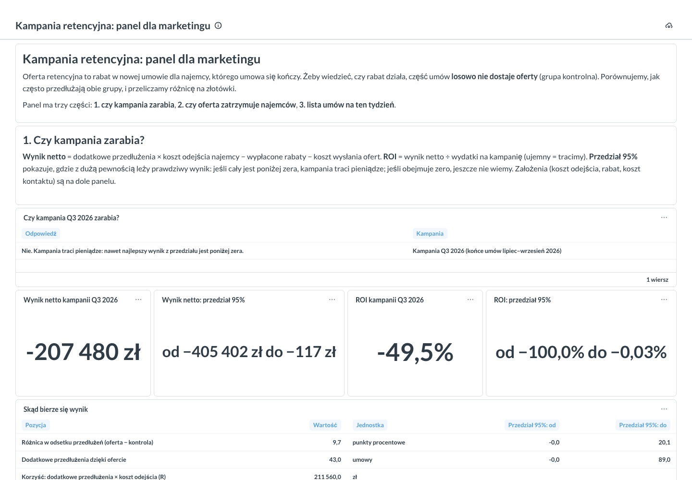
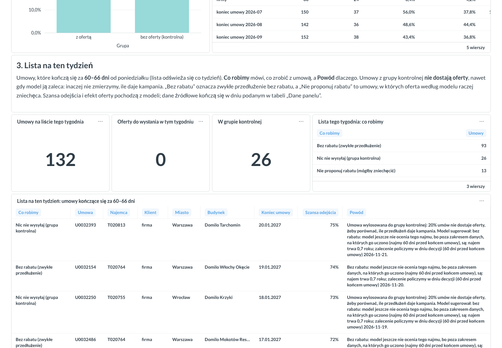

# Panel kampanii retencyjnej w Metabase (dla marketingu)

Stan: 2026-11-16. Adres panelu (lokalnie, bez logowania):
**http://localhost:3300/public/dashboard/4f8c25b0-efea-4eac-bb42-36614d679f09**.
Wersja z edycją (po zalogowaniu): http://localhost:3300/dashboard/2, konto `admin@domilo.local`, hasło w
`dev/metabase/.env` (poza gitem). Start i konfiguracja: `pypyr metabase`.

## Wnioski

1. **Panel odpowiada na pytanie „czy kampania zarabia” jednym zdaniem z danych.** Dla kampanii Q3 2026 odpowiedź
   brzmi: nie. Wynik netto to −207 480 zł (przedział 95%: od −405 402 zł do −117 zł), a ROI −49,5%.
2. **Oferta podnosi odsetek przedłużeń z 39,6% do 49,3%,** ale grupa bez oferty liczy tylko 111 umów, więc różnica
   może wynosić od 0 do 20 punktów procentowych. Panel pokazuje to na wykresie i w tabeli z przedziałami.
3. **Lista na ten tydzień ma 132 umowy, w tym 0 ofert do wysłania i 26 umów w grupie kontrolnej.** Każda umowa
   ma prostą instrukcję („Co robimy”) i powód w jednym zdaniu. Cotygodniowe zadanie `lista-retencyjna` odświeża
   ją samo, bez ręcznego kroku w Metabase.
4. **Metabase nie łączy się z `domilo.duckdb` wprost.** Sterownik DuckDB dla Metabase ma DuckDB 1.5 i nie czyta
   pliku w formacie 2.0, a otwarta baza blokowałaby zapis zadaniom. Panel czyta więc pliki Parquet budowane
   z `domilo.duckdb`, a nowe dane widać przy następnym otwarciu panelu.





## Wyniki

### Co pokazuje panel (stan po zadaniu z 2026-11-16)

| Część | Karta | Wartość w panelu | Źródło (tabela panelu) |
|---|---|---|---|
| 1. Czy kampania zarabia? | Czy kampania Q3 2026 zarabia? | „Nie. Kampania traci pieniądze: nawet najlepszy wynik z przedziału jest poniżej zera.” | `kampania_podsumowanie` |
| | Wynik netto kampanii Q3 2026 | −207 480 zł | `kampania_podsumowanie` |
| | Wynik netto: przedział 95% | od −405 402 zł do −117 zł | `kampania_podsumowanie` |
| | ROI kampanii Q3 2026 | −49,5% | `kampania_podsumowanie` |
| | ROI: przedział 95% | od −100,0% do −0,03% | `kampania_podsumowanie` |
| | Skąd bierze się wynik | 43,0 dodatkowych przedłużeń; korzyść 211 560 zł; rabaty −392 400 zł; kontakt −26 640 zł | `kampania_wynik` |
| 2. Czy oferta zatrzymuje najemców? | Odsetek przedłużeń (wykres) i Przedłużenia w grupach | z ofertą 49,3% (219 z 444; 44,6–53,8%), bez oferty 39,6% (44 z 111; 30,6–48,6%) | `kampania_grupy` |
| | Efekt oferty w grupach klientów i miesiącach | prywatni +11,2 p.p., firmy −0,8 p.p., miesiące +18,2 / +4,1 / +6,6 p.p. | `kampania_segmenty` |
| 3. Lista na ten tydzień | Umowy na liście / Oferty do wysłania / W grupie kontrolnej | 132 / 0 / 26 | `lista_tydzien` |
| | Lista tego tygodnia: co robimy | bez rabatu 93, nic nie wysyłaj (kontrola) 26, nie proponuj rabatu 13 | `lista_tydzien` |
| | Lista na ten tydzień | 132 umowy: co robimy, umowa, najemca, klient, miasto, budynek, koniec umowy, szansa odejścia, powód | `lista_tydzien` |
| Założenia i dane | Założenia do wyniku w złotówkach | R = 4 920 zł (Monika Lis), D = 1 800 zł, k = 60 zł (Joanna Michalak) | `zalozenia` |
| | Dane panelu | lista z 16.11.2026, dane źródłowe do 30.09.2026 | `panel_info` |

Liczby kampanii pochodzą z `retention_bc/wyniki/kampania_2026q3.json`
([kampania_2026q3.md](kampania_2026q3.md)), a lista z tabeli `lista_retencyjna`
([lista_retencyjna.md](lista_retencyjna.md)).

### Słownik decyzji na liście

| Co robimy | Kiedy |
|---|---|
| Wyślij ofertę rabatową | grupa objęta kampanią i zalecenie modelu „rabat” (`wyslac_oferte`) |
| Nic nie wysyłaj (grupa kontrolna) | umowa wylosowana do 20% kontroli; powód zaczyna się od wyjaśnienia losowania i podaje, co sugerował model |
| Nie proponuj rabatu (mógłby zniechęcić) | zalecenie modelu „nie budzić” (oferta obniża szansę przedłużenia) |
| Bez rabatu (zwykłe przedłużenie) | pozostałe; także umowy, których model jeszcze nie ocenia (cechy poza zakresem danych uczących) |

W powodach panel zamienia żargon na zwykły język: „w dniu migawki” → „w dniu decyzji (60 dni przed końcem umowy)”,
„Nie budzić:” → „Nie proponuj rabatu:”.

### Jak to działa

| Element | Co robi |
|---|---|
| `retention_bc/panel_kampanii.py` | buduje 7 tabel panelu i zapisuje je jako `dev/metabase/dane/<tabela>.parquet` (plik obok + `os.replace`) |
| zadanie `lista-retencyjna` | ostatni krok `panel-kampanii` odświeża pliki po zapisie listy (co poniedziałek o 07:00) |
| `dev/metabase/Dockerfile`, `compose.yaml` | Metabase v0.63.17 na `eclipse-temurin:21-jre-jammy`, bo oficjalny obraz (Alpine) nie ma `libstdc++` dla DuckDB; port 3300 |
| sterownik | `motherduckdb/metabase_duckdb_driver` 1.5.6.0 (obsługuje Metabase 0.62.19 i 0.63.17), sha256 sprawdzany przy pobraniu |
| baza w Metabase | DuckDB `:memory:`; Init SQL tworzy dla każdego pliku widok `read_parquet('/dane/<plik>')`, więc każde zapytanie czyta bieżący plik |
| `dev/metabase/konfiguruj.py` | idempotentnie przez API: konto, język polski, liczby „1 000,5”, baza, kolekcja, 16 kart SQL, układ panelu, link publiczny |

Sprawdzenia (2026-11-16):

- DuckDB 1.5 nie otwiera `domilo.duckdb`: „Trying to read a database file with version number 69, but we can only
  read versions between 64 and 68”. To powód, dla którego panel czyta Parquet.
- Pierwsza wersja z kopią bazy w formacie 1.5 nie działała po odświeżeniu: Metabase trzymał otwarty stary plik
  (błąd „column odswiezono not found”). Po przejściu na Parquet przebudowa danych zmieniła godzinę w karcie
  „Dane panelu” z 02:58 na 03:00 bez żadnej zmiany w Metabase, a zadanie `lista_retencyjna` na 03:05.
- Wszystkie 16 kart wykonuje się bez błędu (konfiguruj.py przerywa się, gdy któraś zwróci błąd).

## SQL i kod

```bash
poetry run pypyr metabase            # dane panelu, sterownik, kontener, konfiguracja; wypisuje adresy
poetry run pypyr lista_retencyjna    # lista tygodnia + odświeżenie panelu (krok panel-kampanii)
poetry run pytest -q api/tests/test_panel_kampanii.py api/tests/test_lista_retencyjna.py
docker compose -f dev/metabase/compose.yaml down   # zatrzymanie Metabase (stan zostaje w dev/metabase/stan/)
```

Lista tygodnia (`panel_kampanii.SQL_LISTY` na `domilo.duckdb`):

```sql
SELECT l.*, b.miasto, b.nazwa AS budynek
FROM lista_retencyjna AS l
JOIN pms_najmy AS n USING (id_najmu)
JOIN pms_lokale AS lo ON lo.id_lokalu = n.id_lokalu
JOIN pms_budynki AS b ON b.id_budynku = lo.id_budynku
WHERE l.data_listy = (SELECT max(data_listy) FROM lista_retencyjna)
ORDER BY l.wyslac_oferte DESC, l.ryzyko DESC, l.id_umowy;
```

Init SQL bazy w Metabase (generuje `konfiguruj.py` z plików w `dev/metabase/dane/`):

```sql
CREATE OR REPLACE VIEW kampania_grupy AS SELECT * FROM read_parquet('/dane/kampania_grupy.parquet');
-- … tak samo dla kampania_podsumowanie, kampania_segmenty, kampania_wynik, lista_tydzien, panel_info, zalozenia
```

Przykładowe karty (pełna lista: `KARTY` w `dev/metabase/konfiguruj.py`):

```sql
-- Czy kampania Q3 2026 zarabia?
SELECT czy_kampania_zarabia AS "Odpowiedź", kampania AS "Kampania" FROM kampania_podsumowanie;
-- Wynik netto: przedział 95%
SELECT 'od ' || replace(replace(format('{:,.0f}', wynik_netto_od_zl), ',', ' '), '-', '−') || ' zł do '
       || replace(replace(format('{:,.0f}', wynik_netto_do_zl), ',', ' '), '-', '−') || ' zł' AS "Przedział"
FROM kampania_podsumowanie;
-- Przedłużenia w grupach
SELECT grupa AS "Grupa", umowy AS "Umowy", przedluzenia AS "Przedłużenia", odsetek_przedluzen AS "Odsetek przedłużeń",
       przedzial_od AS "Przedział 95%: od", przedzial_do AS "Przedział 95%: do"
FROM kampania_grupy ORDER BY kolejnosc;
-- Oferty do wysłania w tym tygodniu
SELECT count(*) FILTER (WHERE wyslac_oferte) AS "Oferty" FROM lista_tydzien;
-- Lista na ten tydzień
SELECT co_robimy AS "Co robimy", id_umowy AS "Umowa", id_najemcy AS "Najemca", rodzaj_klienta AS "Klient",
       miasto AS "Miasto", budynek AS "Budynek", strftime(koniec_umowy, '%d.%m.%Y') AS "Koniec umowy",
       szansa_odejscia AS "Szansa odejścia", powod AS "Powód"
FROM lista_tydzien ORDER BY wyslac_oferte DESC, szansa_odejscia DESC, id_umowy;
```

Werdykt „czy kampania zarabia” (`panel_kampanii.werdykt`): górna granica przedziału wyniku netto < 0 → „Nie”, dolna
> 0 → „Tak”, w pozostałych przypadkach „Nie wiadomo”.
