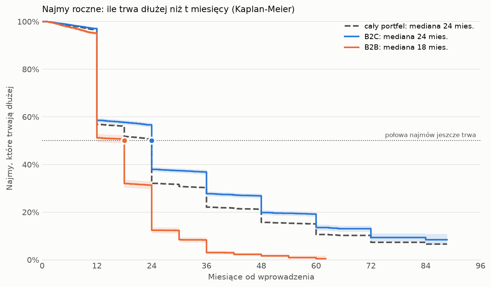
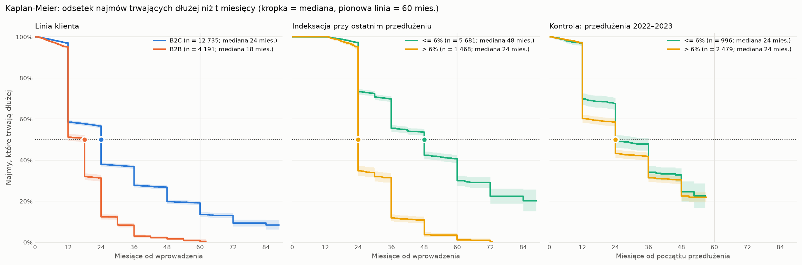

# Czas najmu: ile miesięcy zostaje najemca (tabela `czas_najmu`, Kaplan-Meier)

Stan danych: eksport 2026-09-30 23:59 Europe/Warsaw; tabela zbudowana w `domilo.duckdb` 2026-11-16
(`cd api && poetry run python -m api.ai.features.najemcy.czas_najmu`, także krok `pypyr baza`), analiza:
`cd api && poetry run python -m api.ai.churn_model.evals.przezycie` (wyniki:
[`api/api/ai/churn_model/evals/wyniki/przezycie.json`](../api/api/ai/churn_model/evals/wyniki/przezycie.json)).

## Wnioski

1. W dniu eksportu trwa jeszcze 6 296 z 16 926 najmów rocznych (37,20%). Nie wiemy, kiedy się skończą, więc każda
   liczba „ile trwa najem” zależy od tego, co z nimi zrobimy.
2. Obie proste średnie zaniżają czas najmu: średnia z zakończonych najmów to 18,33 mies., a średnia z dzisiejszym
   stażem dla aktywnych 19,82 mies. Pierwsza pomija najemców, którzy zostają najdłużej, a druga ucina ich staż
   na dniu eksportu. Krzywa Kaplana-Meiera wykorzystuje informację „ten najem trwa już co najmniej X miesięcy”
   i daje medianę 24 mies. Porównywalna średnia z tej krzywej (w horyzoncie 4 lat) to 24,61 mies., czyli
   o 5–6 miesięcy więcej niż proste średnie.
3. Mediana 24 mies. leży na granicy: tuż przed końcem drugiego roku trwa jeszcze 50,83% najmów. Do rozmowy
   z biznesem lepiej nadają się dwie liczby: 56,81% najemców zostaje po pierwszym roku, a 32,08% po drugim.
4. Klienci firmowi (B2B) zostają krócej: mediana 18 mies., po dwóch latach zostaje 12,39% najmów wobec 37,96%
   w B2C. Model „po ilu miesiącach odejdzie” musi rozróżniać obie linie.
5. Najemcy z lat 2022–2024 częściej zostają po pierwszym roku (56,38–63,03%) niż najemcy z lat 2019–2021
   (44,31–50,13%). Dalsza część krzywej (po 3–4 latach) opiera się wyłącznie na starszych najmach, więc dla
   dzisiejszych najemców prawdopodobnie zaniża czas najmu.

To analiza opisowa, a nie model. Nie ma więc porównania z baseline w `evals/porownanie.md`. Model czasu do
odejścia (np. Cox albo model dyskretny po okresach umowy) będzie potrzebował własnego baseline, a punktem
odniesienia może być ta krzywa.



*Wykres: odsetek najmów trwających dłużej niż t miesięcy. Pasma to 95% przedział dla B2C i B2B, a kropki
oznaczają medianę (cały portfel i B2C mają ją w tym samym punkcie, 24 mies.). Plik: `docs/img/przezycie_km.png`.*

## Definicja tabeli `czas_najmu`

Jeden wiersz to jeden najem z `pms_najmy` (ciągły najem lokalu przez najemcę). SQL:
[`api/api/ai/features/najemcy/czas_najmu.sql`](../api/api/ai/features/najemcy/czas_najmu.sql), budowa:
`api/api/ai/features/najemcy/czas_najmu.py`, testy: `api/tests/test_czas_najmu.py`.

| Kolumna / element | Definicja |
|---|---|
| Populacja | `pms_najmy.linia` = `B2C` albo `B2B` (najem zaczyna umowa roczna; pierwsza umowa B2B może mieć 18 lub 24 mies.) i `data_wprowadzenia` ≤ 2026-09-30 |
| Pominięte | linia `MID` (umowy średnioterminowe); najmy z `data_wprowadzenia` po dniu eksportu (podpisane, ale jeszcze się nie zaczęły, więc nie mają czasu obserwacji) |
| `zdarzenie` | 1: najem zakończony (`data_wyprowadzenia` wpisana, w tym przeprowadzka do innego lokalu Domilo); 0: najem aktywny, obserwacja ucięta (cenzurowana) na 2026-09-30 |
| `data_konca` | `data_wyprowadzenia` albo 2026-09-30 |
| `dni` | (`data_konca` + 1 dzień) − `data_wprowadzenia`: oba końce liczone włącznie, bo `data_wyprowadzenia` to ostatni dzień najmu, a eksport jest z 23:59 |
| `miesiace` | pełne miesiące kalendarzowe od `data_wprowadzenia` do `data_konca` + 1 dzień plus ułamek kolejnego miesiąca (dni / liczba dni tego miesiąca). Umowa 2019-09-08 – 2020-09-07 daje dokładnie 12,0 |
| `import_pms` | `data_wprowadzenia` < 2023-03-01 (rekord z importu do PMS) |
| pozostałe | `id_najmu`, `id_najemcy`, `id_lokalu`, `linia`, `data_wprowadzenia`, `rok_wprowadzenia`, `data_wyprowadzenia`, `powod_odejscia` |

Decyzje:

- **Miesiące kalendarzowe zamiast dni / 30,44.** Zakończone najmy kończą się w zdecydowanej większości dokładnie na
  końcu okresu umowy, czyli po całkowitej liczbie miesięcy (9 741 z 10 630). Przy dzieleniu dni przez średnią
  długość miesiąca ten sam koniec umowy wypadałby raz na 11,99, a raz na 12,02 mies. (lata przestępne), a mediana
  wychodziłaby „krzywa”. Kolumna `dni` zostaje do innych analiz.
- **Najmy jeszcze niezaczęte pomijamy** (282 w B2C i B2B): nie wnoszą żadnego czasu obserwacji, a z czasem 0 lub
  ujemnym zaburzyłyby krzywą.
- **Przeprowadzka do innego lokalu Domilo kończy najem** (`zdarzenie` = 1), bo jednostką jest najem lokalu, a nie
  klient. Dla pytania „ile trwa klient” trzeba by łączyć najmy po `id_najemcy`.
- Najmy z importu PMS (6 930 z `data_wprowadzenia` < 2023-03-01) zostają. PMS zaczyna się w 2019-04, a w pierwszym
  miesiącu wprowadziło się tylko 41 najemców (bez skoku), więc nic nie wskazuje, że import pominął najmy zaczęte
  wcześniej, czyli lewego ucięcia historii.
- **lifelines** 0.30.3 (najnowsza wersja) deklaruje `pandas < 3`, a projekt używa pandas 3.1. Pozostałe zależności
  lifelines są w `pyproject.toml`, a samą bibliotekę instaluje bez zależności krok `pypyr install`
  (`pip install --no-deps lifelines==0.30.3`). Test porównuje krzywą lifelines z ręcznie policzonym przykładem
  i przechodzi na pandas 3.1.1.

## Wyniki

### Cenzura

| Grupa | Najmy | Zakończone | Aktywne (cenzurowane) | Odsetek cenzurowanych |
|---|---:|---:|---:|---:|
| Wszystkie | 16 926 | 10 630 | 6 296 | 37,20% |
| B2C | 12 735 | 7 640 | 5 095 | 40,01% |
| B2B | 4 191 | 2 990 | 1 201 | 28,66% |

Aktywne najmy nie są „młode”: ich dotychczasowy staż to średnio 22,34 mies. (mediana 17,9), a zakończonych najmów
średnio 18,33 mies. (mediana 12,0). Wśród aktywnych jest wielu najemców, którzy przedłużali umowę kilka razy.

### Trzy liczby (w miesiącach)

| Grupa | Średnia tylko z zakończonych | Średnia z dzisiejszym stażem aktywnych | Mediana Kaplan-Meier (95% przedział) |
|---|---:|---:|---:|
| Wszystkie | 18,33 | 19,82 | **24** (24–24) |
| B2C | 19,04 | 21,41 | **24** (24–24) |
| B2B | 16,54 | 15,00 | **18** (12–18) |

Żeby nie porównywać średniej z medianą, poniżej każde podejście w obu wersjach. „Do 48 mies.” oznacza czas ucięty na
4 latach. Dla KM to pole pod krzywą do 48 mies. (RMST), dla prostych podejść średnia z `least(miesiace, 48)`.

| Grupa | Podejście | Średnia | Średnia do 48 mies. | Mediana |
|---|---|---:|---:|---:|
| Wszystkie | tylko zakończone | 18,33 | 18,17 | 12,00 |
| Wszystkie | dzisiejszy staż aktywnych | 19,82 | 19,34 | 12,00 |
| Wszystkie | Kaplan-Meier | brak w danych¹ | **24,61** | **24** |
| B2C | tylko zakończone | 19,04 | 18,81 | 12,00 |
| B2C | dzisiejszy staż aktywnych | 21,41 | 20,78 | 13,03 |
| B2C | Kaplan-Meier | brak w danych¹ | **26,51** | **24** |
| B2B | tylko zakończone | 16,54 | 16,53 | 12,00 |
| B2B | dzisiejszy staż aktywnych | 15,00 | 14,98 | 12,00 |
| B2B | Kaplan-Meier | brak w danych¹ | **18,24** | **18** |

¹ Pełnej średniej z KM nie da się policzyć: najdłuższa obserwacja to 88,67 mies., a krzywa nie spada tam do zera.

### Ile najmów trwa dłużej niż t miesięcy (Kaplan-Meier)

| Grupa | tuż przed 12 | > 12 | tuż przed 24 | > 24 | > 36 | > 48 |
|---|---:|---:|---:|---:|---:|---:|
| Wszystkie | 96,62% | 56,81% | 50,83% | 32,08% | 22,10% | 15,69% |
| B2C | 97,09% | 58,52% | 56,65% | 37,96% | 27,75% | 19,83% |
| B2B | 95,14% | 51,23% | 31,35% | 12,39% | 3,03% | 1,65% |

### Rok wprowadzenia

| Rok | Najmy | Aktywne | Odsetek aktywnych | Średnia z zakończonych | KM > 12 mies. | KM > 24 mies. | Mediana KM |
|---|---:|---:|---:|---:|---:|---:|---:|
| 2019 | 334 | 12 | 3,59% | 22,59 | 44,31% | 26,35% | 12,00 |
| 2020 | 744 | 52 | 6,99% | 22,06 | 50,13% | 28,76% | 13,58 |
| 2021 | 2 227 | 217 | 9,74% | 20,32 | 49,17% | 26,18% | 12,00 |
| 2022 | 3 118 | 556 | 17,83% | 19,62 | 56,38% | 32,68% | 24,00 |
| 2023 | 3 378 | 903 | 26,73% | 18,69 | 63,03% | 35,91% | 24,00 |
| 2024 | 2 619 | 1 032 | 39,40% | 15,03 | 59,26% | 34,19% | 24,00 |
| 2025 | 2 679 | 1 738 | 64,87% | 11,68 | 57,68% | brak w danych | 18,00 |
| 2026 | 1 827 | 1 786 | 97,76% | 3,58 | brak w danych | brak w danych | brak w danych |

## Dlaczego te trzy liczby się różnią

**Średnia tylko z zakończonych (18,33 mies.) jest zaniżona z dwóch powodów.** Po pierwsze, wyrzuca 37,20% najmów,
które jeszcze trwają, a to głównie najemcy, którzy już przedłużali umowę: ich staż to średnio 22,34 mies. i będzie
rósł. Po drugie, z najnowszych roczników do średniej trafiają tylko najmy, które skończyły się szybko. Z 2026 roku
mamy średnio 3,58 mies. (zerwane w trakcie pierwszej umowy), z 2025 roku 11,68 mies., a z 2019 roku 22,59 mies.
Im krótszy czas obserwacji, tym bardziej zaniżona średnia. Wynik zależy więc od tego, kiedy zrobiono eksport,
a nie tylko od zachowania najemców.

**Średnia z dzisiejszym stażem (19,82 mies.) liczy aktywnych, ale traktuje dzień eksportu tak, jakby był dniem
wyprowadzki.** To dolna granica: każdy aktywny najem potrwa co najmniej tyle. Kierunek błędu wobec średniej
z zakończonych zależy od tego, kim są aktywni. W B2C aktywni mają już średnio 24,97 mies. stażu (wieloletni
najemcy), więc średnia rośnie (19,04 → 21,41). W B2B aktywne najmy są młode (średnio 11,17 mies.), więc średnia
spada (16,54 → 15,00). Metoda zaniża więc obie linie, ale w różnym stopniu, i sztucznie powiększa różnicę między
B2C a B2B. Model uczony na takim celu przejąłby ten błąd.

**Kaplan-Meier (mediana 24 mies.) wykorzystuje każdy miesiąc obserwacji.** Aktywny najem liczy się jako „przetrwał
do dziś”, a później wypada z grupy obserwowanych, zamiast udawać zakończenie. Tak liczony odsetek przedłużeń po
pierwszym roku to 56,81%. Obie proste mediany wynoszą 12, bo ponad połowa zakończonych najmów (5 747 z 10 630)
kończy się po pierwszej umowie, a aktywni ze stażem poniżej 12 mies. dorzucają krótkie czasy. Porównując średnią
ze średnią w tym samym horyzoncie 4 lat: KM daje 24,61 mies., a proste podejścia 18,17 i 19,34 mies.

**Na co uważać przy medianie KM:**

- Krzywa spada schodkowo na końcach umów (12, 24, 36… mies.; w B2B także 18 i 30). Mediana to pierwszy schodek
  poniżej 50%, więc zawsze wypada na końcu jakiejś umowy, a jej przedział bywa zerowy (24–24). Tuż przed 24. mies.
  trwa jeszcze 50,83% najmów: gdyby spadło to o kilka punktów poniżej 50%, mediana przeskoczyłaby z 24 na moment
  między 12 a 24 mies. (np. 18, jak w B2B i w roczniku 2025). Dla B2B przedział 12–18 pokazuje to samo.
  Stabilniejsze są odsetki „> 12” i „> 24 mies.”.
- KM zakłada, że najmy ucięte eksportem zachowałyby się jak te obserwowane dłużej. Tutaj cenzura wynika tylko
  z daty eksportu (nie z decyzji najemcy), ale roczniki różnią się: po pierwszym roku zostaje 44,31–50,13% najemców
  z lat 2019–2021 i 56,38–63,03% z lat 2022–2024. Część krzywej po 36–48 mies. pochodzi tylko ze starszych
  roczników (przy 60 mies. obserwujemy jeszcze 311 najmów, przy 84 mies. 10), więc dla obecnych najemców
  prawdopodobnie zaniża czas najmu. Model czasu do odejścia powinien mieć rocznik (albo okres) jako cechę.
- 915 zakończonych najmów skończyło się przed końcem umowy (wypowiedzenie w trakcie). Dają łagodne spadki krzywej
  między schodkami.

## Grupy: linia klienta i indeksacja przy ostatnim przedłużeniu



*Wykres `docs/img/przezycie_km_grupy.png`: pasma to 95% przedział, kropka to mediana. W prawym panelu obie
mediany wypadają w tym samym punkcie (24 mies.).*

**Naiwne średnie z `leasing_bc/zalozenia.yaml` (`czas_najmu_mies`: B2C 19,01, B2B 16,5 mies.) są niższe od RMST
do 60 mies. o 9,85 mies. (51,8%) w B2C i o 1,89 mies. (11,5%) w B2B. RMST ucina czas najmu na 5 latach, więc
prawdziwe niedoszacowanie jest co najmniej tak duże.**

S(t) to odsetek najmów trwających dłużej niż t miesięcy. RMST do 60 mies. to średni czas najmu w pierwszych 5 latach
(pole pod krzywą). Czas liczony od wprowadzenia.

| Grupa | Najmy | Aktywne | S(12) | S(24) | Mediana KM (95% przedział) | RMST do 60 mies. |
|---|---:|---:|---:|---:|---:|---:|
| B2C | 12 735 | 5 095 | 58,52% | 37,96% | 24 (24–24) | 28,86 |
| B2B | 4 191 | 1 201 | 51,23% | 12,39% | 18 (12–18) | 18,39 |
| Indeksacja przy ostatnim przedłużeniu ≤ 6% | 5 681 | 3 527 | 100,00%² | 73,30% | 48 (48–48) | 43,98 |
| Indeksacja przy ostatnim przedłużeniu > 6% | 1 468 | 101 | 100,00%² | 34,78% | 24 (24–24) | 29,48 |
| *bez przedłużenia (dla porządku)* | 9 777 | 2 668 | 14,46% | 0,00% | 12 (12–12) | 12,81 |

² S(12) = 100% wynika z definicji grupy, a nie z danych: przedłużenie ma tylko najem, który przetrwał pierwszą umowę
(najkrótszy czas w grupach: 12,03 i 12,37 mies.).

**Różnica 14,5 mies. RMST między grupami indeksacji nie mierzy wpływu podwyżki.** Grupę wyznacza się dopiero po
fakcie. Indeksacje > 6% to prawie wyłącznie przedłużenia z lat 2022–2023 (tabela niżej), więc „ostatnie
przedłużenie > 6%” oznacza najczęściej najem, który po 2022–2023 już się nie przedłużył. Kto przedłużał dalej, ma
ostatnie przedłużenie z lat 2024–2026, zwykle z indeksacją ≤ 6%. Stąd tylko 101 aktywnych najmów w grupie > 6%
wobec 3 527 w grupie ≤ 6%.

| Rok początku ostatniego przedłużenia | ≤ 6% | > 6% |
|---|---:|---:|
| 2020 | 47 | 0 |
| 2021 | 141 | 11 |
| 2022 | 77 | 403 |
| 2023 | 224 | 583 |
| 2024 | 874 | 312 |
| 2025 | 1 684 | 98 |
| 2026 | 2 634 | 61 |

**Kontrola bez tego obciążenia:** każde przedłużenie z lat 2022–2023 (obie grupy są wtedy liczne) z czasem od
początku przedłużenia, a grupa to indeksacja tego przedłużenia, znana w chwili podpisania. S(12) oznacza tu, że
najem trwał dłużej niż 12 mies. od przedłużenia, czyli zwykle przedłużono go ponownie. Jeden najem może mieć kilka
wierszy (średnio 1,26), więc przedziały są za wąskie.

| Przedłużenia | Indeksacja | Przedłużenia (wiersze) | Aktywne | S(12) | S(24) | Mediana KM | RMST do 60 mies. |
|---|---|---:|---:|---:|---:|---:|---:|
| 2022–2023, obie linie | ≤ 6% | 996 | 354 | 69,78% | 49,10% | 24 (24–36) | 32,67 |
| 2022–2023, obie linie | > 6% | 2 479 | 755 | 60,23% | 43,20% | 24 (24–24) | 30,41 |
| 2022, B2C | ≤ 6% | 193 | 50 | 63,21% | 49,22% | 24 | 31,54 |
| 2022, B2C | > 6% | 974 | 229 | 61,60% | 42,81% | 24 | 30,24 |
| 2023, B2C | ≤ 6% | 729 | 298 | 74,62% | 52,81% | 36 | 35,65 |
| 2023, B2C | > 6% | 1 376 | 525 | 64,10% | 47,24% | 24 | 33,45 |
| 2023, B2B | ≤ 6% | 66 | 6 | 40,91% | 12,12% | 12 | 20,03 |
| 2023, B2B | > 6% | 100 | 1 | 11,00% | 4,00% | 12 | 13,92 |

B2B z 2022 roku (8 i 29 przedłużeń) pomijamy, bo grupy są za małe. Wniosek z kontroli: po przedłużeniu
z indeksacją > 6% kolejne przedłużenie zdarza się rzadziej, ale różnica RMST to 2,26 mies. (32,67 wobec 30,41),
a nie 14,5 mies. W B2C zmienia się też z roku na rok: S(12) różni się o 1,6 p.p. w 2022 roku i o 10,5 p.p.
w 2023 roku. To nadal porównanie, a nie przyczyna, bo nie wiemy, dlaczego danemu najemcy dano wyższą
indeksację (np. niski czynsz wyjściowy lub budynek).

## SQL i kod

Budowa tabeli i analiza (z katalogu głównego repozytorium):

```bash
pypyr baza                                                  # przebudowa bazy, krok czas_najmu
cd api && poetry run python -m api.ai.features.najemcy.czas_najmu      # albo tylko tabela
cd api && poetry run python -m api.ai.churn_model.evals.przezycie       # JSON z wynikami + wykres
cd api && poetry run pytest tests/test_czas_najmu.py                    # testy definicji i KM
cd api && poetry run python -m api.ai.churn_model.evals.przezycie_grupy # grupy: JSON + przezycie_km_grupy.png
cd api && poetry run pytest tests/test_przezycie_grupy.py               # testy grup i porównania z założeniami
```

Grupy (sekcja „Grupy: linia klienta i indeksacja”):

- [`api/api/ai/features/najemcy/indeksacja_ostatnia.sql`](../api/api/ai/features/najemcy/indeksacja_ostatnia.sql):
  `czas_najmu` + indeksacja przedłużenia z najwyższym `nr_okresu` i `data_od` ≤ 2026-09-30 (8 przedłużeń zaczyna
  się po eksporcie), `grupa_indeksacji` = `<= 6%` (z 6,0 włącznie) / `> 6%` / `bez przedłużenia`.
- [`api/api/ai/features/najemcy/okresy_przedluzen.sql`](../api/api/ai/features/najemcy/okresy_przedluzen.sql):
  kontrola, czyli jeden wiersz na przedłużenie B2C / B2B z `data_od` ≤ 2026-09-30, czas od `data_od` liczony
  tak samo jak w `czas_najmu.sql`.
- [`api/api/ai/churn_model/evals/przezycie_grupy.py`](../api/api/ai/churn_model/evals/przezycie_grupy.py):
  `metryki_km()` liczy S(12), S(24), medianę z przedziałem i `restricted_mean_survival_time(km, t=60)`,
  a `roznice_z_zalozeniami()` porównuje RMST z `czas_najmu_mies` z `leasing_bc/zalozenia.yaml`
  (`wczytaj_zalozenia()`). Wyniki:
  [`api/api/ai/churn_model/evals/wyniki/przezycie_grupy.json`](../api/api/ai/churn_model/evals/wyniki/przezycie_grupy.json)
  (klucze `linia`, `indeksacja_ostatnia`, `kontrola_od_przedluzenia_2022_2023`, `kontrola_<rok>_<linia>`,
  `ostatnie_przedluzenie_wg_roku`, `kontrola_przedluzenia_na_najem`, `zalozenia_vs_rmst`).

```sql
-- Udział indeksacji > 6% wśród wszystkich przedłużeń według roku data_od (2022: 83,3%, 2023: 65,0%, 2024: 19,8%)
SELECT year(data_od) AS rok, count(*) AS n, round(avg((indeksacja_pct > 6)::INT), 3) AS udzial_powyzej_6
FROM pms_umowy WHERE typ = 'przedłużenie' GROUP BY 1 ORDER BY 1;
```

- Definicja tabeli: [`api/api/ai/features/najemcy/czas_najmu.sql`](../api/api/ai/features/najemcy/czas_najmu.sql).
- Analiza: [`api/api/ai/churn_model/evals/przezycie.py`](../api/api/ai/churn_model/evals/przezycie.py).
  `podsumowanie_przezycia()` liczy tabele „Cenzura”, „Trzy liczby” i „Ile najmów trwa dłużej”;
  `cenzura_wg_roku()` liczy tabelę „Rok wprowadzenia”; `wykres()` rysuje `docs/img/przezycie_km.png`. KM:
  `lifelines.KaplanMeierFitter().fit(miesiace, event_observed=zdarzenie)`, przedział mediany
  `lifelines.utils.median_survival_times(km.confidence_interval_)`, RMST
  `lifelines.utils.restricted_mean_survival_time(km, t=48)`, „> t” = S(t), „tuż przed t” = S(t−).

Liczby kontrolne z opisu (DuckDB przez `polacz()`, `domilo.duckdb`):

```sql
-- Najmy po dniu eksportu (pominięte): B2B 95, B2C 187, MID 68
SELECT linia, count(*) AS najmy,
       count(*) FILTER (WHERE data_wprowadzenia::DATE > DATE '2026-09-30') AS po_eksporcie
FROM pms_najmy GROUP BY 1 ORDER BY 1;

-- Staż aktywnych i czas zakończonych: 0 → 6 296, średnio 22,34, mediana 17,9, maks. 88,67;
--                                     1 → 10 630, średnio 18,33, mediana 12,0, maks. 84,00
SELECT zdarzenie, count(*) AS n, round(avg(miesiace), 2) AS srednia, median(miesiace) AS mediana,
       round(max(miesiace), 2) AS maks
FROM czas_najmu GROUP BY 1 ORDER BY 1;

-- Import PMS: 6 930 najmów (964 aktywnych), po imporcie 9 996 (5 332 aktywnych)
SELECT import_pms, count(*) AS n, sum(1 - zdarzenie) AS cenzurowane FROM czas_najmu GROUP BY 1 ORDER BY 1;

-- Staż aktywnych według linii: B2B 1 201 aktywnych, średnio 11,17 mies.; B2C 5 095 aktywnych, średnio 24,97 mies.
SELECT linia, zdarzenie, count(*) AS n, round(avg(miesiace), 2) AS srednia, median(miesiace) AS mediana
FROM czas_najmu GROUP BY ALL ORDER BY ALL;

-- Koniec zakończonego najmu względem ostatniej umowy: 9 715 na data_do, 915 wcześniej
WITH ost AS (SELECT id_najmu, max(data_do)::DATE AS data_do FROM pms_umowy GROUP BY 1)
SELECT count(*) FILTER (WHERE c.data_konca = o.data_do) AS na_koniec_umowy,
       count(*) FILTER (WHERE c.data_konca < o.data_do) AS przed_koncem_umowy
FROM czas_najmu AS c JOIN ost AS o USING (id_najmu)
WHERE c.zdarzenie = 1;

-- Zakończone po całkowitej liczbie miesięcy: 9 741 z 10 630; najczęstsze: 12 (5 747), 24 (2 178), 36 (728), 18 (581)
SELECT count(*) FILTER (WHERE miesiace = round(miesiace)) AS calkowite, count(*) AS wszystkie
FROM czas_najmu WHERE zdarzenie = 1;
SELECT round(miesiace) AS m, count(*) AS n FROM czas_najmu WHERE zdarzenie = 1 GROUP BY 1 ORDER BY 2 DESC LIMIT 6;
```

```bash
# Wprowadzenia w 2019 r. według miesiąca (pierwszy miesiąc PMS, 2019-04: 41 najmów, bez skoku); CLI czyta Parquet
duckdb -c "SELECT strftime(data_wprowadzenia, '%Y-%m') AS m, count(*) FROM 'data/pms/pms_najmy.parquet'
           WHERE year(data_wprowadzenia) = 2019 GROUP BY 1 ORDER BY 1"
```

```python
# Liczba najmów w ryzyku przy 60 i 84 mies. (311 i 10)
from api.adapters.duckdb_baza import polacz
from api.ai.churn_model.evals.przezycie import krzywa_km

km = krzywa_km(polacz().execute("SELECT miesiace, zdarzenie FROM czas_najmu").df())
for t in (60, 84):
    print(t, int(km.event_table[km.event_table.index <= t]["at_risk"].iloc[-1]))
```
