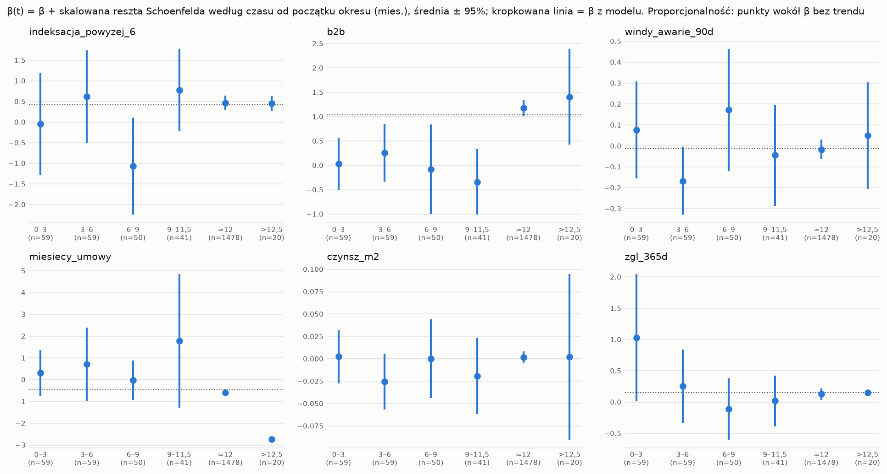

# Model Coxa: co skraca najem (v2_przezycie_cox)

Stan danych: eksport 2026-09-30 23:59 Europe/Warsaw; policzone 2026-11-16
(`cd api && poetry run python -m api.ai.churn_model.evals.ewaluacja_v2`). Wyniki:
[`versions/v2_przezycie_cox/metryki.json`](../api/api/ai/churn_model/versions/v2_przezycie_cox/metryki.json),
predykcje testu: `api/api/ai/churn_model/evals/wyniki/v2_przezycie_cox.parquet`, MLflow: eksperyment `najemcy`
(runy `v2_przezycie_cox` i `regula_b2b`).

## Wnioski

1. Przy tych samych pozostałych cechach najem z indeksacją powyżej 6% kończy się 1,54 razy częściej (95%: 1,30–1,83)
   niż przy niższej indeksacji. Klient firmowy (B2B) kończy najem 2,84 razy częściej (2,27–3,55) niż prywatny.
   Awarie wind w budynku nie mają widocznego wpływu: HR 0,99 (0,93–1,05) na każdą awarię w 90 dniach.
2. Efekt B2B dotyczy prawie wyłącznie decyzji na końcu umowy. W trakcie okresu firmy nie zrywają najmu częściej
   (HR 0,80; 0,48–1,34), a na końcu umowy odchodzą 3,27 razy częściej (2,82–3,80). Jedno „2,84” uśrednia te dwie
   sytuacje, więc w następnej wersji B2B powinno mieć osobny efekt dla każdej z nich.
3. Model porządkuje nowe najmy (od 2025-01) lepiej niż reguła „B2B najpierw”: C-index 0,665 wobec 0,595
   (różnica +0,070; 95%: +0,043 … +0,101). Cała przewaga pochodzi jednak z porządkowania klientów B2B. Wśród
   najemców prywatnych C-index wynosi 0,504, czyli tyle co losowanie. Na początku najmu nasze dane prawie nic
   nie mówią o kliencie prywatnym (brak historii płatności, zgłoszeń i ankiet).
4. Dla Domilo: wysokość indeksacji to jedyna z badanych dźwigni, na którą firma ma wpływ, i wiąże się z wyraźnie
   krótszym najmem. Nie jest to jednak dowód przyczyny: indeksacje powyżej 6% dawano głównie w latach 2022–2023
   i być może innym najemcom (`docs/przezycie.md`). Modelu nie wpisujemy do `current.yaml`, bo przewiduje coś
   innego niż lista retencyjna (ryzyko od początku okresu, a nie 60 dni przed końcem umowy).

## Dane i podział

Jeden wiersz to okres umowy rocznej B2C / B2B (pierwsza umowa albo przedłużenie). Czas liczymy od początku okresu
do końca najmu w tym okresie (zdarzenie) albo do końca okresu lub obserwacji (cenzura). Najem przedłużony dostaje
kolejny wiersz z cechami na nowy dzień startu. Cechy v1 (`features/najemcy/sql/*.sql`) są policzone na `data_od`
okresu, tylko ze zdarzeń sprzed tego dnia (`features/najemcy/cechy_okresow.py`).

| Zbiór | Opis | Okresy | Zdarzenia | Najmy | B2B (okresy) | Umowy 12 / 18 / 24 mies. |
|---|---|---:|---:|---:|---:|---|
| Trening | okresy z `data_od` 2023-04-01 – 2024-12-31, obserwacja do 2024-12-31 | 10 445 | 1 707 | 7 809 | 1 660 | 9 948 / 314 / 183 |
| Wrażliwość HR | te same okresy, obserwacja do 2026-09-30 | 10 445 | 4 205 | 7 809 | 1 660 | 9 948 / 314 / 183 |
| Test (główny) | najmy z `data_wprowadzenia` 2025-01-01 – 2026-09-30, pierwszy okres | 4 506 | 971 | 4 506 | 1 484 | 3 887 / 394 / 225 |
| Test (wszystkie okresy) | wszystkie okresy tych najmów | 5 396 | 982 | 4 506 | 1 545 | 4 777 / 394 / 225 |

Decyzje:

- **Trening kończy się na 2024-12-31 i od tego dnia ucinamy obserwację.** Model nie widzi niczego, co zdarzyło się
  w czasie najmów testowych. Okresy treningu zaczynają się od 2023-04-01, bo dopiero od tego dnia okno płatności
  90 dni jest pełne (`pms_platnosci` od 2023-01).
- **Czas od początku okresu zamiast stażu od wprowadzenia.** Przy stażu jako osi czasu każdy okres wchodziłby do
  obserwacji z opóźnieniem, a lifelines nie liczy wtedy reszt Schoenfelda (`NotImplementedError: Residuals for
  entries not implemented`). Staż jest cechą (`staz_lat`).
- **Cechy v1 po przekształceniu** (`versions/v2_przezycie_cox/model.py`): linia jako `b2b`, indeksacja bieżącego
  przedłużenia jako `indeksacja_powyzej_6` (0 także dla pierwszej umowy), staż w latach. Pominięte:
  `nr_okresu` (korelacja ze stażem na treningu 0,996) i `windy_awarie_90d_na_winde` (iloraz awarii i liczby wind,
  pusty dla budynków bez wind). Braki uzupełnia mediana z treningu, a brak porównania czynszu oznacza osobna flaga.
- **Błędy standardowe są odporne, z klastrem `id_najemcy`**, bo firma B2B ma wiele lokali, a najem wiele okresów.
- **Ryzyko do C-index** to 1 − S(12 mies. od początku okresu): ta miara jest porównywalna między warstwami
  12 / 18 / 24 mies.

## Hazard ratio

HR > 1 oznacza, że najem kończy się szybciej. Pozostałe cechy są ustalone. 95% przedział z odpornych błędów.

| Cecha | v2 (trening do 2024-12) | p | Model główny (bez poprawek) | Wrażliwość: obserwacja do 2026-09 |
|---|---:|---:|---:|---:|
| Indeksacja przedłużenia > 6% | **1,54** (1,30–1,83) | 6·10⁻⁷ | 1,52 (1,29–1,78) | 1,49 (1,35–1,65) |
| Linia B2B | **2,84** (2,27–3,55) | 6·10⁻²⁰ | 2,82 (2,30–3,45) | 2,99 (2,60–3,44) |
| Awarie wind w budynku w 90 dniach (na 1 awarię) | **0,99** (0,93–1,05) | 0,68 | 0,99 (0,94–1,04) | 0,99 (0,96–1,03) |

Liczności w treningu: 1 865 okresów z indeksacją > 6% (z 5 228 przedłużeń), 1 660 okresów B2B. Awarie wind w 90
dniach mają medianę 1, 90. percentyl 3 i maksimum 8, więc nawet 8 awarii przy HR 0,99 nie zmienia ryzyka.
Pozostałe współczynniki: `metryki.json`, klucz `hazard_ratio`.

## Proporcjonalność hazardów (reszty Schoenfelda)

Test: `lifelines.statistics.proportional_hazard_test` na treningu, 27 cech modelu głównego, próg Bonferroniego
0,05 / 27 = 0,00185.

| Cecha | p, model główny (czas = ranga) | p, z warstwami 12 / 18 / 24 | Werdykt |
|---|---:|---:|---|
| `czynsz_m2` | < 0,0001 | < 0,0001 | łamie |
| `zgl_365d` | 0,0005 | 0,0013 | łamie |
| `miesiecy_umowy` | 0,0037 | (warstwa) | łamie przy p < 0,05 |
| `zgl_90d` | 0,0080 | 0,0171 | łamie przy p < 0,05 |
| `indeksacja_powyzej_6` | 0,28 | — | nie łamie |
| `b2b` | 0,32 (km: 0,00016; identity: 0,0019) | — | **łamie** (patrz niżej) |
| `windy_awarie_90d` | 0,33 (km: 0,84; identity: 0,99) | — | nie łamie |



*β(t) = β + skalowana reszta Schoenfelda; punkty to średnie w przedziałach czasu z 95% przedziałem. Przy
proporcjonalności leżą wokół kropkowanej linii β. Plik: `docs/img/cox_schoenfeld.png`.*

Test z czasem jako rangą słabo widzi naruszenie, gdy zdarzenia skupiają się w jednym punkcie: 1 497 z 1 707
zdarzeń treningu wypada dokładnie na końcu umowy. Dlatego dla trzech cech z polecenia dodaliśmy osobny HR
„w trakcie okresu” (czas ≤ 11,5 mies.) i „na końcu okresu” (> 11,5 mies.):

| Cecha | HR w trakcie okresu | HR na końcu okresu | p różnicy |
|---|---:|---:|---:|
| Indeksacja > 6% | 1,42 (1,00–2,01) | 1,57 (1,32–1,87) | 0,59 |
| B2B | 0,80 (0,48–1,34) | **3,27** (2,82–3,80) | 0,00003 |
| Awarie wind (na 1) | 1,02 (0,91–1,15) | 0,98 (0,94–1,03) | 0,57 |
| `czynsz_m2` | 0,99 (0,98–1,01) | 1,00 (0,99–1,01) | 0,81 |
| `zgl_365d` | 1,25 (1,11–1,41) | 1,14 (1,03–1,25) | 0,13 |

**Co zrobiliśmy w v2** (decyzja na treningu, przed oceną na teście):

- **Warstwy według długości umowy (12 / 18 / 24 mies.)** zamiast współczynnika `miesiecy_umowy`. Każda długość
  umowy ma własny schodek na końcu, więc wspólna krzywa bazowa nie pasuje. Po stratyfikacji naruszenia nie ma,
  a HR pozostałych cech prawie się nie zmienia (B2B 2,82 → 2,84, indeksacja 1,52 → 1,54).
- **Interakcja z czasem (próg 11,5 mies.) dla `czynsz_m2` i `zgl_365d`**, czyli dla cech przekraczających próg
  Bonferroniego. Dla `zgl_365d` to pomaga: zgłoszenia mocniej podnoszą ryzyko zerwania w trakcie okresu (1,28)
  niż na jego końcu (1,28 × 0,88 = 1,13). Dla `czynsz_m2` podział nie wyjaśnia naruszenia, ale HR ≈ 1 w każdej wersji,
  więc ta cecha nie zmienia wniosków.

**Propozycja na v3:** interakcja z czasem dla B2B, czyli osobny HR w trakcie okresu i na końcu umowy. Warstwa
po linii też usunęłaby naruszenie, ale wtedy model nie podaje HR dla B2B. Indeksacji i awarii wind poprawiać
nie trzeba. Proponujemy też warstwę albo cechę roku przedłużenia, bo indeksacja > 6% dotyczy głównie lat
2022–2023.

## C-index na najmach rozpoczętych od 2025-01

Harrell C: czas i zdarzenie z okresu, wynik = ryzyko 1 − S(12 mies.). Baseline: reguła „B2B najpierw” (B2B = 1,
B2C = 0). 95% przedział z bootstrapu najemców (1 000 losowań, te same dla wszystkich wyników).

| Wynik | Test: pierwszy okres (4 506 najmów) | Test: wszystkie okresy (5 396) |
|---|---:|---:|
| Baseline: reguła „B2B najpierw” | 0,595 (0,574–0,615) | 0,599 (0,579–0,619) |
| Cox główny (bez poprawek) | 0,662 (0,638–0,690) | 0,655 (0,629–0,683) |
| Cox z warstwami | 0,661 (0,637–0,689) | 0,654 (0,627–0,683) |
| **v2_przezycie_cox** | **0,665** (0,640–0,694) | **0,657** (0,630–0,686) |
| v2 − baseline | +0,070 (+0,043 … +0,101) | +0,058 (+0,030 … +0,090) |
| v2 − Cox główny | +0,003 (−0,003 … +0,008) | +0,002 (−0,004 … +0,008) |
| v2 tylko B2C / tylko B2B | 0,504 / 0,696 | 0,499 / 0,690 |

Poprawki proporcjonalności nie zmieniają jakości rankingu (różnica v2 − model główny obejmuje 0). Służą temu, żeby
HR dało się uczciwie odczytać.

## SQL i kod

```bash
cd api && poetry run python -m api.ai.churn_model.evals.ewaluacja_v2    # model, metryki.json, wykres, MLflow
cd api && poetry run pytest tests/test_churn_cox.py                      # okresy, ryzyko vs lifelines, interakcje
```

- Okresy: [`api/api/ai/features/najemcy/okresy_umow.sql`](../api/api/ai/features/najemcy/okresy_umow.sql)
  (parametr `$koniec_obserwacji`; `zdarzenie` = `data_wyprowadzenia` ≤ `data_do` i ≤ koniec obserwacji; czas
  w miesiącach kalendarzowych jak w `czas_najmu.sql`).
- Cechy na początek okresu: [`api/api/ai/features/najemcy/cechy_okresow.py`](../api/api/ai/features/najemcy/cechy_okresow.py).
  Te same pliki `sql/*.sql` co v1, czytające tymczasową tabelę okresów zamiast `migawki_najemcy`.
- Model: [`api/api/ai/churn_model/versions/v2_przezycie_cox/model.py`](../api/api/ai/churn_model/versions/v2_przezycie_cox/model.py)
  (`CoxPHFitter(strata=["miesiecy_umowy"])`, `cluster_col` = najemca; interakcja przez podział wiersza w 11,5 mies.
  i `entry_col`; `ryzyko()` = 1 − S(12), zgodne z `predict_survival_function`, co sprawdza test).
- Ewaluacja: [`api/api/ai/churn_model/evals/ewaluacja_v2.py`](../api/api/ai/churn_model/evals/ewaluacja_v2.py)
  (`proportional_hazard_test(..., time_transform="rank" | "km" | "identity")`, `hr_na_koncu_okresu()`:
  exp(β + β_po) z wariancją sumy z `variance_matrix_`, `concordance_index(czas, -ryzyko, zdarzenie)`,
  `bootstrap_c()`).

```python
# Liczności zbiorów (trening 10 445 okresów / 1 707 zdarzeń; test 4 506 najmów / 971 zdarzeń w pierwszym okresie)
from api.adapters.duckdb_baza import polacz
from api.ai.churn_model.evals.ewaluacja_v2 import zbiory

z = zbiory(polacz())
print(len(z["trening"]), z["trening"]["zdarzenie"].sum())
pierwsze = z["test"][z["test"]["nr_okresu"] == 1]
print(len(pierwsze), pierwsze["zdarzenie"].sum())
# Rozkład awarii wind w treningu (mediana 1, P90 3, maks. 8), indeksacje > 6% (1 865) i przedłużenia (5 228)
tr = z["trening"]
print(tr["windy_awarie_90d"].quantile([0.5, 0.9]).tolist(), tr["windy_awarie_90d"].max())
print((tr["indeksacja_ostatnia_pct"] > 6).sum(), (tr["nr_okresu"] > 1).sum())
```
